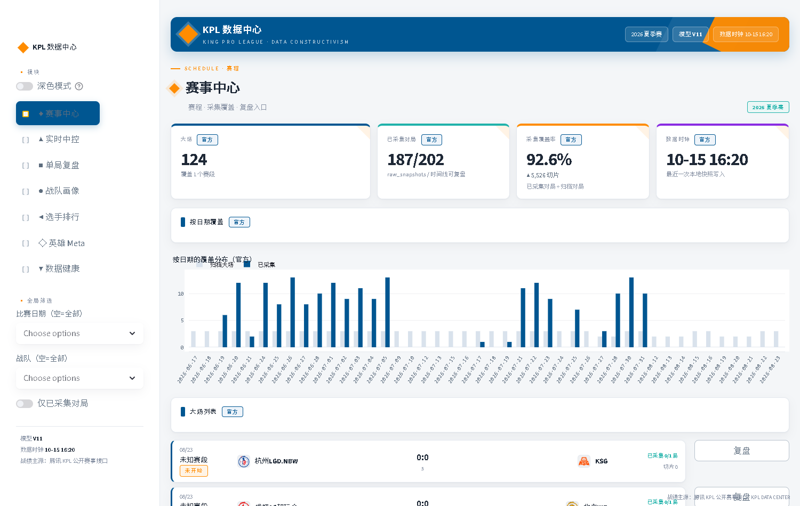
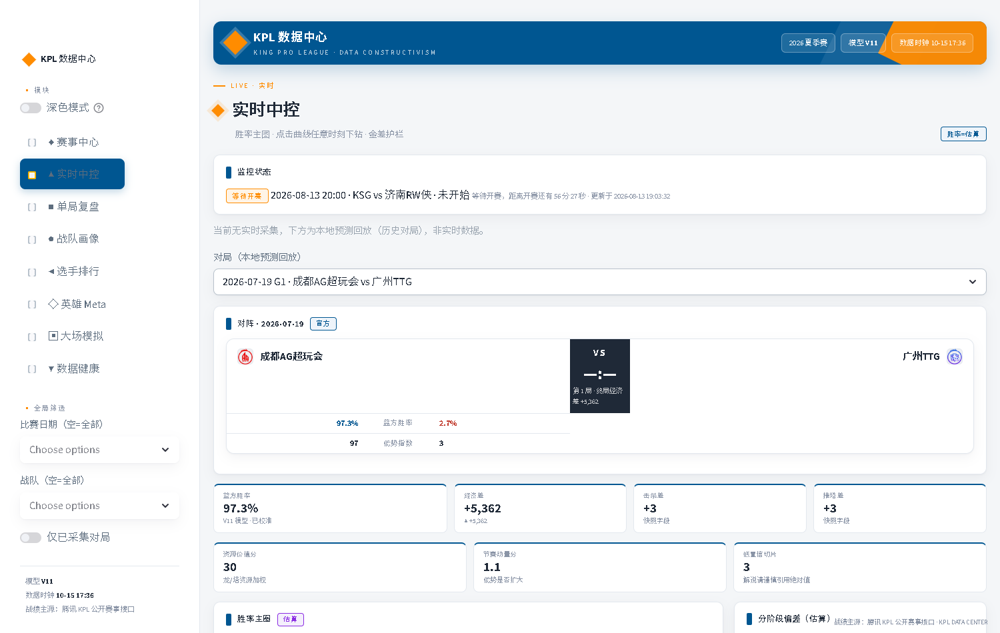
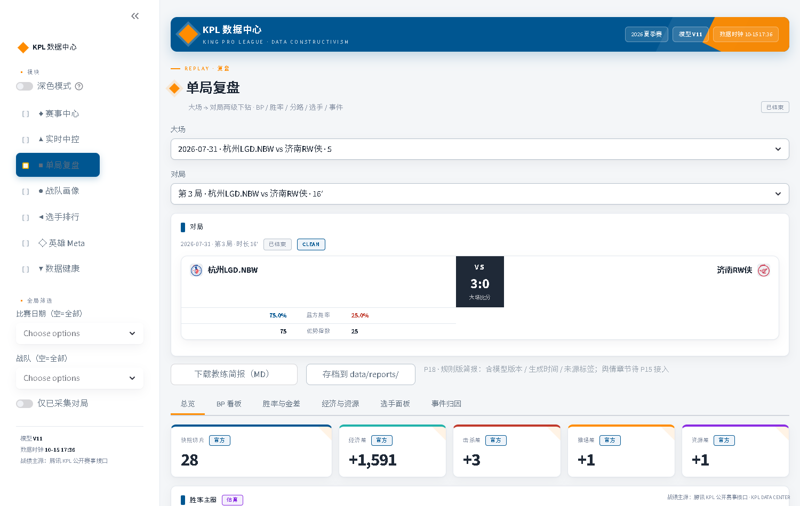
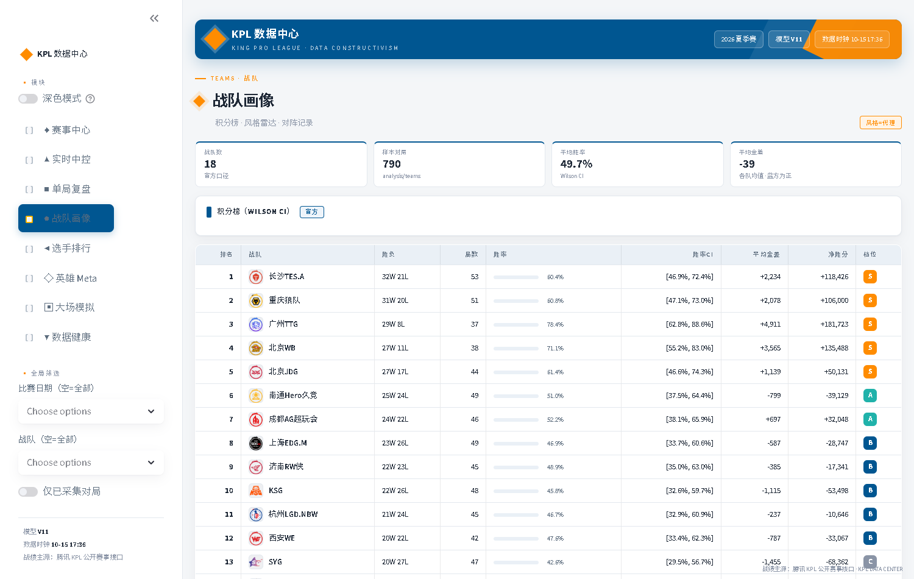
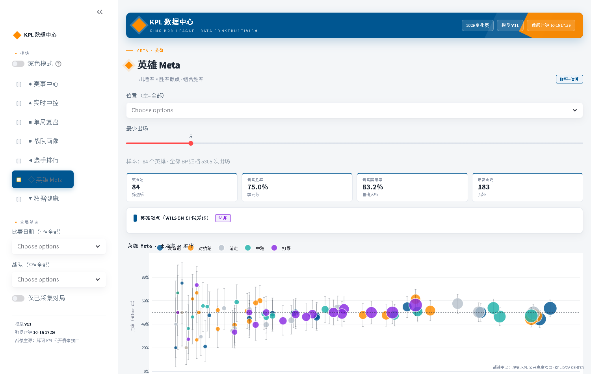
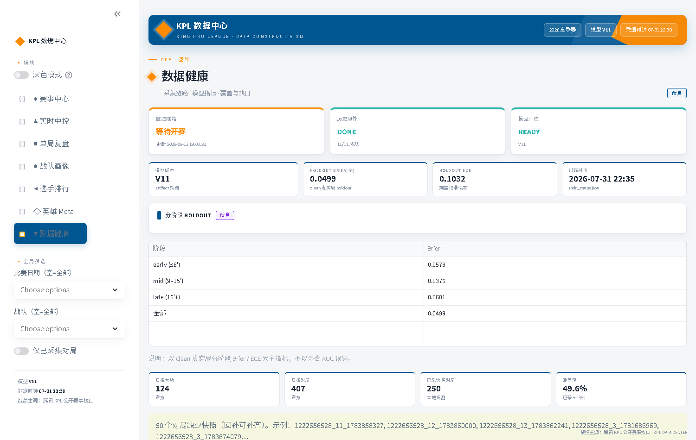

# KPL 赛事数据智能平台

> **开源与协作**：原创代码与文档采用 [MIT License](LICENSE)。欢迎通过 [Issue](https://github.com/hccccc01333/KPLdata/issues) 和 [Pull Request](https://github.com/hccccc01333/KPLdata/pulls) 参与。
> 阅读 [贡献指南](CONTRIBUTING.md) 与 [复现说明](REPRODUCIBILITY.md)；竞赛/赛事数据及第三方资源不在此授权范围内。

> **定位**：面向 KPL 赛事的实时数据分析系统（可演进为「KPL 数据中心」）  
> **能力**：赛程监控 · 实时胜率预测 · 关键事件识别 · 战队/赛局复盘 · 数据健康中控  
> **技术**：Python · pandas · scikit-learn · Plotly · Streamlit  
> **数据**：腾讯 KPL 公开赛事接口（赛程 / 对局 / 局内快照）

---

## 项目简介

端到端的赛事智能分析链路：

```text
官方赛程 API
  → 自动识别 match_id / battle_id
  → 实时采集局内快照
  → 统一 FeatureBuilder 生成特征
  → V11 胜率模型预测
  → Dashboard：实时中控 / 历史复盘 / 战队分析 / 数据健康
```

适用场景：

- **解说辅助**：当前哪队赢面更大，主要依据是什么  
- **导播支持**：胜率大幅波动或关键资源节点时的数据面板  
- **赛后复盘**：转折点、资源控制、经济节奏、翻盘窗口  
- **数据运营**：战队对比、赛局战报、位置表现素材  

---

## 核心模块

| 模块 | 路径 | 说明 |
|------|------|------|
| 官方核心层 | `scripts/kpl_official_core.py` | 赛程、快照解析、特征、预测、复盘、健康报告 |
| 赛程归档 | `scripts/build_schedule_archive.py` | 跨赛季赛程索引 |
| 历史回补 | `scripts/backfill_history.py` | 按赛程批量回补对局 |
| 结果回补 | `scripts/repair_missing_results.py` | 未结算对局补拉最终帧（回补后重建分析表） |
| 模型训练 | `scripts/train_realtime_model_v9.py` | clean 真实优先 + 因果特征 + 分阶段模型 |
| 诚实回测 | `scripts/backtest_realtime_v9.py` | holdout 分阶段 Brier / ECE + 验收门禁 |
| 自动监控 | `scripts/official_match_monitor.py` | 赛程刷新、等待开赛、识别对局、异步采集与预测 |
| Dashboard | `scripts/dashboard.py` | 赛事中心 / 实时中控 / 单局复盘 / 战队画像 / 选手排行 / 英雄 Meta / 数据健康 |

---

## 特征体系

训练与线上共用同一套 `FeatureBuilder`（因果、可解释）：

| 模块 | 代表特征 | 含义 |
|------|----------|------|
| 基础优势 | `gold_ratio`、`kill_rate`、`tower_diff` | 当前谁领先 |
| 节奏动量 | `tempo_swing_score`、`gold_diff_accel` | 优势是否扩大 |
| 滚动窗口 | `gold_diff_roll4*` | 近窗经济节奏 |
| 地图资源 | `objective_value_score` | 暴君 / 先知 / 暗影 / 风暴 / 塔 |
| 位置对位 | `gold_diff_*`、`kill_diff_jungle/adc` | 核心位表现 |
| 核心发育 | `carry_dominance`、`hurt_conc_diff` | 双 C 与输出结构 |
| 战队先验 | `team_winrate_diff` | 开赛前历史胜率（无泄漏） |

---

## 快速运行

```bash
pip install -r requirements.txt

# 训练 / 回测
python scripts/train_realtime_model_v9.py
python scripts/backtest_realtime_v9.py --gates

# 监控采集（或双击 start_monitor.bat 常驻运行）
python scripts/official_match_monitor.py --interval 3

# Dashboard
streamlit run scripts/dashboard.py
```

Dashboard 默认：`http://localhost:8501`

---

## Dashboard

| 页面 | 能力 |
|------|------|
| 赛事中心 | 赛程、采集覆盖、赛段分布、复盘入口 |
| 实时中控 | 胜率曲线、经济/击杀/推塔、金差护栏、与金差先验对标 |
| 单局复盘 | 战报、BP 看板、胜率与金差、分路经济、选手面板、事件归因 |
| 战队画像 | 积分榜（Wilson CI）、风格雷达、H2H、最近对局 |
| 选手排行 | 按位置/指标的选手榜（官方统计字段） |
| 英雄 Meta | 出场/禁用/胜率（Wilson CI）、三人核心组合 |
| 数据健康 | 监控/回补/训练状态、模型 Holdout 指标、覆盖率与缺口 |

界面遵循 **「动态数据构成主义」** 设计语言（`docs/product/00-设计系统与UI规范.md`）：
浅色工作台 + 深蓝 `#005691` 结构色、橙 `#FF8C00` 主强调、全站 Roboto Mono 等宽字体、
非对称网格与几何块、克制动效；蓝/红方全站一致，所有 KPI 带来源标签（官方 / 代理 / 估算 / 舆情）。

---

## 界面预览

| 赛事中心 · 采集覆盖与赛程 | 实时中控 · 胜率主图与金差护栏 |
| --- | --- |
|  |  |
| **单局复盘 · BP / 胜率 / 分路 / 选手 / 事件** | **战队画像 · 积分榜（Wilson CI）与风格雷达** |
|  |  |
| **英雄 Meta · 出场×胜率散点（Wilson CI）** | **数据健康 · 分阶段 Holdout 与覆盖率** |
|  |  |

完整截图（含 选手排行、单局复盘 · 选手面板）见 [`docs/showcase/`](docs/showcase/)。

---

## 模型与评估

- **主指标**：clean 真实局 holdout 的 early / mid / late **Brier、ECE、方向正确率**（不以混合 AUC 为主）
- **数据分层**：`raw_snapshots` 入库 → `datasets/clean|quarantine`；训练与回测默认 clean
- **线上兜底**：金差一致性护栏，避免「经济明显落后却报高胜率」

**Holdout 结果（V11 · 2026-10-15 重训，最新 8 场时间 holdout）**

| 阶段 | 旧模型 Brier | 当前模型 Brier | 当前 Acc |
|------|-------------|---------------|----------|
| early (≤8′) | 0.152 | **0.117** | 0.85 |
| mid (9–15′) | 0.210 | **0.129** | 0.85 |
| late (16′+) | 0.282 | **0.231** | 0.52 |
| all | 0.199 | **0.143** | 0.79 |

> holdout 按最新 8 场滚动，当前为 8 月场次（含 1 场翻盘局，任何跟随经济领先的模型在该局都会失效）。新旧模型在同一 holdout 上对比才说明改进：all Brier 0.199 → 0.143、AUC 0.694 → 0.854。旧版数字（early 0.057）建立在 7 月较易 holdout 上，与当前不可直接比较；验收门禁阈值同样待按新 holdout 重标定。

模型产物：`output/models/v9_official_platform.joblib`（本地训练生成，仓库不收录大文件）

---

## 技术栈

| 模块 | 工具 |
|------|------|
| 接口与采集 | `requests` |
| 数据处理 | `pandas`、`numpy` |
| 建模 | `scikit-learn` |
| 可视化 | `plotly`、`matplotlib` |
| 产品界面 | `streamlit` |

---

## 仓库说明

- 大体积快照、模型权重已由 `.gitignore` 排除，仓库以**代码 + 文档 + 指标样例**为主  
- 产品需求文档矩阵（总纲 + P01–P20 PRD）见 `docs/product/`  
- 数据规模：124 大场 / 396 对局（含 194 场回补最终帧与 44 场结果回补；随采集更新）  
- 本地采集数据后即可完整复现训练、回测与 Dashboard  

---

## 版本记录

当前线上模型：**V11**（artifact：`v9_official_platform.joblib` · 2026-10-15 数据回补后重训）

| 版本 | 日期 | 更新内容 |
|------|------|----------|
| **V11 · 重训** | 2026-10-15 | 结果回补 + 快照补全（205 场缺口 → 剩 11 场为接口已下线对局）；clean 99→185 场；同 holdout Brier 0.199→0.143 |
| **V12** | 2026-08 | 前端重写（七模块 + 设计语言）；核心库扩展（积分榜/雷达/BP/分路/对标/组合）；采集异步化（0.1s + 异步预测）；产品文档矩阵 P01–P20（模型仍为 V11） |
| **V11** | 2026-07-20 | clean 数据集分层；因果特征（roll/动量/分路等）；Early RF + Midlate Voting；特征消融与模型选型；5–7′ 轻度金差护栏；holdout early Brier ≈0.057 / all ≈0.049，gates 通过 |
| **V10** | 2026-07 | 坏局诊断与金差一致性护栏（≥8′）；拐点/战报；midlate 校准择优；特殊局验收门禁 |
| **V9** | 2026-07 | 官方平台统一 FeatureBuilder；真实优先训练 + 因果战队先验；分阶段 early/midlate 混合预测 |
| **V8** | 2026-06 | 增强型实时特征与 stacking/集成探索 |
| **V7** | 2026-06 | 实时 stacking 与校准迭代 |
| **V6** | 2026-06 | 实时校准版投票/融合基线 |
| **V5** | 2026-05 | Streamlit Dashboard 演示闭环 |
| **V4** | 2026-05 | 赛中时间切片实时胜率建模 |
| **V3** | 2026-05 | 赛中快照采集链路 |
| **V2** | 2026-05 | BP 后赛前特征增强 |
| **V1** | 2026-05 | 赛后/赛前基线建模与接口探索 |

## 许可

- 代码：[MIT License](LICENSE)
- 数据：来自腾讯 KPL 公开赛事接口，仅用于个人学习研究，不做商业用途（详见 `data/README.md`）

## 致谢

数据来源：腾讯 KPL 公开赛事接口（`prod.comp.smoba.qq.com`）
