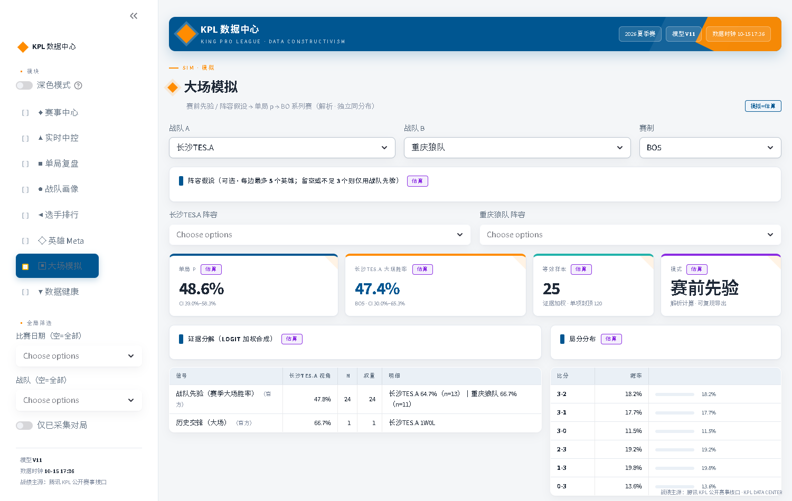
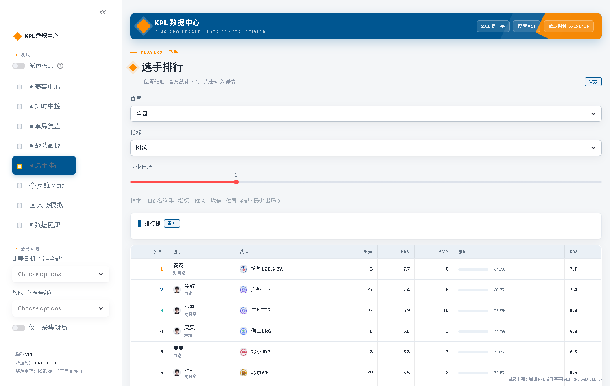

# KPL 赛事数据智能平台

> **开源与协作**：原创代码与文档采用 [MIT License](LICENSE)。欢迎通过 [Issue](https://github.com/hccccc01333/KPLdata/issues) 和 [Pull Request](https://github.com/hccccc01333/KPLdata/pulls) 参与。
> 阅读 [贡献指南](CONTRIBUTING.md) 与 [复现说明](REPRODUCIBILITY.md)；竞赛/赛事数据及第三方资源不在此授权范围内。

> **定位**：面向 KPL 赛事的实时数据分析系统 + 对外数据产品（「KPL 数据中心」）  
> **能力**：赛程监控 · 实时胜率预测 · 关键事件识别 · 战队/赛局复盘 · 数据健康中控  
> **技术**：Python · pandas · scikit-learn · Plotly · Streamlit（工作台）· 原生 JS（静态站）  
> **数据**：腾讯 KPL 公开赛事接口（赛程 / 对局 / 局内快照）  
> **在线站点**：<https://kpldata-site.hccccc01333.workers.dev>（静态站，见下「仓库分工」）

---

## 仓库分工

本项目拆成两个仓库，各自负责一段：

| 仓库 | 角色 | 内容 |
|---|---|---|
| **本仓** `KPLdata` | 数据与模型 | 采集 / 归档 / 特征 / 训练 / 回测 / 分析宽表 / Streamlit 工作台（内部用，重操作） |
| [`KPLdata-site`](https://github.com/hccccc01333/KPLdata-site) | 对外产品 | 纯静态站，20 个页面；数据由本仓经 `build_*.py`（11 个）离线生成为 `assets/*.js` |

```text
官方接口 → 本仓采集/归档 → 分析宽表（data/analysis/*.csv）
                              ├→ 训练 / 回测 / Streamlit 工作台（内部）
                              └→ build_*.py → 静态站 assets/*.js（对外）
```

---

## 项目简介

端到端的赛事智能分析链路：

```text
官方赛程 API
  → 自动识别 match_id / battle_id
  → 实时采集局内快照
  → 统一 FeatureBuilder 生成特征
  → V11 胜率模型预测
  → 分析宽表（data/analysis/）
      ├→ Streamlit 工作台：实时中控 / 历史复盘 / 战队分析 / 数据健康
      └→ 静态站（20 页）：赛程 / 复盘 / 战队 / 选手 / 英雄 / BP / 预测 / 精选
```

适用场景：

- **解说辅助**：当前哪队赢面更大，主要依据是什么  
- **导播支持**：胜率大幅波动或关键资源节点时的数据面板  
- **赛后复盘**：转折点、资源控制、经济节奏、翻盘窗口  
- **数据运营**：战队对比、赛局战报、位置表现素材  

---

## 核心模块

| 模块 | 路径 | 说明 |
|------|------|------|
| 官方核心层 | `scripts/kpl_official_core.py` | 赛程、快照解析、特征、预测、复盘、健康报告 |
| 赛程归档 | `scripts/build_schedule_archive.py` | 跨赛季赛程索引 |
| 历史回补 | `scripts/backfill_history.py` | 按赛程批量回补对局 |
| 结果回补 | `scripts/repair_missing_results.py` | 未结算对局补拉最终帧（回补后重建分析表） |
| 模型训练 | `scripts/train_realtime_model_v9.py` | clean 真实优先 + 因果特征 + 分阶段模型 |
| 诚实回测 | `scripts/backtest_realtime_v9.py` | 只评 artifact 记录的 test 段；分阶段 Brier / ECE + 验收门禁 |
| 重放回归 | `scripts/regression_replay_vs_live.py` | 同一局「直播 CSV vs 当前模型重放」的偏差分布；baseline + 漂移门禁 |
| 自动监控 | `scripts/official_match_monitor.py` | 赛程刷新、等待开赛、识别对局、异步采集与预测 |
| Dashboard | `scripts/dashboard.py` | 赛事中心 / 实时中控 / 单局复盘 / 战队画像 / 选手排行 / 英雄 Meta / 大场模拟 / 数据健康 |

---

## 特征体系

训练与线上共用同一套 `FeatureBuilder`（因果、可解释）：

| 模块 | 代表特征 | 含义 |
|------|----------|------|
| 基础优势 | `gold_ratio`、`kill_rate`、`tower_diff` | 当前谁领先 |
| 节奏动量 | `tempo_swing_score`、`gold_diff_accel` | 优势是否扩大 |
| 滚动窗口 | `gold_diff_roll4*` | 近窗经济节奏 |
| 地图资源 | `objective_value_score` | 暴君 / 先知 / 暗影 / 风暴 / 塔 |
| 位置对位 | `gold_diff_*`、`kill_diff_jungle/adc` | 核心位表现 |
| 核心发育 | `carry_dominance`、`hurt_conc_diff` | 双 C 与输出结构 |
| 战队先验 | `team_winrate_diff` | 开赛前历史胜率（无泄漏） |

---

## 快速运行

```bash
pip install -r requirements.txt

# 训练 / 回测
python scripts/train_realtime_model_v9.py
python scripts/backtest_realtime_v9.py --gates

# 监控采集（或双击 start_monitor.bat 常驻运行）
python scripts/official_match_monitor.py --interval 3

# Dashboard
streamlit run scripts/dashboard.py
```

Dashboard 默认：`http://localhost:8501`

---

## Dashboard

| 页面 | 能力 |
|------|------|
| 赛事中心 | 赛程、采集覆盖、赛季之最画廊（P13）、复盘入口 |
| 实时中控 | 胜率曲线、经济/击杀/推塔、金差护栏、与金差先验对标 |
| 单局复盘 | 战报、BP 看板、胜率与金差、分路经济、选手面板、阶段归因（P12）、教练简报导出（P18） |
| 战队画像 | 积分榜（Wilson CI）、风格雷达、H2H、英雄池（P11）、最近对局 |
| 选手排行 | 按位置/指标的选手榜（官方统计字段） |
| 英雄 Meta | 出场/禁用/胜率（Wilson CI）、三人核心组合、同位置对位（P11） |
| 大场模拟 | 选队/BO/阵容假设 → 单局 p、大场胜率与局分分布（解析 · iid 假设、证据分解、可复现导出） |
| 数据健康 | 监控/回补/训练状态、模型 Holdout 指标、覆盖率与缺口 |

界面遵循 **「动态数据构成主义」** 设计语言（`docs/product/00-设计系统与UI规范.md`）：
浅色工作台 + 深蓝 `#005691` 结构色、橙 `#FF8C00` 主强调、全站 Roboto Mono 等宽字体、
非对称网格与几何块、克制动效；蓝/红方全站一致，所有 KPI 带来源标签（官方 / 代理 / 估算 / 舆情）。

---

## 产品能力（V4 重构 · 四阶段）

对外站点 `KPLdata-site` 在 V4 里做了四轮重构，四个阶段已全部闭环：

| 阶段 | 交付 | 状态 |
|---|---|---|
| 01 基础修复 | 实时状态词表、TTL / 自刷新、移动端导航、赛程入口、英雄详情覆盖、导出一致性、搜索深链 | ✅ |
| 02 赛事体验 | 复盘工作台（统一时间轴）、战队详情页、首页重排、赛事中心闭环、数据完整度徽标 | ✅ |
| 03 分析体系 | BP 对阵假设工作台、选手同位置对比、对比页统一交互 | ✅ |
| 04 可信度 / 分享 / 收藏 | 分时点命中率、模型卡、徽标合并、复盘分享深链、收藏、精选对局索引 | ✅ |

两个值得单独说的「可信度」设计，共同点是**把口径摊开让人能反驳**：

**① 分时点命中率**（`predict.html`）：按 8′ / 12′ / 16′ 三个时点分别报 n、命中数、Brier，不合并成一个好看的数字。

| 时点 | n | 命中率 | Brier |
|---|---|---|---|
| 8′ | 151 | 63.6% | 0.237 |
| 12′ | 154 | 80.5% | 0.152 |
| 16′ | 158 | 88.6% | 0.100 |

> 口径：来自**直播期**写下的预测 CSV（不是赛后重放），n 是「局数」不是「帧数」。
> 这些档案由 V11 模型在当时产生，V12 重训不回写历史——所以这张表和下面的回测表是两个模型版本，
> 不能相加或互相印证。重放 vs 直播的固定回归测试是下一轮要做的。

**② 精选对局索引**（`picks.html`）：4 条规则全部写在页面上，阈值按 202 局的分位数定，不是拍脑袋。

| 标签 | 规则 | 全量达标 | 入选 |
|---|---|---|---|
| 翻盘局 | 第 6 分钟之后、经济落后 ≥3,000 时，收官胜方胜率仍 ≤10% | 8 | 8 |
| 拉锯局 | 时长 ≥20 分钟 | 34 | 16 |
| 波动局 | 任意 3 个采样点内胜率变化 ≥55pp | 49 | 39 |
| 资源战 | 结构性事件（推塔 / 暴君 / 主宰 / 风暴）≥16 个 | 36 | 18 |

从 202 局里按综合分取前 48 条（「全量达标」是规则命中数，「入选」是取前 48 后的展示数，两者都写在页面上）。
每张卡写明触发条件，链接带 `&m=` 直接落到关键分钟：翻盘局落最低点，其余落波动最大那段的起点。

> **口径修正记录**：第一版「翻盘局」只按概率筛，抓到 42 条，但大量是早期低置信噪声
> （第 2 分钟胜率 2%、而金差只有 +225，这不是翻盘）。改成**必须同时满足「第 6 分钟后」+「经济真落后 ≥3,000」**
> 后收敛到 8 条，每条都能点进去核对到具体分钟与金差。
> 首条：2026-06-26 广州TTG vs 北京JDG G3，第 13 分钟胜率 5%、经济落后 4,297，最终 JDG 翻盘。

模型侧还留了三件事未做（都需要独立一轮 + 重新训练验证）：train / calibrate / test 硬隔离、重放 vs 直播的固定回归测试、BP 启发式的离线校验（历史 BP 反推 Brier）。

---

## 界面预览

| 赛事中心 · 赛季之最画廊 | 实时中控 · 胜率主图与金差护栏 |
| --- | --- |
|  |  |
| **单局复盘 · BP / 胜率 / 分路 / 选手 / 事件** | **战队画像 · 积分榜（Wilson CI）与风格雷达** |
|  |  |
| **英雄 Meta · 出场×胜率散点（Wilson CI）** | **数据健康 · 分阶段 Holdout 与覆盖率** |
|  |  |
| **大场模拟 · 阵容假设与 BO 系列赛** | **选手排行 · 位置榜与英雄池** |
|  |  |

完整截图（含 单局复盘 · 选手面板 / 阶段归因）见 [`docs/showcase/`](docs/showcase/)。

---

## 模型与评估

- **主指标**：clean 真实局 holdout 的 early / mid / late **Brier、ECE、方向正确率**（不以混合 AUC 为主）
- **数据分层**：`raw_snapshots` 入库 → `datasets/clean|quarantine`；训练与回测默认 clean
- **线上兜底**：金差一致性护栏，避免「经济明显落后却报高胜率」

**Holdout 结果（V12 · 2026-10-18 三段隔离重训，最近 20 局 test 段）**

| 阶段 | 帧数 n | Brier | Acc | AUC |
|---|---|---|---|---|
| early (≤8′) | 130 | 0.235 | 0.59 | 0.75 |
| mid (9–15′) | 116 | 0.102 | 0.89 | 0.96 |
| late (16′+) | 52 | 0.200 | 0.65 | 0.86 |
| all | 298 | **0.177** | 0.72 | 0.87 |

切分：train 145 局 / calib 20 局 / test 20 局，按时间、按整局切，三段不重叠。
校准器（isotonic / Platt）、early clip、校准器方法全部只在 calib 段拟合；test 段只报指标。

> **这次数字比旧版"变差"了，原因值得写清楚。**
> 旧口径是「最近 8 局，且这 8 局同时被用来拟合校准器」，报的是 all Brier 0.143 / early 0.117 / Acc 0.79。
> 那个数字有两个问题：① 校准是样本内的；② 只有 8 局，而 8 局恰好偏容易。
>
> 为区分这两点，把新模型放回旧的 8 局上复算：**all Brier 0.135**（旧 0.143），early 0.121（旧 0.117）——
> 同量级，说明**模型本身没退步，旧数字的乐观主要来自样本窄，不是校准泄露**。
> 但泄露仍然真实存在、不可辩护，所以照样修掉。修完的代价是数字变难看：8 局 → 20 局。
>
> 20 局里为什么 early 掉得这么狠？因为这 20 局有 **6 局是翻盘局**（其中 5 局来自同一场 BO7）：

| test 子集 | 局数 | early Brier | early Acc | all Brier | all Acc |
|---|---|---|---|---|---|
| 翻盘局 | 6 | 0.416 | **0.15** | 0.329 | 0.37 |
| 非翻盘局 | 14 | 0.151 | **0.80** | 0.101 | 0.89 |

早期阶段在翻盘局上的准确率只有 15%（低于随机），说明 early 模型对"后期会翻"的局面是**反向自信**——
它跟着经济差走，而翻盘局恰恰是经济差不代表结果。这是下一步该动的地方，不是靠调阈值能盖住的。

**重放 vs 直播（`scripts/regression_replay_vs_live.py`）**

站点上的胜率有两条来源：直播期写下的 CSV，和事后用当前模型重放。两者不是一回事，得量化：

| 口径 | Brier | 说明 |
|---|---|---|
| 直播（比赛当时写入） | 0.217 | 旧模型 + 实时链路延迟（lag p90 ≈ 18s） |
| 重放（当前 V12 模型） | 0.134 | 同一批局、同一分钟重算 |
| **差** | **−0.083** | 方向一致率仅 **80.2%**（每 5 帧有 1 帧两边看好不同队） |

在 test 20 局（模型没见过）上差距更大：**0.305 → 0.178（−0.127）**。所以这不是"重放背答案"，
而是当时的直播预测确实更差。但两个原因仍分不开：① 当时的模型更旧；② 实时数据更脏。
**已给预测 CSV 加上 `model_version` / `model_trained_at`**，下一批数据就能归因。

这个测试是**固定回归**：首次 `--baseline` 冻结偏差分布，之后每次运行只比漂移（中位 |Δp| / 方向一致率 / Brier 差），
超容忍度就 exit 1。它不预设"偏差应该多小"（没有理论值），只保证"不会悄悄变"。

模型产物：`output/models/v9_official_platform.joblib`（本地训练生成，仓库不收录大文件）

---

## 技术栈

| 模块 | 工具 |
|------|------|
| 接口与采集 | `requests` |
| 数据处理 | `pandas`、`numpy` |
| 建模 | `scikit-learn` |
| 可视化 | `plotly`、`matplotlib` |
| 产品界面 | `streamlit`（内部工作台） |
| 对外站点 | 原生 HTML / CSS / JS（无框架、无构建），Cloudflare Workers 静态托管 |

---

## 仓库说明

- 大体积快照、模型权重已由 `.gitignore` 排除，仓库以**代码 + 文档 + 指标样例**为主  
- 产品需求文档矩阵（总纲 + P01–P20 PRD）见 `docs/product/`  
- 数据规模（本仓分析宽表）：**173 大场 / 690 对局**，覆盖 2026 夏季赛与年度总决赛（2026-06-17 ~ 2026-10-16，18 支战队）；随采集更新  
- 数据规模（对外站点全历史归档）：**33 个赛事 / 2,884 场 / 11,117 局**（2019–2026）；其中**有分钟级快照的 202 局**才参与逐帧分析与分时点命中率  
- 本地采集数据后即可完整复现训练、回测与 Dashboard；站点侧再跑 `../kpl-data-center-site/build_*.py` 生成静态站数据  

---

## 版本记录

当前线上模型：**V12**（artifact：`v9_official_platform.joblib` · 2026-10-18 三段隔离重训）

| 版本 | 日期 | 更新内容 |
|------|------|----------|
| **V12 · 切分重构** | 2026-10-18 | train / calib / test 按时间整局三段硬隔离；校准器与 clip 只在 calib 拟合，test 只报指标；test 从 8 局扩到 20 局；补齐 players.csv 的 position / hurt 字段（此前导出缺列导致训练直接 KeyError）；新增「重放 vs 直播」固定回归测试（baseline + 漂移门禁），预测 CSV 增加模型归因列；同一样本对照证明模型未退步 |
| **产品 V4 · 站点重构** | 2026-10-17 | 静态站四阶段闭环（基础修复 / 赛事体验 / 分析体系 / 可信度·分享·收藏）；新增复盘工作台与分享深链、战队详情、赛段对比、精选对局索引；分时点命中率改为分时点分别报 n（模型仍为 V11，未重训） |
| **V11 · 重训** | 2026-10-15 | 结果回补 + 快照补全（205 场缺口 → 剩 11 场为接口已下线对局）；clean 99→185 场；同 holdout Brier 0.199→0.143 |
| **V12** | 2026-08 | 前端重写（七模块 + 设计语言）；核心库扩展（积分榜/雷达/BP/分路/对标/组合）；采集异步化（0.1s + 异步预测）；产品文档矩阵 P01–P20（模型仍为 V11） |
| **V11** | 2026-07-20 | clean 数据集分层；因果特征（roll/动量/分路等）；Early RF + Midlate Voting；特征消融与模型选型；5–7′ 轻度金差护栏；holdout early Brier ≈0.057 / all ≈0.049，gates 通过 |
| **V10** | 2026-07 | 坏局诊断与金差一致性护栏（≥8′）；拐点/战报；midlate 校准择优；特殊局验收门禁 |
| **V9** | 2026-07 | 官方平台统一 FeatureBuilder；真实优先训练 + 因果战队先验；分阶段 early/midlate 混合预测 |
| **V8** | 2026-06 | 增强型实时特征与 stacking/集成探索 |
| **V7** | 2026-06 | 实时 stacking 与校准迭代 |
| **V6** | 2026-06 | 实时校准版投票/融合基线 |
| **V5** | 2026-05 | Streamlit Dashboard 演示闭环 |
| **V4** | 2026-05 | 赛中时间切片实时胜率建模 |
| **V3** | 2026-05 | 赛中快照采集链路 |
| **V2** | 2026-05 | BP 后赛前特征增强 |
| **V1** | 2026-05 | 赛后/赛前基线建模与接口探索 |

> 命名提醒：**「V4」在两套序列里含义不同** —— 上表 `V4`（2026-05）是**模型**版本（赛中时间切片建模）；
> 「产品 V4」（2026-10）是**站点**重构路线（`docs/product/V4-产品重构路线图.md`）。两者互不影响。

## 致谢

数据来源：腾讯 KPL 公开赛事接口（`prod.comp.smoba.qq.com`）
