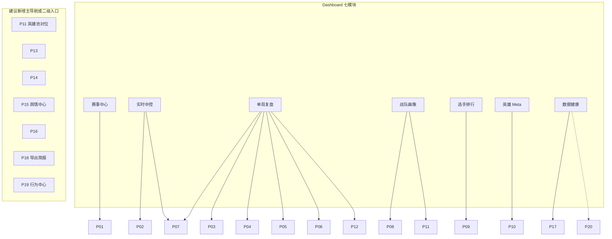

# Dashboard 七模块 ↔ P01–P20 映射

> **目的**：把现有 Streamlit Dashboard（`scripts/dashboard.py`）与产品文档矩阵对齐，标明「已有可升级」与「待建」。  
> **原则**：本表只对齐文档，不改代码；优先级以各 PRD「实现优先级」为准。  
> **当前基线**：2026-08-13 前端重写后的七模块；2026-07-22 五页基线的变更见文末修订记录。

## 现有导航（代码事实 · 2026-08 前端重写后）

`scripts/dashboard.py` 侧栏 `st.radio` 七模块：

| # | 模块 | 入口函数 | 当前能力摘要 |
|---|------|----------|--------------|
| 1 | 赛事中心 | `render_schedule` | 赛程 KPI（大场 / 采集覆盖 / 数据时钟）、按日期覆盖分布、大场列表（状态 / 覆盖 / 复盘入口） |
| 2 | 实时中控 | `render_live` | 监控状态、对局回放选择、胜率主图（点击下钻）、金差护栏、与金差先验对标 |
| 3 | 单局复盘 | `render_replay` | 大场 → 对局两级下钻；Tab：总览 / BP 看板 / 胜率与金差 / 经济与资源 / 选手面板 / 事件归因 |
| 4 | 战队画像 | `render_teams` | 积分榜（Wilson CI）、风格雷达、对阵记录 H2H |
| 5 | 选手排行 | `render_players` | 位置 × 指标排行榜（官方统计字段）、最少出场过滤 |
| 6 | 英雄 Meta | `render_heroes` | 出场率 × 胜率散点（Wilson CI）、英雄梯度榜、三人核心组合 |
| 7 | 数据健康 | `render_ops` | 监控 / 回补 / 训练状态灯、分阶段 Holdout、覆盖率与缺口、数据表规模 |

相关状态文件（非 UI）：`data/realtime/monitor_status.json`、`train_status.json`、`backfill_status.json`。

## 总映射表

| PRD | 标题 | Dashboard 落点 | 状态 | 升级要点 |
|-----|------|----------------|------|----------|
| [P01](./P01-赛事中心与赛程.md) | 赛事中心与赛程 | 赛事中心 | **已有 · 升级** | 联赛/日期筛选、大场列表 + 覆盖、复盘入口已落地；赛程日历、大场状态机待升级 |
| [P02](./P02-实时中控台.md) | 实时中控台 | 实时中控 | **已有 · 升级** | 监控状态、胜率主图、护栏已落地；多路指标条、延迟、告警待升级 |
| [P03](./P03-单局赛后复盘.md) | 单局赛后复盘 | 单局复盘 | **已有 · 升级** | 大场 → 对局下钻、战报/事件已落地；导出入口 P18 待建 |
| [P04](./P04-BP看板与阵容分析.md) | BP 看板与阵容分析 | 单局复盘 · BP 看板 Tab | **已有 · 升级** | `bp_list` 蓝/红分列 + 全量归档 Wilson CI 已落地；阵容标签、禁用热度待升级 |
| [P05](./P05-选手实时面板-出装铭文.md) | 选手实时面板 | 单局复盘 · 选手面板 Tab | **已有 · 升级** | 出装 / 铭文解析已上屏（铭文名依赖可选 `data/meta/rune_dict.json`）；实时装备刷新待升级 |
| [P06](./P06-经济分路与资源时间轴.md) | 经济分路与资源时间轴 | 单局复盘 · 经济与资源 Tab | **已有 · 升级** | 分路经济、资源时间轴已落地；压制/缺口指标待补 |
| [P07](./P07-实时胜率与官方胜率对标.md) | 实时胜率与官方胜率对标 | 实时中控 + 单局复盘 | **已有 · 升级** | 自研曲线 + 金差先验对标 + 分阶段偏差、护栏已落地（「估算」标签）；官方胜率并排待接入 |
| [P08](./P08-战队画像与积分榜.md) | 战队画像与积分榜 | 战队画像 | **已有 · 升级** | 积分榜（Wilson CI）、风格雷达已落地；对阵矩阵待升级 |
| [P09](./P09-选手排行与能力雷达.md) | 选手排行与能力雷达 | 选手排行 | **已有 · 升级** | 位置 × 指标榜已落地（官方字段）；能力雷达待升级 |
| [P10](./P10-英雄Meta与组合胜率.md) | 英雄 Meta 与组合胜率 | 英雄 Meta | **已有 · 升级** | 出场/胜率散点（Wilson CI）、梯度榜、三人组合已落地；双人组合待升级 |
| [P11](./P11-英雄池对位与H2H.md) | 英雄池对位与 H2H | 战队画像（H2H） | **部分已有 · 升级** | 战队 H2H 已落地；英雄池深度、对位胜率待建 |
| [P12](./P12-赛段切片与胜负归因.md) | 赛段切片与胜负归因 | 单局复盘 · 事件归因 Tab | **部分已有 · 升级** | 事件 / 转折点已落地；赛段切片、归因卡（代理/估算）待升级 |
| [P13](./P13-高光赛季之最与荣誉.md) | 高光赛季之最与荣誉 | — | **待建** | 赛季之最榜、荣誉墙 |
| [P14](./P14-教练与战队元数据.md) | 教练与战队元数据 | — | **待建** | 百科/官微/官网半自动元数据 |
| [P15](./P15-赛事舆情与弹幕分析.md) | 赛事舆情与弹幕分析 | — | **待建** | `data/sentiment/{match_id}/`，赛后任务 |
| [P16](./P16-BP与大场胜率模拟器.md) | BP 与大场胜率模拟器 | — | **待建** | What-if BP / BO 仿真 |
| [P17](./P17-数据健康与采集中控.md) | 数据健康与采集中控 | 数据健康 | **已有 · 升级** | 状态灯、Holdout、覆盖率与缺口已落地；SLA、重跑编排待升级 |
| [P18](./P18-导出报告与教练简报.md) | 导出报告与教练简报 | —（单局复盘/画像导出） | **待建** | PDF/MD 简报、复盘包 |
| [P19](./P19-行为指标-入侵开团支援.md) | 行为指标（入侵/开团/支援） | — | **待建** | 三层口径；**禁止视频 CV 主路径** |
| [P20](./P20-进阶算法实验室.md) | 进阶算法实验室 | —（可挂数据健康旁路） | **待建 · Lab** | 校准/因果/RL，默认非教练主路径 |

## 按模块聚合

### 赛事中心

| PRD | 状态 | 备注 |
|-----|------|------|
| P01 | 已有 · 升级 | 主承载页 |
| P13 | 待建 | 「赛季之最」卡片入口 |

### 实时中控

| PRD | 状态 | 备注 |
|-----|------|------|
| P02 | 已有 · 升级 | 主承载页 |
| P07 | 已有 · 升级 | 胜率主图 + 金差护栏 + 对标 |

### 单局复盘

| PRD | 状态 | 备注 |
|-----|------|------|
| P03 | 已有 · 升级 | 主承载页 |
| P04 | 已有 · 升级 | BP 看板 Tab |
| P05 | 已有 · 升级 | 选手面板 Tab（出装 / 铭文） |
| P06 | 已有 · 升级 | 经济与资源 Tab |
| P07 | 已有 · 升级 | 胜率与金差 Tab |
| P12 | 部分已有 · 升级 | 事件归因 Tab |
| P15 | 待建 | Tab「舆情与弹幕」；读 `data/sentiment/{match_id}/` |
| P18 | 待建 | 「导出简报」按钮 |
| P19 | 待建 | Tab「行为指标」；L1/L2/L3，非视频 CV |

### 战队画像

| PRD | 状态 | 备注 |
|-----|------|------|
| P08 | 已有 · 升级 | 主承载页 |
| P11 | 部分已有 | H2H 子模块；英雄池对位待建 |

### 选手排行

| PRD | 状态 | 备注 |
|-----|------|------|
| P09 | 已有 · 升级 | 主承载页 |

### 英雄 Meta

| PRD | 状态 | 备注 |
|-----|------|------|
| P10 | 已有 · 升级 | 主承载页 |
| P11 | 待建 | 英雄对位数据补充 |

### 数据健康

| PRD | 状态 | 备注 |
|-----|------|------|
| P17 | 已有 · 升级 | 主承载页 |
| P15 | 待建 | 舆情任务健康（manifest 完成率） |
| P20 | 待建 · Lab | 实验任务调度入口（权限隔离） |

## 状态统计

| 状态 | PRD 数 | ID |
|------|--------|-----|
| 已有 · 升级 | 11 | P01–P10, P17 |
| 部分已有 · 升级 | 2 | P11, P12 |
| 待建 | 6 | P13–P16, P18, P19 |
| 待建 · Lab | 1 | P20 |

## 字段与接口真相源

实现时以技术文档为准（产品 PRD 不重复维护字段表）：

| 文档 | 用途 |
|------|------|
| [../数据字典.md](../数据字典.md) | `battle_id`、`bp_list`、`battle_player_list`、装备嵌套等 |
| [../接口逆向笔记.md](../接口逆向笔记.md) | leaguesite 开放接口、Headers、赛程链路 |
| [../项目设计.md](../项目设计.md) | **历史架构参考**，早期目录/爬虫设想，**非**当前实现真相源 |

## 验收检查（映射层）

- [x] 七模块均有明确 PRD 主承载 / 落点
- [x] 每个 P01–P20 标注「已有 / 部分已有 / 待建」
- [x] P15 路径约定 `data/sentiment/{match_id}/`（见 P15）；下钻 Tab + 运维健康双入口
- [x] P19 明确非视频 CV 主路径（见 P19）；可挂单局复盘 Tab
- [x] 指标口径链接至 [00-术语表.md](./00-术语表.md)
- [x] 字段/接口真相源指向 [数据字典](../数据字典.md) / [接口逆向笔记](../接口逆向笔记.md)

## 修订记录

| 日期 | 说明 |
|------|------|
| 2026-07-22 | 初稿映射表（五页基线） |
| 2026-07-22 | 统一口径：补 P15/P19 落点；交叉引用验收勾选 |
| 2026-07-22 | 终验：五页 ↔ P01–P20 齐全；P19 徽章口径对齐术语表（L2=`代理` / L3=`估算`） |
| 2026-08-13 | 前端重写为七模块（赛事中心 / 实时中控 / 单局复盘 / 战队画像 / 选手排行 / 英雄 Meta / 数据健康） |
| 2026-10-15 | 按七模块重基线：P04–P07 / P09 / P10 转「已有」，P11 / P12 转「部分已有」 |
