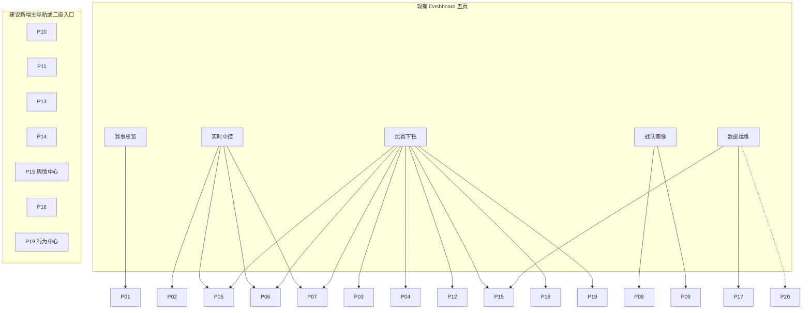

# Dashboard 五页 ↔ P01–P20 映射

> **目的**：把现有 Streamlit Dashboard（`scripts/dashboard.py`）与产品文档矩阵对齐，标明「已有可升级」与「待建」。  
> **原则**：本轮只写文档，不改代码；优先级以各 PRD「实现优先级」为准。  
> **基线注记（2026-08-13 后）**：本表按五页基线编写；前端重写后侧栏为七模块（赛事中心 / 实时中控 / 单局复盘 / 战队画像 / 选手排行 / 英雄 Meta / 数据健康），多个「待建」项（P04 BP 看板、P05 选手面板、P06 分路经济、P09 选手排行、P10 英雄 Meta 等）已随重写落地或部分落地，本映射待重基线。

## 现有导航（代码事实）

`scripts/dashboard.py` 侧栏 `st.radio` 五页：

| # | 页面名 | 入口函数（逻辑名） | 当前能力摘要 |
|---|--------|-------------------|--------------|
| 1 | 赛事总览 | `page_overview` | 联赛/日期筛选、大场列表、基础统计 |
| 2 | 实时中控 | `page_live_control` | 监控状态、进行中对局、实时链路健康 |
| 3 | 比赛下钻 | `page_match_drilldown` | 选大场/单局、战报表、事件表 |
| 4 | 战队画像 | `page_team_profile` | 选战队、胜负与基础剖面 |
| 5 | 数据运维 | `page_ops` | 数据集规模、采集/处理运维视角 |

相关状态文件（非 UI）：`data/realtime/monitor_status.json`、`train_status.json`、`backfill_status.json`。

## 总映射表

| PRD | 标题 | Dashboard 落点 | 状态 | 升级要点 |
|-----|------|----------------|------|----------|
| [P01](./P01-赛事中心与赛程.md) | 赛事中心与赛程 | 赛事总览 | **已有 · 升级** | 赛程日历、联赛层级、大场状态机、跳转 P02/P03 |
| [P02](./P02-实时中控台.md) | 实时中控台 | 实时中控 | **已有 · 升级** | 多路指标条、延迟、官方/自研胜率并排、告警 |
| [P03](./P03-单局赛后复盘.md) | 单局赛后复盘 | 比赛下钻 | **已有 · 升级** | 时间轴复盘、分路拆解、导出入口 P18 |
| [P04](./P04-BP看板与阵容分析.md) | BP 看板与阵容分析 | —（可挂比赛下钻 Tab） | **待建** | `bp_list` 可视化、阵容标签、禁用热度 |
| [P05](./P05-选手实时面板-出装铭文.md) | 选手实时面板 | —（可挂实时中控/下钻） | **待建** | 快照装备/铭文字段上屏（字典已有，UI 未展） |
| [P06](./P06-经济分路与资源时间轴.md) | 经济分路与资源时间轴 | —（可挂实时中控/下钻） | **待建** | 分路经济差、野区/龙节奏时间轴 |
| [P07](./P07-实时胜率与官方胜率对标.md) | 实时胜率与官方胜率对标 | 实时中控 + 比赛下钻（V11 曲线） | **已有片段 · 升级** | 校准曲线、偏差表、标签强制「估算」 |
| [P08](./P08-战队画像与积分榜.md) | 战队画像与积分榜 | 战队画像 | **已有 · 升级** | 积分榜、风格雷达、对阵矩阵 |
| [P09](./P09-选手排行与能力雷达.md) | 选手排行与能力雷达 | — | **待建** | 位置榜、能力雷达（官方/代理分层） |
| [P10](./P10-英雄Meta与组合胜率.md) | 英雄 Meta 与组合胜率 | — | **待建** | 出场/胜率/CI、双人组合 |
| [P11](./P11-英雄池对位与H2H.md) | 英雄池对位与 H2H | — | **待建** | 池深度、H2H、对位胜率 |
| [P12](./P12-赛段切片与胜负归因.md) | 赛段切片与胜负归因 | 比赛下钻（事件片段） | **部分已有 · 升级** | 赛段切片、归因卡（代理/估算） |
| [P13](./P13-高光赛季之最与荣誉.md) | 高光赛季之最与荣誉 | — | **待建** | 赛季之最榜、荣誉墙 |
| [P14](./P14-教练与战队元数据.md) | 教练与战队元数据 | — | **待建** | 百科/官微/官网半自动元数据 |
| [P15](./P15-赛事舆情与弹幕分析.md) | 赛事舆情与弹幕分析 | — | **待建** | `data/sentiment/{match_id}/`，赛后任务 |
| [P16](./P16-BP与大场胜率模拟器.md) | BP 与大场胜率模拟器 | — | **待建** | What-if BP / BO 仿真 |
| [P17](./P17-数据健康与采集中控.md) | 数据健康与采集中控 | 数据运维 | **已有 · 升级** | SLA、缺口清单、重跑编排 |
| [P18](./P18-导出报告与教练简报.md) | 导出报告与教练简报 | —（下钻/画像导出） | **待建** | PDF/MD 简报、复盘包 |
| [P19](./P19-行为指标-入侵开团支援.md) | 行为指标（入侵/开团/支援） | — | **待建** | 三层口径；**禁止视频 CV 主路径** |
| [P20](./P20-进阶算法实验室.md) | 进阶算法实验室 | —（可挂运维旁路） | **待建 · Lab** | 校准/因果/RL，默认非教练主路径 |

## 按 Dashboard 页聚合

### 赛事总览

| PRD | 状态 | 备注 |
|-----|------|------|
| P01 | 已有 · 升级 | 主承载页 |
| P13 | 待建 | 可作为总览「赛季之最」卡片入口 |

### 实时中控

| PRD | 状态 | 备注 |
|-----|------|------|
| P02 | 已有 · 升级 | 主承载页 |
| P05 | 待建 | 选手卡 Tab |
| P06 | 待建 | 经济/资源子面板 |
| P07 | 已有片段 · 升级 | 胜率曲线主视觉 |

### 比赛下钻

| PRD | 状态 | 备注 |
|-----|------|------|
| P03 | 已有 · 升级 | 主承载页 |
| P04 | 待建 | BP Tab |
| P05 / P06 | 待建 | 与实时同构，赛后只读 |
| P07 | 已有片段 · 升级 | 终局偏差复盘 |
| P12 | 部分已有 · 升级 | 事件 → 归因 |
| P15 | 待建 | Tab「舆情与弹幕」；读 `data/sentiment/{match_id}/` |
| P18 | 待建 | 「导出简报」按钮 |
| P19 | 待建 | Tab「行为指标」；L1/L2/L3，非视频 CV |

### 战队画像

| PRD | 状态 | 备注 |
|-----|------|------|
| P08 | 已有 · 升级 | 主承载页 |
| P09 | 待建 | 选手子页 / 跳转 |
| P11 | 待建 | H2H 子模块 |

### 数据运维

| PRD | 状态 | 备注 |
|-----|------|------|
| P17 | 已有 · 升级 | 主承载页 |
| P15 | 待建 | 舆情任务健康（manifest 完成率） |
| P20 | 待建 · Lab | 实验任务调度入口（权限隔离） |

## 状态统计

| 状态 | PRD 数 | ID |
|------|--------|-----|
| 已有 · 升级 | 5 | P01, P02, P03, P08, P17 |
| 已有片段 / 部分已有 · 升级 | 2 | P07, P12 |
| 待建 | 12 | P04–P06, P09–P11, P13–P16, P18–P19 |
| 待建 · Lab | 1 | P20 |

## 字段与接口真相源

实现时以技术文档为准（产品 PRD 不重复维护字段表）：

| 文档 | 用途 |
|------|------|
| [../数据字典.md](../数据字典.md) | `battle_id`、`bp_list`、`battle_player_list`、装备嵌套等 |
| [../接口逆向笔记.md](../接口逆向笔记.md) | leaguesite 开放接口、Headers、赛程链路 |
| [../项目设计.md](../项目设计.md) | **历史架构参考**，早期目录/爬虫设想，**非**当前实现真相源 |

## 验收检查（映射层）

- [x] 五页均有明确 PRD 主承载
- [x] 每个 P01–P20 标注「已有 / 待建」
- [x] P15 路径约定 `data/sentiment/{match_id}/`（见 P15）；下钻 Tab + 运维健康双入口
- [x] P19 明确非视频 CV 主路径（见 P19）；可挂比赛下钻 Tab
- [x] 指标口径链接至 [00-术语表.md](./00-术语表.md)
- [x] 字段/接口真相源指向 [数据字典](../数据字典.md) / [接口逆向笔记](../接口逆向笔记.md)

## 修订记录

| 日期 | 说明 |
|------|------|
| 2026-07-22 | 初稿映射表 |
| 2026-07-22 | 统一口径：补 P15/P19 落点；交叉引用验收勾选 |
| 2026-07-22 | 终验：五页 ↔ P01–P20 齐全；P19 徽章口径对齐术语表（L2=`代理` / L3=`估算`） |
