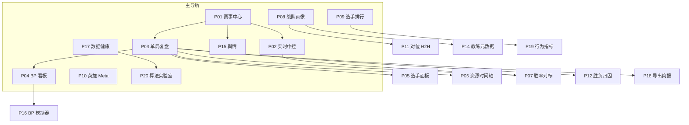
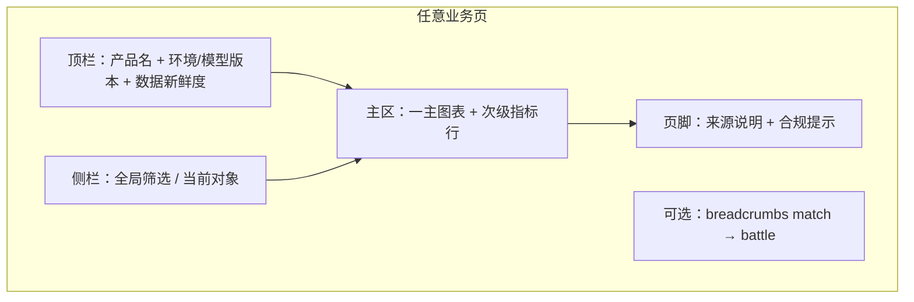
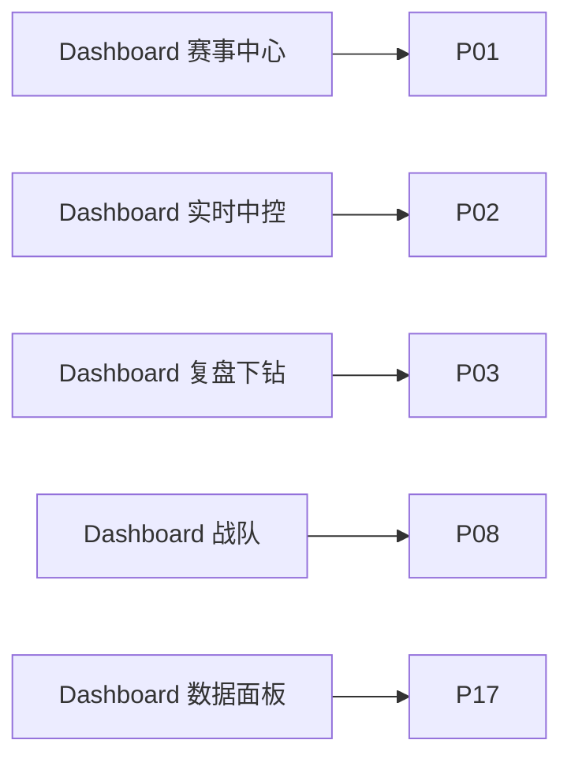

# 00 · 总览与信息架构

| 属性 | 内容 |
|------|------|
| 文档类型 | 产品总纲 PRD |
| 状态 | 已定稿（批次 A） |
| 主用户 | 数据分析师 / KPI 运营 / 教练组 |
| 术语 | [00-术语表](./00-术语表.md) |
| 设计 | [00-设计系统与UI规范](./00-设计系统与UI规范.md) |
| 数据合规 | [00-数据源与合规矩阵](./00-数据源与合规矩阵.md) |
| 现网映射 | [00-Dashboard映射](./00-Dashboard映射.md) |
| 全量索引 | [README.md](./README.md)（P01–P20 可点链接） |
| 技术交叉 | [数据字典](../数据字典.md) · [接口逆向笔记](../接口逆向笔记.md) |
| 历史参考 | [项目设计.md](../项目设计.md)（早期架构设想，**不是**现行实现真源） |

---

## 1. 产品定位

**一句话**：把 KPL 公开赛事数据变成教练/分析师可决策的「实时 + 复盘 + Meta + 舆情」一体化工作台，用统计与 ML 把竞品的浅表展示做深，而不是做一个粉丝娱乐站。

**目标用户与任务**

| 角色 | 核心任务 | 成功标准 |
|------|----------|----------|
| 数据分析师 | 拉通赛程→单局→指标→导出，做渗透与归因 | 指标可定义、可复现、可标注来源 |
| KPI / 数据运营 | 覆盖率、数据健康、素材与榜单 | 监控可观测，报告可一键出 |
| 教练组 | 赛前 BP 情景、赛中态势、赛后拐点与行为代理 | 30 秒读懂一局，5 分钟出简报 |

**非目标（本阶段）**

- 粉丝社区、弹幕娱乐墙、夸张动画特效优先的观赛产品
- 以视频 CV 批量生产「开团/入侵」官方同款榜（见 P19）
- 对接禁爬仿站与 `dataReport` 类不明通道（见合规矩阵）

---

## 2. 用户故事（≥5，含验收）

### US-01 赛程一张图掌握覆盖

**作为** 数据运营，**我希望** 在赛事中心看到今日/本周大场、BO 局数与本地是否已采集，**以便** 判断监控是否漏局。

**验收**

- [ ] 列表粒度为 `match_id`，可下钻到 `battle_id`
- [ ] 展示 `has_raw` / 快照数 / clean·quarantine 角标（有则显示）
- [ ] 空态文案说明「请启动监控或回补」，非空白页

### US-02 赛中 10 秒读赢面

**作为** 教练/分析师，**我希望** 实时中控同时看到双方胜率、经济差、击杀差与 Top 领先因子，**以便** 判断是否进入关键窗口。

**验收**

- [ ] 胜率曲线带 `估算` 标签；经济/击杀等差值带 `官方`（来自快照字段）
- [ ] 加载中显示骨架屏；无 live 数据时引导启动 `official_match_monitor`
- [ ] 刷新延迟在产品说明中声明（如采集间隔 3s 级，非毫秒级）

### US-03 赛后复盘拐点与战报

**作为** 分析师，**我希望** 单局复盘自动标拐点并生成文字战报，**以便** 写复盘纪要。

**验收**

- [ ] 可选 battle，回放胜率与事件
- [ ] 战报含时间点、比分/经济关键变化、结论句
- [ ] quarantine 局可打开但角标警告「质量未过门禁」

### US-04 指标来源不误导

**作为** 教练，**我希望** 任何「开团/入侵/支援」类指标明确是官方还是代理，**以便** 不把估算当官方 KPI。

**验收**

- [ ] 所有指标卡含来源标签组件（见设计系统）
- [ ] L2/L3 指标禁止文案出现「官方开团数据」字样（文案审查清单）

### US-05 Meta 与对位服务备战

**作为** 教练组数据分析，**我希望** 按赛季/阶段查看英雄胜率、组合与 H2H，**以便** BP 讨论有数据支撑。

**验收**

- [ ] 样本量 N 与胜率置信区间或至少标准误差提示
- [ ] 小样本（如 N&lt;10）降权展示或灰显

### US-06 舆情与赛果关联但不混进战绩

**作为** KPI 运营，**我希望** 大场结束后自动汇总舆情主题与情绪，**以便** 公关与内容选题。

**验收**

- [ ] 舆情模块全局 `舆情` 标签
- [ ] 存储路径与 `match_id` 关联；延迟与采样偏差在页脚声明

### US-07 数据健康可运维

**作为** 数据运营，**我希望** 看到监控状态、模型版本、clean/quarantine 分布，**以便** 训练前知道数据是否可信。

**验收**

- [ ] 展示 monitor/train/backfill 状态文件摘要
- [ ] quarantine reasons 可筛选

### US-08 导出教练简报

**作为** 教练，**我希望** 一键导出单局或大场简报（Markdown/PDF 规划），**以便** 会前同步。

**验收**

- [ ] 导出内容含来源标签与模型版本
- [ ] 不含未授权第三方水印数据

---

## 3. 信息架构（IA）

### 3.1 站点地图

### 3.2 导航分组（最终产品）

| 分组 | 页面 | 主任务 |
|------|------|--------|
| **赛时** | 赛事中心、实时中控 | 覆盖与态势 |
| **复盘** | 单局复盘、BP、选手面板、经济资源轴、胜率对标、归因 | 解释「发生了什么 / 为什么」 |
| **对象** | 战队、选手、英雄 Meta、对位 H2H、赛季荣誉 | 跨局聚合 |
| **情报** | 教练元数据、舆情弹幕 | 非战绩上下文 |
| **决策工具** | BP/大场模拟器、行为指标、算法实验室 | 情景与实验 |
| **运维** | 数据健康、导出中心 | 质量与产出物 |

### 3.3 全局筛选器（侧栏约定）

- 日期范围
- 赛事 `league_id` / 赛段 stage
- 战队多选
- 「仅含时间线」开关（`has_timeline`）
- 数据质量：全部 / 仅 clean / 含 quarantine

筛选器变更不得静默切换指标定义；若样本量变化，KPI 卡需更新 N。

### 3.4 页面线框（逻辑布局，非框架绑定）

**空态 / 加载 / 错误**

| 状态 | 要求 |
|------|------|
| 加载 | 骨架屏 + 「拉取快照/计算特征」文案，禁止布局跳动 |
| 空态 | 说明缺什么数据、下一步命令或入口（如启动监控） |
| 错误 | 人类可读原因 + `battle_id`/`match_id` + 是否可重试；不弹栈轨迹给教练用户 |
| 降级 | 模型失败时仍展示官方经济/KDA 等原始字段 |

### 3.5 对象主键与路由逻辑

| 层级 | 主键 | 子对象 |
|------|------|--------|
| 赛事 | `league_id` | matches |
| 大场 | `match_id` | battles, sentiment |
| 单局 | `battle_id` | snapshots, prediction timeline, events |
| 战队 | `team_id` / 队名归一化 | 画像、积分、H2H |
| 选手 | `player_name` + `team_id` | 排行、雷达 |
| 英雄 | `hero_id` | Meta、组合 |

---

## 4. 关键指标与统计方法（平台级）

> 各模块细节指标在 Pxx 中展开；此处定义**跨模块必须一致**的口径。

| 指标 | 定义 | 窗口 | 方法要点 | 标签 |
|------|------|------|----------|------|
| 大场覆盖率 | 有 ≥1 个 battle 快照的 match / 赛程 match | 按日/周 | 简单比率 + 分母列表 | 运维 |
| 单局完整度 | clean 判定通过的 battle 占比 | 赛季 | 见术语表门禁 | 运维 |
| 平台胜率 | `camp1_win_prob` | 快照时刻 | 分阶段模型 + 可选护栏 | `估算` |
| 经济差 | camp1.gold − camp2.gold（或相对队） | 快照时刻 | 官方字段差分 | `官方` |
| 方向正确率 | sign(prob−0.5) 与最终胜方一致 | early/mid/late | holdout | `估算`评估 |
| Brier / ECE | 概率质量 | holdout | 主验收，非 AUC 优先 | 算法 |

**显著性（教练向默认）**

- 胜率类：Clopper-Pearson 或正态近似 95% CI；N&lt;10 不强调排序第一
- 对比两类胜率：可选双侧比例检验，p 值仅作参考，UI 写「探索性」
- 禁止在无 N 的情况下展示「必胜阵容」文案

---

## 5. 数据源

| 层级 | 主源 | 辅源 | 缺口 |
|------|------|------|------|
| 赛程与对局 | 官方 leaguesite open API | 赛程归档 CSV | 部分历史 league 需回补脚本 |
| 局内快照 | `battle/open` 轮询 | backfill | 官方刷新频率不可控 |
| 特征/预测 | `parse_snapshot` + FeatureBuilder + V11 | — | 铭文可读名、部分龙字段语义 |
| 元数据 | 百科/官网（P14） | 人工 | 教练变更滞后 |
| 舆情 | B 站/微博等（P15） | 半自动 | 小红书不强承诺实时 |
| 行为榜 | 官方榜（若有） | 代理指标 | 无官方则仅 L2/L3 |

字段语义真源：[数据字典](../数据字典.md)。  
接口与 Headers：[接口逆向笔记](../接口逆向笔记.md)。

**现行代码锚点（依赖，非本 PRD 改码）**

- `scripts/kpl_official_core.py`：解析、特征、预测、战报、健康
- `scripts/official_match_monitor.py`：实时采集
- `scripts/dashboard.py`：五页原型
- `scripts/classify_realtime_battles.py`：clean/quarantine

---

## 6. 算法与 AI（平台路线）

| 阶段 | 能力 | 对应 PRD |
|------|------|----------|
| 基线（已有） | 分阶段实时胜率、因果特征、金差护栏、拐点与战报 | P02/P07/P03 |
| 对齐增强 | 官方胜率对标、校准面板、分路/出装展示 | P05/P06/P07 |
| 统计加深 | Meta CI、H2H、胜负归因、行为代理分 | P10–P12/P19 |
| 决策工具 | BO/BP 蒙特卡洛 | P16 |
| 实验台 | 校准、因果、序列、RL 仿真（隔离环境） | P20 |
| 明确非主路径 | 选手视角视频 CV | P19 备注 |

---

## 7. 与竞品差异

| 维度 | 典型竞品/公开站 | 本产品 |
|------|-----------------|--------|
| 定位 | 粉丝向数据页、浅表榜单 | 教练/分析师工作台 |
| 实时胜率 | 有则黑盒或无校准 | 可解释因子 + Brier/ECE + 护栏 |
| 行为指标 | 常直接写「入侵/开团」 | **三层口径**强制标签 |
| 数据质量 | 少谈脏数据 | clean/quarantine 一等公民 |
| 舆情 | 少与赛程主键绑定 | `match_id` 关联落盘与复看 |
| 合规 | 偶发不明源 | 禁仿站、禁 dataReport、来源矩阵公开 |

**对齐**：赛程、KDA、经济、BP、基础榜单。  
**碾压**：校准与诚实回测、归因、代理分层、数据健康、可导出教练简报。

---

## 8. 实现优先级

| 优先级 | 范围 | 依赖现有能力 |
|--------|------|----------------|
| **P0** | P01/P02/P03/P07/P17 教练级体验升级（标签、空态、质量角标） | dashboard 五页 + monitor + core |
| **P0** | 术语/来源标签在所有已有 KPI 落地 | 设计系统 |
| **P1** | P04/P05/P06（快照已有字段 UI 化）、P08/P12/P18 | parse_snapshot 字段 |
| **P1** | P19 L1/L2（有官方用官方，无则代理） | 官方榜接入评估 |
| **P2** | P09–P11、P13–P16、P15、P20 | 新聚合管线与合规采集 |

**技术落点约定**

- 短期：Streamlit 原型继续承载
- 中期：可迁 React + Plotly/ECharts；PRD 线框按最终产品写，不绑死框架

---

## 9. 版本路线

| 版本 | 主题 | 交付焦点 |
|------|------|----------|
| **Now** | 文档矩阵 + 现有五页映射 | 00 总纲 + Pxx PRD |
| **V-Coach-1** | 标签化与复盘深度 | 来源标签、分路/装备、拐点战报模板 |
| **V-Coach-2** | Meta 与模拟 | 英雄/组合、BP 模拟、简报导出 |
| **V-Intel** | 舆情与元数据 | P14/P15 合规接入 |
| **V-Lab** | 算法实验室 | P20 隔离实验，不影响生产胜率 |

---

## 10. 与现有 Dashboard 五页映射

完整「已有 vs 待建」表见 **[00-Dashboard映射.md](./00-Dashboard映射.md)**。摘要：

| 现有页面 | 路由职责（现状） | 产品深化 |
|----------|------------------|----------|
| 赛事总览 / 赛事中心 | 赛程、match、本地 BO | **[P01](./P01-赛事中心与赛程.md)** + 质量角标、覆盖漏斗 |
| 实时中控 | 胜率曲线、经济/击杀/塔、因子、战报 | **[P02](./P02-实时中控台.md)** / [P05](./P05-选手实时面板-出装铭文.md) / [P06](./P06-经济分路与资源时间轴.md) / [P07](./P07-实时胜率与官方胜率对标.md) |
| 比赛下钻 / 历史复盘 | 选局回放、拐点、战报 | **[P03](./P03-单局赛后复盘.md)** / [P04](./P04-BP看板与阵容分析.md) / [P12](./P12-赛段切片与胜负归因.md) / [P18](./P18-导出报告与教练简报.md) |
| 战队画像 | 胜率、金差、雷达、趋势 | **[P08](./P08-战队画像与积分榜.md)**（及 [P09](./P09-选手排行与能力雷达.md) / [P11](./P11-英雄池对位与H2H.md) / [P14](./P14-教练与战队元数据.md) 链出） |
| 数据运维 / 数据面板 | 模型版本、快照质量、监控状态 | **[P17](./P17-数据健康与采集中控.md)**（及 [P20](./P20-进阶算法实验室.md) 入口） |

### PRD 全量链接（P01–P20）

| ID | 文档 | ID | 文档 |
|----|------|----|------|
| P01 | [赛事中心与赛程](./P01-赛事中心与赛程.md) | P11 | [英雄池对位与H2H](./P11-英雄池对位与H2H.md) |
| P02 | [实时中控台](./P02-实时中控台.md) | P12 | [赛段切片与胜负归因](./P12-赛段切片与胜负归因.md) |
| P03 | [单局赛后复盘](./P03-单局赛后复盘.md) | P13 | [高光赛季之最与荣誉](./P13-高光赛季之最与荣誉.md) |
| P04 | [BP看板与阵容分析](./P04-BP看板与阵容分析.md) | P14 | [教练与战队元数据](./P14-教练与战队元数据.md) |
| P05 | [选手实时面板](./P05-选手实时面板-出装铭文.md) | P15 | [赛事舆情与弹幕分析](./P15-赛事舆情与弹幕分析.md) |
| P06 | [经济分路与资源时间轴](./P06-经济分路与资源时间轴.md) | P16 | [BP与大场胜率模拟器](./P16-BP与大场胜率模拟器.md) |
| P07 | [实时胜率与官方胜率对标](./P07-实时胜率与官方胜率对标.md) | P17 | [数据健康与采集中控](./P17-数据健康与采集中控.md) |
| P08 | [战队画像与积分榜](./P08-战队画像与积分榜.md) | P18 | [导出报告与教练简报](./P18-导出报告与教练简报.md) |
| P09 | [选手排行与能力雷达](./P09-选手排行与能力雷达.md) | P19 | [行为指标-入侵开团支援](./P19-行为指标-入侵开团支援.md) |
| P10 | [英雄Meta与组合胜率](./P10-英雄Meta与组合胜率.md) | P20 | [进阶算法实验室](./P20-进阶算法实验室.md) |

---

## 11. 验收清单（总纲级）

### 数据正确性

- [ ] match / battle 层级文案无混用
- [ ] 胜率类一律 `估算`；官方字段差分一律 `官方`
- [ ] clean 默认用于训练相关说明；quarantine 有 reasons
- [ ] 不出现仿站 / dataReport 作为数据源的产品描述

### 性能（产品目标）

- [ ] 赛程页交互 &lt; 2s（本地归档量级）
- [ ] 单局复盘加载快照时间线可接受延迟有进度提示
- [ ] 实时页允许轮询，不阻塞导航切换

### 视觉与体验

- [ ] 符合设计系统：深蓝工作台 + 青 accent，非娱乐粉紫风
- [ ] 一屏一主任务；指标卡有定义 tooltip + 来源标签
- [ ] 空态/错误态文案面向教练，而非开发者

### 文档

- [ ] 本目录 README 可索引全部 00 + P01–P20
- [ ] 交叉引用数据字典与接口笔记；项目设计标为历史参考

---

## 12. 开放问题（登记，不阻塞总纲）

1. 官方是否持续提供可对标的「官方胜率」字段？无则 P07 以「自研校准面板」为主。
2. 行为类官方榜的稳定接口形态（页面 HTML vs API）。
3. 舆情各平台 ToS 与频率的法务确认节奏（产品先写分层承诺）。
