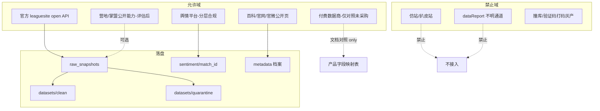

# 00 · 数据源与合规矩阵

| 属性 | 内容 |
|------|------|
| 文档类型 | 产品总纲 · 数据源与合规 |
| 状态 | 已定稿（批次 A） |
| 术语 | [00-术语表](./00-术语表.md) |
| IA | [00-总览与信息架构](./00-总览与信息架构.md) |
| 字段真源 | [数据字典](../数据字典.md) |
| 接口技术笔记 | [接口逆向笔记](../接口逆向笔记.md) |
| 历史参考 | [项目设计.md](../项目设计.md)（早期爬虫目录设想，**非**现行合规授权依据） |

---

## 1. 产品定位

**一句话**：在合法、可审计、可标注来源的前提下，为教练/分析师工作台规定「能接什么、怎么标、绝不能碰什么」。

**目标用户**

- 数据分析师：知道字段从哪来、缺什么
- 数据运营：知道采集边界与健康指标
- 教练组：信任标签，不被不明来源污染决策

---

## 2. 用户故事（含验收）

### US-C01 主源可追溯

**作为** 分析师，**我希望** 任一战绩指标能追溯到官方接口字段或明确代理公式，**以便** 复现结论。

**验收**：PRD 与 UI tooltip 能指出字段名或公式文档锚点。

### US-C02 禁源不可进产品

**作为** 项目负责人，**我希望** 仿站与 dataReport 类通道被明确列入黑名单，**以便** 工程与产品评审有否决依据。

**验收**：本文件黑名单章节；代码/文档不得将其列为主源。

### US-C03 舆情不冒充战绩

**作为** KPI 运营，**我希望** 舆情数据单独标签与存储，**以便** 公关材料与教练战报分离。

**验收**：`舆情` 标签；路径 `data/sentiment/{match_id}/`。

### US-C04 缺口诚实

**作为** 教练，**我希望** 铭文名、部分龙字段语义等问题被标明「缺口」而非假数据填满。

**验收**：缺口表可见；UI 显示 `—` 或「字典未覆盖」。

### US-C05 频率与合规声明

**作为** 运营，**我希望** 各平台采集频率与「可做/半自动/不做」分层写清，**以便** 不对外过度承诺。

**验收**：P15 与本矩阵承诺列一致。

---

## 3. 信息架构（数据流）

### 与产品模块映射

| 数据域 | 主要消费 PRD |
|--------|----------------|
| 官方赛程/对局/快照 | P01–P07、P12、P17 |
| 官方 BP/选手装备字段 | P04、P05、P06 |
| 聚合战队/选手/英雄 | P08–P13 |
| 百科元数据 | P14 |
| 舆情弹幕 | P15 |
| 行为榜官方/代理 | P19 |
| 训练 clean 集 | P07、P17、P20 |

---

## 4. 总矩阵

### 4.1 官方（主源，优先）

| 源 | 能力 | 产品承诺 | 标签 | 技术锚点 |
|----|------|----------|------|----------|
| `GET /leaguesite/leagues/open` | league 列表 | **可做** | `官方` | 赛程入口 |
| `GET /leaguesite/matches/open?league_id=` | 大场赛程 | **可做** | `官方` | match 索引 |
| `GET /leaguesite/match/battles/open?match_id=` | 大场下 battle 列表 | **可做** | `官方` | **唯一可信** battle_id 来源 |
| `GET /leaguesite/battle/open?battle_id=` | 单局快照/赛后详情 | **可做**（轮询需限速） | `官方` | `parse_snapshot` |
| 官方赛程/数据页 HTML | 展示与核对 | **可做**（SSR/异步需验证） | `官方` | 见接口笔记 |
| 官方公示榜（反野/支援/开团等，若存在） | L1 行为口径 | **可做**（先确认稳定入口） | `官方` | P19 L1 |

**Headers 与防盗链**（技术细节见 [接口逆向笔记](../接口逆向笔记.md)）：

- 需合理 `User-Agent`、`Referer`、`Origin`（如 `pvp.qq.com`）
- 禁止无延迟高并发；遇 403/429 冷却
- 原始 JSON 必须落盘，便于字段演进

**产品硬约束**

- **禁止**批量构造 `battle_id` 作为主采集路径（数据字典结论：第三段不可假设递增）
- `game_duration` 展示前必须从毫秒换算
- `kill_big_dragon_num` 语义存疑：展示与建模优先分项主宰字段

**字段级权威表**：[数据字典](../数据字典.md)

| 类别 | 代表字段 | 赛前/赛中/赛后 |
|------|----------|----------------|
| 身份 | `team_id`, `player_name`, `position_desc` | 赛前可知 |
| 英雄/BP | `hero_id`, `bp_list` | BP 阶段可知 |
| 战绩 | `gold`, KDA, 伤害, `participation_rate` | 赛中累积 / 赛后完整 |
| 资源 | 暴君/主宰/龙王分项 | 赛中累积 |
| 装备 | `BriefEquipList` | 赛中/赛后 |
| 铭文 | `symbol_ids` | **缺口**：缺可读名 |

### 4.2 王者营地 / 掌盟（辅源，评估后）

| 源 | 能做什么 | 产品承诺 | 标签 |
|----|----------|----------|------|
| 营地公开战绩/资料卡 | 选手门面信息、部分展示字段交叉验证 | **评估后可做**；需独立合规评审与频率策略 | `营地` |
| 营地非公开/登录强依赖接口 | 深度隐私或协议不明数据 | **默认不做** | — |

规则：

- 不得用营地数据覆盖官方赛事主键逻辑
- UI 必须与官方字段分开展示或明确「营地口径」
- 若仅能人工导出：走 `人工` 标签补录

### 4.3 第三方（对照 / 谨慎）

| 源 | 能做什么 | 产品承诺 | 标签 |
|----|----------|----------|------|
| 付费电竞数据商 | 事件流、高阶行为字段、标注数据 | **文档可列对照字段**；**未采购前不承诺交付** | 采购后单列 |
| 开放研究数据集 | 算法实验 | 仅实验室，水印「实验」 | `估算` |
| 粉丝统计表 / 网盘分享包 | 不可审计 | **不做主源**；禁止静默导入生产 | — |

### 4.4 百科 / 官网 / 官微（元数据）

| 源 | 能做什么 | 产品承诺 | 标签 |
|----|----------|----------|------|
| 俱乐部官网 | 教练、成员名单 | **可做**（低频抓取或人工） | `百科`/`人工` |
| 公开百科词条 | 战队沿革、教练变更 | **可做**；需时间戳与引用 URL | `百科` |
| 官方微博/公众号 | 日程、宣告 | **可做**（公开页/RSS/官方 API 优先） | `百科` |

用于 **P14**，不进入胜率训练特征，除非另做评审。

### 4.5 舆情与弹幕（P15）

| 源 | 能做什么 | 产品承诺 | 标签 | 备注 |
|----|----------|----------|------|------|
| B 站直播间弹幕 | 热度曲线、关键词、情绪 | **可做**；声明频率与平台规则 | `舆情` | 历史/回放接口或直播流，择合规路径 |
| 微博 | 赛后话题、情感 | **可做**；有延迟与采样偏差 | `舆情` | 关键词：战队+选手+比赛日 |
| 贴吧 / NGA / 虎扑 | 长帖争议点、主题聚类 | **可做**；非实时 | `舆情` | 注意社区 ToS |
| 小红书 | 笔记舆情 | **半自动 / 检索 API / 人工补录** | `舆情`/`人工` | **禁止**承诺全站实时 |
| 弹幕数值特征 | 条数、峰值、情感分、主题 | 落盘复看 | `舆情` | `data/sentiment/{match_id}/` |

**触发**：大场打完 → 舆情任务 → 主题 / 情绪 / 争议点 / 与赛果关联摘要（关联是分析结论，仍标 `舆情`）。

---

## 5. 禁止清单（黑名单）

以下来源与行为**一律禁止**接入产品主链路、训练生产模型、Dashboard 默认可视化：

| 禁止项 | 说明 | 原因 |
|--------|------|------|
| **仿站 / 扒皮镜像站** | 复制官方 UI 或二次展示官方数据的非授权站点 | 版权与 ToS 风险、数据不可审计、随时失效 |
| **dataReport 类不明通道** | 未授权、来源不清的战报上报/转发接口或「神奇 report」端点 | 合规与稳定性双风险；**产品名录显式禁止** |
| 绕过鉴权、撞库、打码平台 | 任何破解登录、验证码农场 | 法律与账号风险 |
| 选手视角录像批量 CV 未授权分发 | 以盗录流为原料的工业化管道 | 版权；且非行为指标主路径 |
| 把 quarantine 当 clean 训练且不声明 | 质量欺诈 | 模型诚信 |

**评审否决句式（可直接用于 PR/方案）**：

> 该方案依赖仿站或 dataReport 类不明数据通道，违反 `docs/product/00-数据源与合规矩阵.md` 黑名单，不予合并。

---

## 6. 关键指标与「统计方法」在数据层的含义

| 概念 | 数据要求 |
|------|----------|
| 官方指标 | 必须能指到 open API 字段或官方榜单截图/URL+抓取时间 |
| 代理指标 | 必须有公式文档；输入字段全为允许域 |
| 估算指标 | 必须有模型版本与训练桶（默认 clean） |
| 舆情指标 | 必须有平台、采样时间窗、样本量 |

**clean / quarantine**（与术语表一致）

- 入库：`raw_snapshots` 永远保留
- 分桶：`classify_realtime_battles` 逻辑产出 manifest
- 训练/回测默认：**仅 clean**
- 产品复盘：quarantine 可看但角标 + reasons

---

## 7. 算法与数据依赖

| 算法能力 | 允许训练数据 | 禁止 |
|----------|--------------|------|
| V11 实时胜率 | clean 官方快照 | 仿站特征、舆情特征默认入模 |
| 拐点/战报 | 官方时间线 + 规则/模型 | 用舆情情绪当拐点 |
| 行为 L3 | 官方事件差分（若有）/ 允许域日志 | 未授权视频 CV 主路径 |
| 舆情模型 | 合规文本样本 | 战绩标签与舆情标签混写 |

---

## 8. 与竞品差异

| 维度 | 常见做法 | 本产品 |
|------|----------|--------|
| 数据来源 | 混用不明站 | 矩阵公开 + 黑名单 |
| 字段 | 不说明单位/语义坑 | 对齐数据字典（毫秒、龙字段存疑） |
| 质量 | 有数就训 | clean/quarantine |
| 舆情 | 当热闹 | 独立域、可复看、偏差声明 |

---

## 9. 实现优先级

| 优先级 | 项 | 依赖 |
|--------|----|------|
| **P0** | 官方四层接口稳定采集与 raw 落盘 | `kpl_official_core` / monitor |
| **P0** | clean/quarantine 产品化展示 | classify 脚本 + P17 |
| **P0** | 黑名单写入工程评审习惯 | 本文档 |
| **P1** | 装备/分路等已有字段 UI 化 | 数据字典字段已存在 |
| **P1** | 铭文 ID→名字典 | 缺口攻关 |
| **P1** | B 站弹幕 + 微博赛后任务 | P15 |
| **P2** | 营地评估接入 | 合规评审 |
| **P2** | 付费数据商对照表（仍不采购也可先列） | 商务 |
| **不做** | 仿站、dataReport、全站小红书实时 | — |

---

## 10. 字段映射（产品 → 现行解析）

> 完整字段见 [数据字典](../数据字典.md)。下表服务产品经理/设计师速查。

| 产品对象 | 解析入口 | 主要字段 |
|----------|----------|----------|
| 单局快照 | `parse_snapshot(raw['data'], battle_id)` | 经济、击杀、塔、龙、时长、双方阵容 |
| 选手行 | `battle_player_list` | KDA、伤害、参团、MVP、装备、分路 |
| BP | `bp_list` | ban/pick、英雄、阵营、位置 |
| 胜率时间线 | monitor 写出的 prediction CSV | `camp1_win_prob`, `camp2_win_prob`, 因子 |
| 赛程 | matches open + 归档 CSV | `match_id`, 队伍、开赛时间、stage |

**历史参考声明**：早期 [项目设计.md](../项目设计.md) 中的 `src/crawler/`、`dashboard/app.py` 路径是历史架构草图；**现行实现以 `scripts/` 与本矩阵为准**，不得按历史路径做合规「已存在」假设。

---

## 11. 验收清单

### 合规

- [ ] 产品文档与 UI 无仿站、无 dataReport 主源描述
- [ ] 官方指标可追溯字段；代理有公式；估算有模型版本
- [ ] 舆情独立标签与目录

### 数据正确性

- [ ] battle_id 仅来自赛程链路
- [ ] 时长单位正确
- [ ] 龙类字段按数据字典谨慎展示
- [ ] clean 默认训练口径在运维页可见

### 性能与采集纪律

- [ ] 有随机延迟/间隔策略说明（接口笔记）
- [ ] 403/429 冷却策略有运维可见信号（P17）

### 缺口诚实

- [ ] 铭文可读名、status 枚举等未决项在缺口表登记
- [ ] 不提供虚假填满

---

## 12. 缺口登记（活文档）

| 缺口 | 影响模块 | 临时策略 | 目标 |
|------|----------|----------|------|
| `symbol_ids` 无可读名 | P05 | 显示 ID 或隐藏铭文块 | ID→名字典 |
| `status` 枚举未完全解码 | P02/P17 | 以是否出现 `win_camp`/结束态辅助 | 枚举表补全 |
| `kill_big_dragon_num` 语义 | P06/模型 | 优先分项字段 | 回放对照结论写回数据字典 |
| 官方行为榜入口不稳定 | P19 L1 | 仅 L2 代理 | 稳定源后升级 |
| 小红书强反爬 | P15 | 半自动 | 不升级为实时承诺 |
| 官方胜率字段是否存在 | P07 | 自研校准面板为主 | 有则对标 |

---

## 13. 变更流程

1. 新数据源提案 → 填入本矩阵「源 / 承诺 / 标签」
2. 安全与合规复核（尤其是社交平台）
3. 术语表补充标签（若有新类型）
4. 对应 Pxx PRD 更新验收项
5. 禁止项变更需显式版本说明（默认只增不减）
