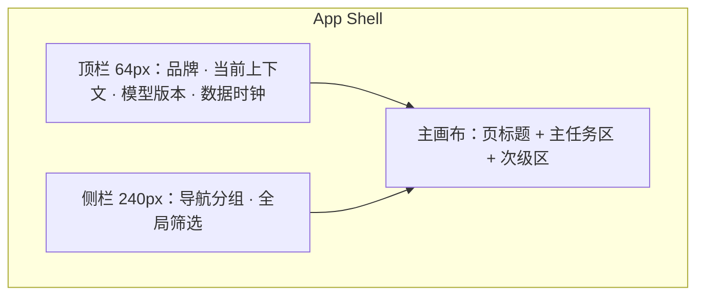

# 00 · 设计系统与 UI 规范

| 属性 | 内容 |
|------|------|
| 文档类型 | 产品总纲 · 设计系统 |
| 状态 | 已定稿（批次 A） |
| 产品形态 | **教练 / 分析师工作台**（深色数据台 + 高对比图表） |
| 术语 | [00-术语表](./00-术语表.md) |
| IA | [00-总览与信息架构](./00-总览与信息架构.md) |
| 字段/接口真相源 | [数据字典](../数据字典.md) · [接口逆向笔记](../接口逆向笔记.md) |
| 历史参考 | [项目设计.md](../项目设计.md)（**历史架构参考，非当前实现真相源**） |

---

## 1. 产品定位（设计视角）

**一句话**：电竞官方感的深色分析台——清晰网格、克制装饰、数据优先；让教练在高压赛时仍能 10 秒读懂态势。

**设计原则**

1. **一屏一主任务**：主图表占视觉重心，次级指标服务主任务，不堆看板墙。
2. **来源可见**：凡数字必有来源标签（官方 / 代理 / 估算 / 舆情）。
3. **高对比可读**：深底浅字，状态色语义稳定，避免「好看但读不清」。
4. **少装饰**：禁止通用 AI 风（紫渐变、奶油衬线、毛玻璃贴纸、表情图标堆砌）。
5. **框架无关**：线框按最终产品写；短期 Streamlit，中期 React + Plotly/ECharts 均可落地本规范。

---

## 2. 用户故事（设计验收向）

### US-D01 赛时可读

**作为** 教练，**我希望** 实时中控在暗光环境仍能快速分辨双方与涨跌，**以便** 解说席/分析席使用。

**验收**：主胜率数字 ≥ 28px 等效；双方色不靠文案唯一区分。

### US-D02 不被估算误导

**作为** 分析师，**我希望** 每个 KPI 旁有来源标签和定义 tooltip，**以便** 写报告时引用正确。

**验收**：无来源标签的指标卡视为缺陷。

### US-D03 空态可行动

**作为** 数据运营，**我希望** 无数据时看到下一步，而不是空白图。

**验收**：空态含原因 + 行动建议（文案级）。

### US-D04 质量风险可见

**作为** 分析师，**我希望** quarantine 局有醒目但不恐慌的角标。

**验收**：角标文案「质量未过门禁」，点击可见 reasons。

### US-D05 导出与屏上一致

**作为** 教练，**我希望** 导出简报的颜色语义与标签与屏上一致。

**验收**：导出模板复用同一标签文案表。

---

## 3. 信息架构 & UI（布局规范）

### 3.1 工作台骨架



| 区域 | 内容 | 禁止 |
|------|------|------|
| 顶栏 | 「KPL 数据中心」、环境（本地/演示）、模型版本、最后快照时间 | 营销 Banner、滚动公告 |
| 侧栏 | 导航 + 日期/战队/质量筛选 | 广告、无关注入口 |
| 主画布 | 页标题一行 + 可选副标题一句 + 主图表 | 首屏堆 8+ 指标卡 |

### 3.2 页面类型模板

#### A. 监控型（实时中控）

```text
┌─────────────────────────────────────────────────────────┐
│ 对局标题 · battle_id · LIVE 点                          │
├───────────────┬─────────────────────────────────────────┤
│ 胜率大数字    │  胜率时间序列（主图）                      │
│ 双方对比      │  事件标记点                               │
├───────────────┴─────────────────────────────────────────┤
│ 经济差 | 击杀差 | 推塔差 | Top 因子（次级一行，最多 4–6）   │
├─────────────────────────────────────────────────────────┤
│ 可选折叠：分路经济 / 出装 / 战报文本                       │
└─────────────────────────────────────────────────────────┘
```

#### B. 复盘型（单局）

```text
┌─────────────────────────────────────────────────────────┐
│ breadcrumbs: 赛事 / 大场 / 第 N 局                        │
├─────────────────────────────────────────────────────────┤
│ 主图：胜率 or 经济轴（Tab 切换，默认一个主图）             │
├─────────────────────────────────────────────────────────┤
│ 拐点列表 | 关键事件 | 自动战报（两栏或 Tab）                │
└─────────────────────────────────────────────────────────┘
```

#### C. 聚合型（战队/Meta）

```text
┌─────────────────────────────────────────────────────────┐
│ 筛选条（赛季/阶段/位置）                                   │
├──────────┬──────────────────────────────────────────────┤
│ 排名表   │  详情：雷达 / 趋势 / 样本 N                    │
└──────────┴──────────────────────────────────────────────┘
```

#### D. 运维型（数据健康）

```text
┌─────────────────────────────────────────────────────────┐
│ 状态灯行：监控 / 回补 / 训练                              │
├─────────────────────────────────────────────────────────┤
│ clean vs quarantine 分布 | reasons 表                    │
└─────────────────────────────────────────────────────────┘
```

### 3.3 状态设计

| 状态 | 视觉 | 文案要点 |
|------|------|----------|
| Loading | 深底骨架（闪烁微弱，非彩色 spinner 狂欢） | 「同步快照…」「计算特征…」 |
| Empty | 单色插画线框可选；主 CTA 文案 | 「暂无 live 预测，请启动监控」 |
| Error | 红不刺眼的错误条 | 原因 + ID + 重试 |
| Stale | 琥珀提示 | 「快照已超过 Xs 未更新」 |
| Quarantine | 灰紫角标（非大红恐慌） | 「质量未过门禁」 |
| Live | 青点 + LIVE | 仅真在采集时显示 |

---

## 4. 视觉规范（深蓝 + 青 accent）

### 4.1 色彩 Token

| Token | 建议值 | 用途 |
|-------|--------|------|
| `--bg-base` | `#0B1220` | 页面底 |
| `--bg-elevated` | `#121A2B` | 面板/表 |
| `--bg-sunken` | `#080D18` | 图表底 |
| `--border-subtle` | `#1E2A3F` | 分割线 |
| `--text-primary` | `#E8EEF9` | 主文字 |
| `--text-secondary` | `#93A4C3` | 次文字 |
| `--text-muted` | `#6B7C99` | 辅助 |
| `--accent` | `#2EE6D6` | 主强调、链接、LIVE、关键 CTA |
| `--accent-dim` | `#1AA89C` | hover/active |
| `--camp-blue` | `#4C8DFF` | 蓝方 / camp1 |
| `--camp-red` | `#FF5C7A` | 红方 / camp2 |
| `--positive` | `#3DDC97` | 正向、上升 |
| `--negative` | `#FF6B6B` | 负向、下降 |
| `--warning` | `#F0B429` | 过期、警告 |
| `--official` | `#5B8DEF` | 来源标签·官方 |
| `--proxy` | `#C4A265` | 来源标签·代理 |
| `--estimate` | `#2EE6D6` | 来源标签·估算（描边青） |
| `--sentiment` | `#B794F4` | 来源标签·舆情（克制紫，仅标签小面积） |

**禁止默认使用**

- 大面积紫到靛渐变背景
- 暖奶油底 + 衬线大标题套路
- 霓虹发光堆叠、玻璃拟态卡片墙
- 圆角胶囊标签集群（pill 过载）

### 4.2 字体

| 角色 | 建议 | 说明 |
|------|------|------|
| 界面 UI | `"Segoe UI", "PingFang SC", "Microsoft YaHei", sans-serif` | 中文可读优先 |
| 数字 / 表格 | `"JetBrains Mono", "Consolas", "Sarasa Mono SC", monospace` | 胜率、金差对齐 |
| 展示标题 | 与 UI 同族 semibold，**不用**装饰衬线 | 工作台感 |

字号阶梯（参考）：12 辅助 / 13 表体 / 14 正文 / 16 小标题 / 20 页标题 / 28–36 胜率英雄数字。

### 4.3 间距与网格

- 基线 8px；面板内边距 16–24px
- 卡片圆角 8px（克制）；**主图区域可不套卡片**，用分隔与背景层级即可
- 图表默认高度：主图 360–420px；次图 240–280px

### 4.4 图标与动效

- 图标：线性、2px 描边、单色；不用 Emoji 当图标系统
- 动效预算：① LIVE 呼吸点 ② 胜率数字变更轻微闪白 ③ 侧栏展开；禁止无意义粒子/烟花

---

## 5. 组件规范

### 5.1 来源标签（强制组件 `SourceTag`）

| 属性 | 规则 |
|------|------|
| 文案 | `官方` / `代理` / `估算` / `舆情` / `营地` / `百科` / `人工` |
| 位置 | KPI 标题右侧或下方；图表标题行右侧 |
| 交互 | hover 显示 1–2 句定义 + 字段/模型名 |
| 组合 | 允许 `官方+差分` 说明写在 tooltip，标签仍用 `官方` |

**文案禁则**：代理/估算标签旁不得出现「官方认证」「官方开团」等措辞。

### 5.2 KPI 卡 `MetricCard`

必含：

1. 指标名
2. 数值（等宽字体）
3. `SourceTag`
4. 定义 tooltip（公式或字段）
5. 可选：环比/对比、样本 N

可选：sparkline（仅当服务主任务）。

### 5.3 双方对阵条 `MatchupBar`

- 左 camp-blue / 右 camp-red（或按主队染色，但需图例）
- 中间比分或胜率
- 队名过长截断 + tooltip

### 5.4 数据表

- 斑马纹极弱或靠 hover
- 排序列有明确指示
- 空值显示 `—`，不显示 `NaN`
- quarantine 行左侧竖条标记

### 5.5 图表（Plotly/ECharts 通用）

| 类型 | 用途 | 规范 |
|------|------|------|
| 折线 | 胜率、经济差时间轴 | 双队色；事件用竖线/标记；图例固定 |
| 条形 | 分路金差、因子贡献 | 零轴居中对称 |
| 雷达 | 战队/选手能力 | 最多 6 维；填色透明度 ≤ 0.25 |
| 热力 | Meta、H2H | 色盲友好（青-灰-红或蓝-灰-红），附数值 |
| 校准曲线 | 算法实验室 | 对角线参考线必须有 |

图表必须：标题、单位、来源标签、样本说明（聚合图）。

### 5.6 角标 `QualityBadge`

- `CLEAN`：低调绿灰
- `QUARANTINE`：灰紫
- `LIVE`：青
- `STALE`：琥珀

---

## 6. 关键指标的视觉映射

| 数据 | 视觉 | 标签 |
|------|------|------|
| 平台胜率 | 大数字 + 面积折线 | `估算` |
| 经济/击杀/塔差 | 对称条或双折线 | `官方` |
| Top 因子 | 水平条 + 因子中文名 | `估算`（模型解释） |
| 参团率等官方选手字段 | 表内数字 | `官方` |
| 开团代理分 | 独立模块，分离排版 | `代理` |
| 情感曲线 | 与战绩图分区，不叠同一 Y 轴 | `舆情` |

---

## 7. 数据源在 UI 上的呈现

- 页脚固定一行：「战绩主源：腾讯 KPL 公开赛事接口」链接到合规矩阵摘要
- 舆情页页脚额外声明采样偏差与延迟
- 禁止展示来源为仿站或 dataReport 的模块入口

字段级细节见 [数据字典](../数据字典.md)；接口约束见 [接口逆向笔记](../接口逆向笔记.md)。

---

## 8. 算法相关 UI

| 场景 | 展示要求 |
|------|----------|
| 胜率 | 始终可展开「当前 Top 因子」 |
| 护栏触发 | 轻提示「已应用金差一致性护栏」 |
| 实验室 | 水印「实验环境，不进生产」 |
| 回测指标 | Brier/ECE 表，不用单一 AUC 大数字误导 |

---

## 9. 与竞品差异（体验）

| 竞品常见 | 本设计 |
|----------|--------|
| 资讯站头图 + 广告感 | 无营销头图，直接数据台 |
| 指标无定义 | tooltip + 来源标签强制 |
| 炫光特效 | 克制动效，电竞官方感 |
| 粉紫娱乐风 | 深蓝 + 青 accent |

---

## 10. 实现优先级

| 优先级 | 项 | 依赖 |
|--------|----|------|
| **P0** | Token 色板、SourceTag、MetricCard、空态文案 | dashboard 样式层 |
| **P0** | 实时页主图层级重构（一主图） | P02 |
| **P1** | QualityBadge、Stale 提示、双方色全站统一 | P03/P17 |
| **P2** | 设计 Token 迁到前端工程文件（若 React 化） | 中期架构 |

短期 Streamlit：用自定义 CSS / `st.markdown` 注入近似 Token；不要求像素级，但**标签与文案必须到位**。

---

## 11. 验收清单

### 视觉

- [ ] 深色工作台，主强调为青，非紫渐变主导
- [ ] 蓝/红方颜色全站一致并有图例
- [ ] 主图高度与留白符合「一屏一主任务」

### 组件

- [ ] 所有 KPI 含 SourceTag + 定义 tooltip
- [ ] LIVE / QUARANTINE / STALE 状态可区分
- [ ] 表格无 NaN、有空值占位

### 无障碍与可读

- [ ] 正文对比度足够（浅字深底）
- [ ] 不只靠颜色传递涨跌（可辅以 ▲▼ 或符号）

### 性能体感

- [ ] 图表重绘不锁死导航
- [ ] 大数字更新无整页闪白

---

## 12. 文案语气

- 用「胜率（估算）」「经济差（官方）」而非「必胜」「碾压局」
- 错误用「未能获取快照」而非「Exception」
- 历史架构文档不在 UI 露出；面向用户的帮助链到产品文档与数据字典字段说明
