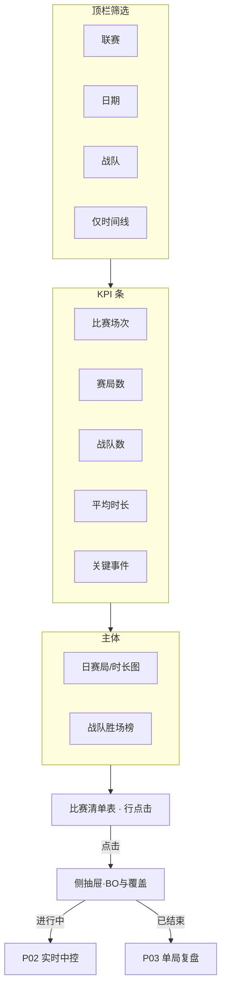

# P01 · 赛事中心与赛程

> 导航：[`00-总览与信息架构`](./00-总览与信息架构.md) · 下游：[`P02 实时中控`](./P02-实时中控台.md) / [`P03 单局复盘`](./P03-单局赛后复盘.md) / [`P08 战队画像`](./P08-战队画像与积分榜.md)  
> **Dashboard 映射**：`scripts/dashboard.py` → `page_overview`（**已有，可升级**）  
> 技术参考：[../数据字典.md](../数据字典.md) · [../接口逆向笔记.md](../接口逆向笔记.md) · [../项目设计.md](../项目设计.md)（历史架构参考，非当前实现真相源）

---

## 1. 产品定位

**一句话**：教练/分析师进入产品的「赛程总入口」——按联赛/赛段/日期浏览对阵，一眼看到数据覆盖与可分析状态，并跳转到实时或复盘。

**目标用户**

| 角色 | 核心诉求 |
|------|----------|
| 数据分析师 | 快速定位有完整时间线的局，做批量切片与覆盖审计 |
| 教练组 | 赛前扫对手近期对阵、BO 进度、是否可下钻 |
| KPI / 运营 | 看赛程密度、直播/回放就绪度、内容选题池 |

---

## 2. 用户故事（含验收标准）

| ID | 故事 | 验收标准 |
|----|------|----------|
| US-01 | 作为分析师，我要按联赛/赛段/日期筛选赛程 | 筛选后列表与官方 `matches/open` 归档一致；空结果有明确空态文案 |
| US-02 | 作为教练，我要看到今日/本周对阵与 BO 类型 | 展示开赛时间、战队、阶段、轮次、BO；状态文案与 `status_text` 一致 |
| US-03 | 作为分析师，我要知道哪些场次有 raw / 预测时间线 | 行级标签：`有赛程` / `有 raw` / `有预测 CSV` / `可复盘`；与磁盘路径一致 |
| US-04 | 作为运营，我要点击一场比赛进入下钻或实时 | 未开赛→赛前摘要；进行中→P02；已结束→P03；无数据→引导采集/运维 |
| US-05 | 作为分析师，我要看赛程覆盖 KPI | KPI：比赛场次、赛局数、战队数、平均时长、关键事件数；与现 Dashboard「赛事总览」口径一致并可下钻 |
| US-06 | 作为教练，我要按战队过滤其相关赛程 | 选中战队后只保留包含该队的 match；支持多选 |
| US-07 | 作为分析师，我要刷新赛程归档而不丢本地分析标记 | `refresh_schedule_archive` 合并写入；覆盖标签基于本地路径重算，不依赖手工维护 |

---

## 3. 信息架构与 UI

### 3.1 页面区块（主次层级）

1. **顶栏（主）**：联赛选择 + 日期范围 + 战队多选 +「仅有时间线」开关  
2. **KPI 条（主）**：场次 / 赛局 / 战队 / 平均时长 / 事件数  
3. **左主图**：日维度赛局数 + 平均时长双轴  
4. **右辅图**：战队胜场排行（窗口内）  
5. **主表**：比赛清单（可排序、可点击）  
6. **侧抽屉（待建，辅）**：单场摘要（BO 比分、battle 列表、覆盖徽章）

### 3.2 Mermaid 线框

### 3.3 空态 / 加载 / 错误态

| 状态 | 表现 |
|------|------|
| 加载 | KPI 骨架屏；表 skeleton；图表占位 shimmer |
| 空数据 | 「分析数据集为空，请先运行 `build_history_dataset`」+ 运维入口 P17 |
| 筛选无结果 | 「当前筛选无比赛」+ 一键清空筛选 |
| 错误 | API 刷新失败保留本地归档，Toast 标明「展示缓存 · 更新时间」 |
| 部分覆盖 | 行内琥珀色徽章「缺时间线」；hover 说明缺 raw 或缺预测 |

---

## 4. 关键指标与统计方法

| 指标 | 标签 | 定义 | 窗口 | 公式 / 方法 | 置信/显著性 |
|------|------|------|------|-------------|-------------|
| 比赛场次 | **官方** | 唯一 `match_id` 数 | 当前筛选 | `nunique(match_id)` | — |
| 赛局数 | **官方** | `battle_id` 行数 | 同上 | `count(battle_id)` | — |
| 平均时长 | **官方** | 单局分钟 | 同上 | `mean(duration_min)`；`game_duration`÷1000÷60 | 附 n |
| 时间线覆盖率 | **代理** | 可复盘局占比 | 同上 | `mean(has_timeline)` | Wilson 95% CI（待建） |
| 战队胜场 | **官方** | 窗口内胜局 | 同上 | `sum(win)` | 胜率附 Beta(1,1) 后验区间（待建） |
| 赛程密度 | **估算** | 日均赛局 | 日 | `games_per_day` | 与同赛段历史均值 z-score（待建） |
| 关键事件数 | **代理** | `detect_events` 产出事件条数 | 筛选窗口 | `count(events)` | 依赖 raw 采样密度 |

**教练口径**：胜率类指标必须同时展示 **n**；n&lt;10 标「小样本，勿过度解读」。

---

## 5. 数据源

| 层级 | 来源 | 用途 | 状态 |
|------|------|------|------|
| 主源 | 官方 `leagues/open` → `matches/open` | 联赛、赛程、状态、BO | **已有** `ScheduleCenter` |
| 主源 | `match/battles/open` | battle_id 列表 | **已有** |
| 本地 | `schedule_archive.csv`、`build_history_dataset` 产出表 | Dashboard 列表与 KPI | **已有** |
| 本地 | `data/raw/{battle_id}/`、`predictions/*.csv` | 覆盖徽章 | **已有**（表字段部分暴露） |
| 辅源 | 营地赛程页（对照） | 校验开赛时间 | **待建** |
| 缺口 | 官方积分榜实时联动 | 赛程旁积分上下文 | 见 P08 |

**字段映射**

| UI 字段 | 代码 / 字段 | 字典章节 |
|---------|-------------|----------|
| 开赛时间 | `ScheduleMatch.start_time` / `parse_start_time` | — |
| 战队 | `team1`/`team2` ← `camp*_team_name` | [数据字典 · 战队级](../数据字典.md) |
| 状态 | `status` → `status_text` | [接口逆向 · 赛程](../接口逆向笔记.md) |
| BO | `bo_type` / `battle_seq` | [数据字典 · 比赛级](../数据字典.md) |
| 是否有 raw | `has_raw`、目录探测 | `parse_snapshot` 输入目录 |
| battle 列表 | `extract_battle_ids` | [接口逆向 · battle_id](../接口逆向笔记.md) |

**交叉引用**

- 字段语义权威表：[../数据字典.md](../数据字典.md)  
- 接口层级、Headers、采集频率：[../接口逆向笔记.md](../接口逆向笔记.md)  
- 历史架构（非真源）：[../项目设计.md](../项目设计.md)

---

## 6. 算法与 AI

| 层级 | 内容 | 状态 |
|------|------|------|
| 基线 | 赛程抓取、归档归一化 `normalize_schedule_archive_frame` | **已有** `kpl_official_core.ScheduleCenter` |
| 规则 | 覆盖标签：raw 目录存在 ∧ 预测 CSV 存在 →「可复盘」 | **待建**（UI） |
| 进阶 | 赛前「关注度」= 历史对阵热度 × 积分差 × 舆情热度（P15） | **待建** |
| 进阶 | 赛程异常检测（开赛时间突变、battle_id 缺失） | **待建** |

本页不直接跑 V11 胜率模型；仅展示「本场是否可预测/可复盘」。

---

## 7. 与竞品差异

| 维度 | 营地 / 官方站 / 第三方数据站 | 本产品更深 |
|------|------------------------------|------------|
| 赛程浏览 | 日期、对阵、比分 | **数据覆盖审计**（raw/时间线/事件）与分析就绪态 |
| 跳转直播 | 跳转视频或文字直播 | 跳转到 **可解释实时胜率中控（P02）** |
| 赛段筛选 | 有 | 与 **历史 holdout 质量、clean/quarantine 分层** 联动提示 |
| 统计深度 | 多为展示 | 覆盖率 Wilson CI、小样本标注 |

---

## 8. 实现优先级

| 优先级 | 能力 | 依赖 |
|--------|------|------|
| **P0** | 赛程列表 + 筛选 + KPI + 日图/胜场榜 | `dashboard.page_overview`；`ScheduleCenter` |
| **P0** | 行点击 → 比赛下钻 | `page_match_drilldown` |
| **P1** | 覆盖徽章（raw / prediction / timeline） | 本地路径探测；`has_timeline` |
| **P1** | 侧抽屉 BO 进度与 battle 列表 | `extract_battle_ids` |
| **P2** | 覆盖率 CI、赛程密度 z-score、关注度排序 | 新建统计模块；可选 P15 |
| **P2** | 多联赛切换 UX 升级 | `fetch_available_leagues` |

**已有 vs 待建**

| 已有（可升级） | 待建 |
|----------------|------|
| Dashboard「赛事总览」五 KPI、日赛局图、胜场榜、比赛清单 | 侧抽屉、覆盖徽章体系、Wilson CI、关注度、空态引导运维 |
| `ScheduleCenter` / `refresh_schedule_archive` | 赛程异常检测告警 UI |
| 侧栏日期/战队/时间线筛选 | 联赛切换一等公民 UI |

**代码依赖**：`scripts/dashboard.py`（`page_overview`、`apply_filters`）；`scripts/kpl_official_core.py`（`ScheduleCenter`、`refresh_schedule_archive`）。

---

## 9. 验收清单

**数据正确性**

- [ ] 列表 `match_id`、对阵、开赛时间与官方归档抽样一致（≥20 场）  
- [ ] `has_raw` / `has_timeline` 与磁盘事实一致  
- [ ] 筛选组合（日期∩战队∩时间线）结果可复算  

**性能**

- [ ] 冷启动加载历史表 &lt; 3s（本地 SSD、单赛季规模）  
- [ ] 切换筛选交互 &lt; 200ms（内存过滤）  

**视觉**

- [ ] 深色数据台；KPI 带来源标签「官方赛程 / 本地归档」  
- [ ] 一屏主任务清晰：找比赛 → 判断可分析 → 进入  

---

## 修订记录

| 日期 | 说明 |
|------|------|
| 2026-07-22 | 初稿，对齐 `dashboard.page_overview` + `ScheduleCenter` |
