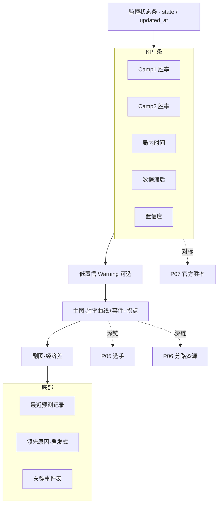

# P02 · 实时中控台

> 上游：[`P01 赛事中心`](./P01-赛事中心与赛程.md) · 并列：[`P05 选手面板`](./P05-选手实时面板-出装铭文.md) / [`P06 经济分路`](./P06-经济分路与资源时间轴.md) / [`P07 胜率对标`](./P07-实时胜率与官方胜率对标.md)  
> 技术参考：[../数据字典.md](../数据字典.md) · [../接口逆向笔记.md](../接口逆向笔记.md) · [../项目设计.md](../项目设计.md)（历史架构参考，非当前实现真相源）

---

## 1. 产品定位

**一句话**：赛中「解说 / 教练指挥台」——5 秒级刷新展示 V11 实时胜率、置信度、数据滞后、关键事件与启发式领先原因。

**目标用户**

| 角色 | 核心诉求 |
|------|----------|
| 教练组 | 赛中节奏判断：谁在赢、拐点是否可信、是否该叫暂停策略复盘 |
| 数据分析师 | 监控采集健康（lag、时钟跳动）、模型输出是否触发金差护栏 |
| KPI / 运营 | 直播间数据口播素材：胜率、事件、一句话战报 |

---

## 2. 用户故事（含验收标准）

| ID | 故事 | 验收标准 |
|----|------|----------|
| US-01 | 作为运营，我要在比赛进行中看到双方实时胜率 | 读取 `monitor_status.json` + `predictions/{battle_id}.csv`；5s 自动刷新 |
| US-02 | 作为教练，我要看到局内时间与数据滞后 | 展示 `minute`、`snapshot_time_sec`、`lag_sec`；时钟跳动时显式提示 |
| US-03 | 作为分析师，我要知道当前是否低置信 | `prediction_confidence`；低置信时 Warning，禁止把绝对值当口播铁律 |
| US-04 | 作为教练，我要看胜率曲线上的关键事件与拐点 | `detect_events` + `detect_turning_points` 叠图；可点选事件 |
| US-05 | 作为运营，我要一句「进行中战报」 | `generate_battle_report` 输出中文摘要 |
| US-06 | 作为分析师，我要看经济差副图与最近预测表 | `gold_diff` 曲线 + 最近 12 条记录 |
| US-07 | 作为教练，我要理解「为什么领先」 | `FeatureBuilder.explain` / `top_factor`；文案标明「启发式 / 非 SHAP」 |
| US-08 | 作为分析师，监控未启动时要有明确引导 | 状态机：`waiting_*` / `not_started` 展示 message，引导 `official_match_monitor.py` |

---

## 3. 信息架构 & UI

### 3.1 页面区块

1. **状态条**：监控 state、更新时间、自动刷新提示  
2. **KPI 条（主）**：Camp1 胜率 / Camp2 胜率 / 局内时间 / 数据滞后 / 置信度  
3. **主图**：双队胜率曲线 + 事件菱形 + 拐点三角  
4. **副图**：经济差走势  
5. **左表**：最近预测记录  
6. **右栏**：领先原因 + 关键事件表  
7. **扩展区（待建）**：跳转 P05/P06 切片；官方胜率对照条（P07）

### 3.2 Mermaid 线框

### 3.3 状态设计

| 状态 | 表现 |
|------|------|
| `waiting_schedule` 等 | Info：等待赛程/开赛，展示 message |
| 进行中正常 | KPI + 曲线实时更新 |
| 低置信 | 琥珀色 Warning + 置信 KPI 徽章 |
| 无 battle_id / 无 CSV | Warning：启动 monitor |
| 时钟跳动 | 滞后 KPI 显示「时钟跳动」而非秒数 |
| 加载 | 图表 skeleton；保留上一帧 3s（待建防闪烁） |

---

## 4. 关键指标与统计方法

| 指标 | 定义 | 窗口 | 公式 / 方法 | 置信/显著性 |
|------|------|------|-------------|-------------|
| 实时胜率 \(p\) | Camp1 获胜概率 | 当前快照 | V11 `predict_probability`（early/midlate 混合 + 校准 + 金差护栏） | 见置信标签 |
| 置信度 | 是否可口播 | 当前 | `prediction_confidence(minute, p)`：早期或缺信息 / \(p\approx0.5\) → low | 低置信禁止绝对化表述 |
| 数据滞后 | 快照相对开局锚点 | 当前 | `compute_lag_sec` + `sanitize_lag_sec` | 异常滞后标红（阈值待定） |
| 拐点 | 胜率大幅摆动 | 全场累计 | \(\|\Delta p\|\ge 0.08\) 或邻域有事件 | 待建：Bootstrap 摆动显著性 |
| 事件权重 | 资源/推塔重要性 | 差分 | `detect_events` 固定 weight（风暴龙王 8 等） | 权重可配置化（P17） |
| 经济差 | Camp1−Camp2 gold | 时间序列 | 快照差分 | 与胜率联动解释 |

**教练口径**：口播模板必须带「模型估计」与「置信」；不得把启发式 `top_factor` 说成「模型 SHAP 贡献」。

---

## 5. 数据源

| 层级 | 来源 | 用途 | 状态 |
|------|------|------|------|
| 主源 | 官方 `battle/open` 轮询 | 实时快照 | **已有** monitor |
| 主源 | `parse_snapshot` | 规范化特征输入 | **已有** |
| 本地 | `realtime/monitor_status.json` | 状态机与最新 KPI | **已有** |
| 本地 | `predictions/{battle_id}.csv` | 时间线 | **已有** |
| 模型 | `output/models/v9_official_platform.joblib`（V11） | 胜率 | **已有** |
| 辅源 | 官方页面「胜率条」（若存在） | 对标 | 见 P07 **待建** |
| 缺口 | 选手出装/分路细面板 | 中控深链 | P05/P06 |

---

## 6. 算法与 AI

| 层级 | 内容 | 状态 |
|------|------|------|
| 基线 | V11：Early RF + Midlate Voting；阶段混合；isotonic/phase 校准；金差一致性护栏 | **已有** |
| 解释 | `FeatureBuilder.explain` 叙事因子 | **已有**（非因果归因） |
| 事件 | 快照差分检测一血/塔/龙 | **已有** |
| 进阶 | 分位数预测区间（P10–P90）替代单点胜率 | **待建**（P20） |
| 进阶 | 事件冲击估计 \(\Delta p\) 的双重差分 | **待建**（P12） |
| 进阶 | 自适应轮询 `adaptive_poll_interval` 可视化 | **部分已有** / UI **待建** |

---

## 7. 与竞品差异

| 维度 | 对齐 | 本产品更深 |
|------|------|------------|
| 实时比分/经济 | 营地/直播数据屏 | **校准后的概率** + Brier/ECE 可追溯到训练 holdout |
| 事件打点 | 部分数据商有 | 事件与 **胜率拐点对齐** + 自动战报 |
| 延迟展示 | 少见 | **lag / 时钟跳动** 对教练透明 |
| 解释 | 多为口号式 | 启发式因子 + 明确「非 SHAP」防误读；后续上校准区间 |

---

## 8. 实现优先级

| 优先级 | 能力 | 依赖现有代码 |
|--------|------|----------------|
| **P0** | 5s 刷新中控、KPI、胜率曲线、经济差、事件、战报 | `dashboard.render_live_control_panel` / `page_live_control` |
| **P0** | 置信与低置信 Warning | `prediction_confidence` |
| **P1** | 深链 P05/P06；官方对标条嵌入 | 新路由；P07 接口 |
| **P1** | 护栏触发标记（`_gold_guard_applied`）UI | `predict_probability` feats |
| **P2** | 预测区间、防闪烁、口播一键复制 | P20；前端态 |

### 已有 vs 待建

| 已有 | 待建 |
|------|------|
| 实时中控全页（胜率/时间/滞后/置信/曲线/事件/战报/经济差/解释） | 官方胜率并排、出装分路内嵌、护栏标记、预测区间、口播复制 |
| `official_match_monitor` + V11 推理 | 中控多画面布局（导播模式） |

---

## 9. 验收清单

**数据正确性**

- [ ] 监控 state 与实际进程一致  
- [ ] 曲线末点胜率 = monitor 或 CSV 最新行（允许 1 tick 差）  
- [ ] 事件分钟与快照差分一致；拐点阈值可复现  

**性能**

- [ ] 片段刷新不阻塞整站；目标 cycle ≤ 5s  
- [ ] 单次读 status + CSV tail &lt; 100ms  

**视觉**

- [ ] 低置信不可被忽略（Warning）  
- [ ] 解释区永久注明「启发式 / 非 SHAP」  
- [ ] 主图一屏可读，副图不抢戏  

---

## 修订记录

| 日期 | 说明 |
|------|------|
| 2026-07-22 | 批次 B 初稿，对齐 `render_live_control_panel` + V11 |
