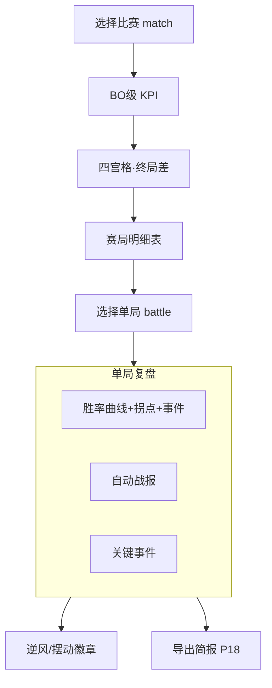

# P03 · 单局赛后复盘

> 上游：[`P01`](./P01-赛事中心与赛程.md) · 关联：[`P07`](./P07-实时胜率与官方胜率对标.md) / [`P12 胜负归因`](./P12-赛段切片与胜负归因.md) / [`P18 教练简报`](./P18-导出报告与教练简报.md)  
> 技术参考：[../数据字典.md](../数据字典.md) · [../接口逆向笔记.md](../接口逆向笔记.md) · [../项目设计.md](../项目设计.md)（历史架构参考，非当前实现真相源）

---

## 1. 产品定位

**一句话**：以单局为粒度的赛后工作台——终局差面板、V11 胜率复盘曲线、拐点、关键事件与自动战报，支撑教练复盘会。

**目标用户**

| 角色 | 核心诉求 |
|------|----------|
| 教练组 | 快速定位「哪一分钟翻盘」、资源交换是否亏、如何写复盘纪要 |
| 数据分析师 | 校验时间线完整性、重跑预测、对比事件与 \(\Delta p\) |
| KPI / 运营 | 产出可读战报与高光时间点，供二创/短视频 |

---

## 2. 用户故事（含验收标准）

| ID | 故事 | 验收标准 |
|----|------|----------|
| US-01 | 作为教练，我要先看一场 BO 的各局终局差 | 四宫格：经济差/击杀差/推塔差/资源差；按 `game_no` |
| US-02 | 作为教练，我要选择单局看胜率复盘 | 选 `battle_id`；曲线 + 拐点表 + 事件叠加 |
| US-03 | 作为分析师，无保存的预测 CSV 时能重跑模型 | `build_replay_timeline`：优先 CSV，否则 raw + `load_model` |
| US-04 | 作为运营，我要自动中文战报 | `generate_battle_report`；含开局倾向、经济极值、拐点、胜者 |
| US-05 | 作为教练，我要看逆风翻盘/摆动标签 | `classify_battle_swing` → comeback / swing 徽章 |
| US-06 | 作为分析师，我要看该局快照数与时间线完备率 | `snapshot_count` / `has_timeline`；缺失时 Info |
| US-07 | 作为教练，我要导出本局简报 | 跳转/调用 P18；至少 Markdown（待建） |
| US-08 | 作为分析师，我要对比模型终局倾向与真实胜者 | 终局 \(p\) 与 `win_camp` 一致性检查；记校准样本 |

---

## 3. 信息架构 & UI

### 3.1 页面区块

1. **比赛选择器**：日期 · match · 对阵  
2. **BO 级 KPI**：赛局数 / 平均时长 / 总击杀 / 时间线完备率  
3. **四宫格终局差**（主概览）  
4. **赛局明细表**  
5. **单局复盘区**：胜率曲线（主） | 自动战报 + 事件（辅）  
6. **拐点表**  
7. **扩展（待建）**：分路经济迷你图（链 P06）、BP 回顾（链 P04）、归因面板（链 P12）

### 3.2 Mermaid 线框

### 3.3 状态设计

| 状态 | 表现 |
|------|------|
| 无赛局 | Info：没有可分析赛局 |
| 无时间线 | Info：缺少 raw 或模型；引导采集/训练 |
| 有 CSV | 优先展示落盘预测（与线上一致） |
| 仅 raw | 现场重推 V11；标注「即时回放 · 非当时落盘」 |
| 错误 | 单局失败不拖垮 BO 概览 |

---

## 4. 关键指标与统计方法

| 指标 | 定义 | 窗口 | 公式 / 方法 | 置信/显著性 |
|------|------|------|-------------|-------------|
| 终局经济差 | Camp1−Camp2 | 终局快照 | `gold_diff` | — |
| 资源差 | 目标加权和 | 终局 | 与特征 `objective_*` 同源口径需文档化 | 权重表 tooltip |
| 胜率曲线 | \(p_t\) | 每分钟 bin | V11 回放 | 低置信切片计数写入战报 |
| 拐点 | \(\|\Delta p\|\ge 0.08\) | 相邻 bin | `detect_turning_points` | 待建：多重检验校正 |
| 逆风翻盘 | 前期金差方向 ≠ 胜者 | ≤8′ vs 终局 | `classify_battle_swing.comeback` | 阈值 80 金可配置 |
| 摆动 | 前中期金差变号 | early vs mid | `swing` | 同上 |
| 时间线完备率 | 有复盘能力局占比 | BO | `mean(has_timeline)` | Wilson CI（待建） |

**教练口径**：复盘会默认展示「最大 \(\Delta p\) 拐点 Top3 + 对齐事件」；避免罗列全部小波动。

---

## 5. 数据源

| 层级 | 来源 | 用途 | 状态 |
|------|------|------|------|
| 主源 | 历史表 battles/teams/events | BO 概览 | **已有** |
| 主源 | `data/raw/{battle_id}` | 重放 | **已有** `load_battle_jsons` |
| 主源 | `predictions/*.csv` | 落盘曲线 | **已有** |
| 算法 | V11 + `detect_events` / `detect_turning_points` / `generate_battle_report` / `classify_battle_swing` | 复盘核心 | **已有**（swing 徽章 UI 待接） |
| 辅源 | `bp_list` | BP 回顾入口 | 字段 **已有**，页 **待建**→P04 |
| 缺口 | 官方文字战报 | 对照叙事 | **待建** |

---

## 6. 算法与 AI

| 层级 | 内容 | 状态 |
|------|------|------|
| 基线 | 胜率回放 + 事件差分 + 拐点 + 战报模板 | **已有** |
| 分类 | comeback/swing | **已有**后端 / **待建**UI |
| 进阶 | 拐点因果归因（资源交换 → \(\Delta p\)） | **待建** P12 |
| 进阶 | 战报 LLM 润色（必须绑定数值事实层） | **待建** P18；禁幻觉 |
| 进阶 | 与官方胜率曲线逐分钟 MAE | **待建** P07 |

---

## 7. 与竞品差异

| 维度 | 对齐 | 本产品更深 |
|------|------|------------|
| 赛后数据页 | KDA、经济、伤害 | **概率复盘曲线** + 拐点事件对齐 |
| 文字战报 | 媒体人工 | **可复现自动战报** + 导出 |
| 翻盘标签 | 少 | 明确统计定义的 comeback/swing |
| 归因 | 观感 | 路径到 P12 统计归因与置信区间 |

---

## 8. 实现优先级

| 优先级 | 能力 | 依赖现有代码 |
|--------|------|----------------|
| **P0** | BO 四宫格 + 明细 + 胜率复盘 + 战报 + 事件 | `page_match_drilldown` |
| **P1** | swing/comeback 徽章；即时回放标注 | `classify_battle_swing` |
| **P1** | 链 P04/P06/P12/P18 | 路由 |
| **P2** | 官方曲线对标、LLM 润色战报、CI | P07/P18 |

### 已有 vs 待建

| 已有 | 待建 |
|------|------|
| Dashboard「比赛下钻」整页复盘能力 | swing UI、导出、BP/分路内嵌、官方对标、归因深化 |
| 预测 CSV 优先 / raw 重跑 | 「即时回放」水印与差异提示 |

---

## 9. 验收清单

**数据正确性**

- [ ] 终局差与终局快照一致  
- [ ] CSV 回放与 monitor 历史抽样一致  
- [ ] 战报胜者 = `winner`/`win_camp`  
- [ ] comeback 标签与金差定义单测通过  

**性能**

- [ ] 单局 ≤40 快照重推 &lt; 2s  
- [ ] 切换 battle 不重新加载整赛季表  

**视觉**

- [ ] 曲线与拐点、事件同色板规范  
- [ ] 无时间线空态可行动  

---

## 10. 交叉引用与扩展 Tab

本页（比赛下钻）深化为「单局工作台」，建议 Tab：

| Tab | PRD | 状态 |
|-----|-----|------|
| 复盘主页 | P03（本页） | 已有 · 升级 |
| BP | [P04](./P04-BP看板与阵容分析.md) | 待建 |
| 选手/出装 | [P05](./P05-选手实时面板-出装铭文.md) | 待建 |
| 分路资源 | [P06](./P06-经济分路与资源时间轴.md) | 待建 |
| 胜率对标 | [P07](./P07-实时胜率与官方胜率对标.md) | 片段已有 |
| 赛段归因 | [P12](./P12-赛段切片与胜负归因.md) | 部分已有 |
| 舆情弹幕 | [P15](./P15-赛事舆情与弹幕分析.md)（`data/sentiment/{match_id}/`） | 待建 |
| 行为指标 | [P19](./P19-行为指标-入侵开团支援.md)（非 CV） | 待建 |
| 导出 | [P18](./P18-导出报告与教练简报.md) | 待建 |

字段真源：[../数据字典.md](../数据字典.md) · 接口：[../接口逆向笔记.md](../接口逆向笔记.md)

---

## 修订记录

| 日期 | 说明 |
|------|------|
| 2026-07-22 | 批次 B 初稿，对齐 `page_match_drilldown` 复盘链路 |
| 2026-07-22 | 补强：下钻 Tab 矩阵与交叉引用 |
