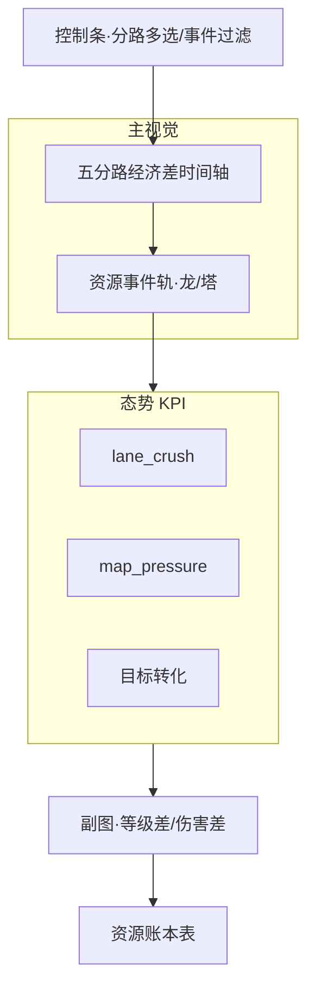

# P06 · 经济分路与资源时间轴

> 并列：[`P02`](./P02-实时中控台.md) / [`P05`](./P05-选手实时面板-出装铭文.md) · 复盘：[`P03`](./P03-单局赛后复盘.md) · 行为：[`P19`](./P19-行为指标-入侵开团支援.md)  
> 技术参考：[../数据字典.md](../数据字典.md) · [../接口逆向笔记.md](../接口逆向笔记.md) · [../项目设计.md](../项目设计.md)（历史架构参考，非当前实现真相源）

---

## 1. 产品定位

**一句话**：把「总经济差」拆成五分路经济/等级/伤害时间轴，并与暴君、主宰、风暴龙王、推塔等资源事件对齐，回答教练「优势来自哪条路、资源有没有兑现」。

**目标用户**

| 角色 | 核心诉求 |
|------|----------|
| 教练组 | 分路崩盘时刻、野区节奏、资源兑换塔/龙是否合理 |
| 数据分析师 | 分路碾压计数、滚动金差、目标转化率等特征校验与研究 |
| KPI / 运营 | 资源时间轴动画、分路高光 |

---

## 2. 用户故事（含验收标准）

| ID | 故事 | 验收标准 |
|----|------|----------|
| US-01 | 作为教练，我要看五分路经济差曲线 | 五条 `gold_diff_{pos}` 或分面小图；与总经济差可叠 |
| US-02 | 作为教练，我要在轴上看到龙/塔事件 | `detect_events` 竖线标记；点击显示归属队伍 |
| US-03 | 作为分析师，我要看 4 分钟滚动金差 | `gold_diff_roll4` / `roll10` 同源计算可复现 |
| US-04 | 作为教练，我要看「分路碾压」提示 | `lane_crush_count`（\|分路金差\|≥800）时间序列 |
| US-05 | 作为分析师，我要看目标→推塔转化 | `obj_tower_convert` 窗口指标；定义进 tooltip |
| US-06 | 作为教练，我要对比等级差 | `level_diff_{pos}` 热力或曲线 |
| US-07 | 作为运营，我要一键生成「10 分钟资源账本」 | 表：时间、事件、当时总金差、分路金差快照 |
| US-08 | 作为分析师，我要区分先知/暗影/风暴与遗留 big_dragon | UI 不用混用字段；遵循数据字典警告 |

---

## 3. 信息架构 & UI

### 3.1 页面区块

1. **控制条**：显示分路多选、是否叠加总经济、事件过滤  
2. **主图**：分路经济差时间轴（主任务）  
3. **事件轨**：资源/推塔泳道  
4. **副图**：等级差 or 伤害差  
5. **KPI**：当前 lane_crush、map_pressure、resource_control_rate  
6. **账本表**  

### 3.2 Mermaid 线框

### 3.3 状态设计

| 状态 | 表现 |
|------|------|
| 快照过稀 | Warning：分钟空洞；虚线插值并标「插值」 |
| 无事件 | 事件轨空态说明「差分未识别」 |
| 字段语义风险 | big_dragon 默认隐藏；高级开关才显示并警告双重计数 |

---

## 4. 关键指标与统计方法

| 指标 | 定义 | 窗口 | 公式 / 方法 | 置信/显著性 |
|------|------|------|-------------|-------------|
| 分路经济差 | 同分路双方 gold 差 | 每快照 | `c1_gold_pos - c2_gold_pos` | — |
| 分路碾压数 | \|金差\|≥800 的分路数 | 当前 | `lane_crush_count` | 阈值可配置 |
| 滚动金差 | 近 4/10 分钟队伍金差变化 | roll | `gold_diff_roll4/10` | — |
| 金差速度/加速度 | 节奏 | 相邻快照 | `gold_diff_velocity` / `accel` | — |
| 目标价值分 | 龙塔加权 | 累计 | `objective_value_score`（暗暴君×4、风暴×6、塔×3.5…） | 权重表公开 |
| 资源控制率 | 目标分 / 分钟 | 当前 | `resource_control_rate` | — |
| 目标→塔转化 | 取龙后窗口推塔增量 | lookback 3′ | `_obj_tower_convert` | 待建：相对基线的 CI |
| 地图压力 | 综合 | 当前 | `map_pressure_index` | 启发式标签 |

**教练口径**：资源轴事件来自 **快照差分**，不是视频 CV；与 P19「官方口径 / 代理 / 实验」分层一致，本页默认 L2 代理展示。

---

## 5. 数据源

| 层级 | 来源 | 用途 | 状态 |
|------|------|------|------|
| 主源 | `parse_snapshot` 分路 gold/hurt/kill/level | 曲线 | **已有** |
| 主源 | camp 级龙/塔计数 | 事件 | **已有** |
| 特征 | `FeatureBuilder` 滚动/碾压/转化 | KPI | **已有**（模型内） |
| Dashboard | 仅总 `gold_diff` 曲线 | UI | **部分已有**；分路 **待建** |
| 缺口 | 野区 buff 独立字段 | 入侵代理 | 见 P19；可能需第三方 |

---

## 6. 算法与 AI

| 层级 | 内容 | 状态 |
|------|------|------|
| 基线 | 分路序列可视化 + 事件对齐 | **待建** UI |
| 特征复用 | 与 V11 同源 FeatureBuilder 指标上屏 | **待建** 暴露 |
| 进阶 | 资源兑现评分：取龙后 2′ 内金差/塔变化回归 | **待建** |
| 进阶 | 结构断点检测（分路金差变号） | **待建**；可对齐拐点 |
| 注意 | 不用个人视角 CV | 计划硬约束 |

---

## 7. 与竞品差异

| 维度 | 对齐 | 本产品更深 |
|------|------|------------|
| 经济曲线 | 普遍有总经济 | **五分路拆解 + 碾压计数** |
| 资源时间轴 | 部分数据商 | 与 **V11 特征定义同源**，可解释进胜率 |
| 转化 | 少 | 目标→塔转化与置信区间路径 |
| 语义 | 常混「大龙」 | **先知/暗影/风暴分离**，遗留字段降权 |

---

## 8. 实现优先级

| 优先级 | 能力 | 依赖现有代码 |
|--------|------|----------------|
| **P0** | 五分路经济差图 + 总经济叠加 | `parse_snapshot` 分路字段；快照序列 |
| **P0** | 事件轨对齐 `detect_events` | **已有**事件函数 |
| **P1** | lane_crush / roll4 / map_pressure KPI 上屏 | `FeatureBuilder` |
| **P1** | 资源账本导出 | 表生成 |
| **P2** | 转化率 CI、结构断点、P19 入侵代理叠加 | P19/P20 |

### 已有 vs 待建

| 已有 | 待建 |
|------|------|
| 分路字段进模型；总经济差在中控/复盘展示；事件检测 | 分路时间轴页、KPI 暴露、账本、转化分析 UI |
| 目标加权与滚动特征代码 | 教练可读定义 tooltip 与配置化权重 |

---

## 9. 验收清单

**数据正确性**

- [ ] 分路金差与 players 聚合一致  
- [ ] 事件时间与差分一致；风暴/暗暴君不与 big_dragon 双计展示  
- [ ] FeatureBuilder 指标与训练特征单测对齐  

**性能**

- [ ] 400 点序列绘图流畅；可降采样显示  

**视觉**

- [ ] 一屏主任务=分路经济；事件轨不遮主曲线  
- [ ] 插值/启发式指标带来源标签  

---

## 10. 交叉引用与口径

| 主题 | 文档 |
|------|------|
| 资源字段去重（`kill_big_dragon_num` 警告） | [../数据字典.md](../数据字典.md) |
| 快照轮询与 `battle_id` | [../接口逆向笔记.md](../接口逆向笔记.md) |
| 入侵/开团代理叠层 | [P19](./P19-行为指标-入侵开团支援.md)（**非视频 CV**） |
| 赛后复盘入口 | [P03](./P03-单局赛后复盘.md) |
| 来源标签 | [00-术语表](./00-术语表.md) |

**与 P19 边界**：本页默认展示 L2「资源/分路代理」时间轴；开团/支援专名指标归 P19，禁止在本页把差分事件标成「官方开团」。

---

## 修订记录

| 日期 | 说明 |
|------|------|
| 2026-07-22 | 批次 B 初稿；对齐 FeatureBuilder 分路与目标特征 |
| 2026-07-22 | 补强：交叉引用与 P19 边界 |
