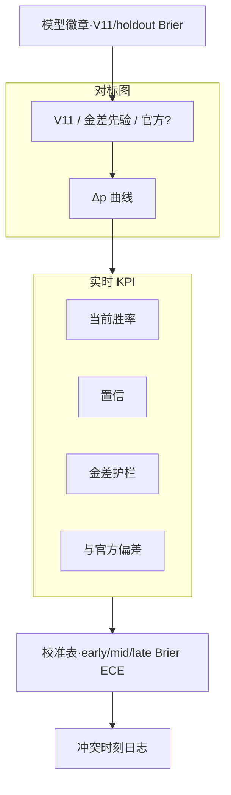

# P07 · 实时胜率与官方胜率对标

> 核心依赖：V11 · [`P02 中控`](./P02-实时中控台.md) · [`P03 复盘`](./P03-单局赛后复盘.md) · 实验台：[`P20`](./P20-进阶算法实验室.md)  
> 技术参考：[../数据字典.md](../数据字典.md) · [../接口逆向笔记.md](../接口逆向笔记.md) · [../项目设计.md](../项目设计.md)（历史架构参考，非当前实现真相源）

---

## 1. 产品定位

**一句话**：把本系统 V11 胜率与「官方/平台展示胜率」（若可得）及内部基线（金差先验）放在同一时间轴对标，并用 Brier/ECE/区间评价可信度，服务分析师模型治理与教练口播纪律。

**目标用户**

| 角色 | 核心诉求 |
|------|----------|
| 数据分析师 | 校准监控、阶段误差、与官方曲线偏差、回归门禁 |
| 教练组 | 知道何时信模型、何时两套胜率冲突该怎么表述 |
| KPI / 运营 | 权威感：展示「可验证的概率」而非黑盒百分比 |

---

## 2. 用户故事（含验收标准）

| ID | 故事 | 验收标准 |
|----|------|----------|
| US-01 | 作为分析师，我要同屏看 V11 vs 金差先验胜率 | \(p_{v11}\) 与 `gold_prior_prob` 双曲线 |
| US-02 | 作为分析师，若存在官方胜率字段/页，我要对齐绘制 | 有源则第三曲线；无源则明确「官方曲线不可用」 |
| US-03 | 作为教练，我要看当前置信与是否触发金差护栏 | `prediction_confidence` + `_gold_guard_applied` |
| US-04 | 作为分析师，我要看 holdout 阶段 Brier/ECE | 展示 train_status / README V11 指标；可点进 P20 |
| US-05 | 作为分析师，我要逐局计算 vs 官方的 MAE/\|Δp\| | 单局报告；赛季汇总表 |
| US-06 | 作为教练，冲突时（\|p−p_official\|≥0.15）要告警 | Banner：建议口播「以局面为准，概率仅供参考」 |
| US-07 | 作为分析师，我要导出对标 CSV | minute, p_v11, p_prior, p_official?, low_conf, guard |
| US-08 | 作为分析师，我要按 early/mid/late 切片误差 | `evaluate_phase_metrics` / `phase_of_minute` |

---

## 3. 信息架构 & UI

### 3.1 页面区块

1. **模型徽章**：V11 · artifact 名 · 训练时间 · holdout Brier  
2. **主图**：多曲线胜率对标（0–1）  
3. **Δ 图**：\(p_{v11}-p_{ref}\)  
4. **KPI**：当前 p、置信、护栏、与官方偏差、阶段  
5. **校准摘要**：ECE、分阶段 Brier 表  
6. **冲突日志**：偏差超阈时刻列表  

### 3.2 Mermaid 线框

### 3.3 状态设计

| 状态 | 表现 |
|------|------|
| **空态** | 无 `battle_id` / 无 predictions CSV：引导「启动监控或选择已结束局」 |
| **载态** | 曲线 skeleton；官方点延迟加载不阻塞自研曲线 |
| **错态** | 模型文件缺失或特征失败：红条 + 禁止伪装官方胜率 |
| 无官方源 | 主图仅 V11+先验；官方图例灰显「未接入」 |
| 官方延迟 | 标注官方点时间戳与对齐方式（最近邻分钟） |
| 低置信 | KPI 琥珀；口播建议模板 |
| 护栏触发 | 标记点；tooltip 显示 α 与 \(p_{gold}\) |

---

## 4. 关键指标与统计方法

| 指标 | 定义 | 窗口 | 公式 / 方法 | 置信/显著性 |
|------|------|------|-------------|-------------|
| \(p_{v11}\) | Camp1 胜率 | 分钟 bin | Early/Midlate 混合 + 校准 + 护栏 | 见置信 |
| \(p_{gold}\) | 金差先验 | 同上 | `gold_prior_prob(gold_ratio)` | 基线 |
| \(p_{official}\) | 平台展示胜率 | 同上 | 爬取/接口（若合规可得） | 来源标签强制 |
| MAE | 平均绝对误差 | 局/赛季 | \(\mathrm{mean}\|p_{v11}-p_{ref}\|\) | Bootstrap 95% CI（待建） |
| Brier | 概率质量 | holdout | \(\mathrm{mean}(p-y)^2\) | 主门禁指标 |
| ECE | 校准 | holdout | `expected_calibration_error` | 主门禁 |
| 阶段 | early≤8′ / mid 等 | — | `phase_of_minute` | 分阶段表 |
| 冲突率 | \|Δp\|≥0.15 的分钟占比 | 局 | 计数/总分钟 | Wilson CI |

**Holdout 参考（V11，2026-07-20，README）**

| 阶段 | Brier | Acc |
|------|-------|-----|
| early (≤8′) | ≈0.057 | ≈0.94 |
| mid (9–15′) | ≈0.036 | ≈0.96 |
| all | ≈0.049 | ≈0.94 |

**教练口径**：对标页默认教育「概率是估计」；官方曲线若不可得，不伪造。

---

## 5. 数据源

| 层级 | 来源 | 用途 | 状态 |
|------|------|------|------|
| 主源 | V11 `predict_probability` / predictions CSV | 本系统曲线 | **已有** |
| 主源 | `gold_prior_prob` / 护栏 meta | 基线与治理 | **已有** |
| 主源 | `train_status.json`、模型 artifact metrics | 校准摘要 | **已有** |
| 辅源 | 官方站点/客户端胜率条 | 对标第三曲线 | **待建**（合规见 `00-数据源与合规`） |
| 评价 | `evaluate_prediction_arrays` / `evaluate_phase_metrics` | 报表 | **已有**函数 / **待建**产品页 |
| Dashboard | 中控只显示 V11，无对标 | UI | **待建**专页；中控可嵌迷你条 |

---

## 6. 算法与 AI

| 层级 | 内容 | 状态 |
|------|------|------|
| 基线 | V11 混合模型 + 校准 + 金差护栏 + 时间收缩（配置） | **已有** |
| 基线对标 | 金差先验曲线 | **已有**函数 / **待建**UI |
| 官方对标 | 采集与时间对齐 | **待建** |
| 进阶 | 等温/分段校准对比；可靠性图 | **待建** P20 |
| 进阶 | 预测区间（分位数回归 / MC dropout 替代方案） | **待建** |
| 进阶 | 冲突时刻自动归因（事件冲击） | **待建** P12 |

---

## 7. 与竞品差异

| 维度 | 对齐 | 本产品更深 |
|------|------|------------|
| 展示一个胜率% | 普遍 | **多源对标 + 校准指标公开** |
| 模型说明 | 少 | holdout Brier/ECE、阶段表、护栏可解释 |
| 冲突处理 | 无 | 口播纪律 Banner + 冲突日志 |
| 统计严谨 | 弱 | MAE CI、冲突率 Wilson、禁伪造官方曲线 |

---

## 8. 实现优先级

| 优先级 | 能力 | 依赖现有代码 |
|--------|------|----------------|
| **P0** | V11 vs 金差先验双曲线 + 护栏/置信 KPI | `predict_probability`、`gold_prior_prob`、`apply_gold_consistency_guard` |
| **P0** | holdout 指标徽章（读 train_status） | Dashboard `page_ops` 已有字段可复用 |
| **P1** | 专页嵌入 P02/P03；导出 CSV；冲突 Banner | 新 UI |
| **P1** | 分阶段误差表（单局回放） | `evaluate_phase_metrics` |
| **P2** | 官方曲线接入（合规批准后）；MAE CI；可靠性图 | 合规矩阵；P20 |

### 已有 vs 待建

| 已有 | 待建 |
|------|------|
| V11 全链路推理、置信、护栏、Brier/ECE 计算、ops 展示训练指标、中控单曲线 | 对标专页、先验/官方多曲线、冲突治理 UX、官方采集、区间与可靠性图 |
| README 公布 V11 holdout | 产品内版本对比历史 |

---

## 9. 验收清单

**数据正确性**

- [ ] \(p_{v11}\) 与中控/CSV 一致  
- [ ] 护栏标记与 feats meta 一致  
- [ ] 无官方源时 UI 不出现假数据  
- [ ] 阶段划分与 `phase_of_minute` 一致  

**性能**

- [ ] 对标页加载单局 &lt; 1s（预计算优先）  

**视觉**

- [ ] 曲线图例含来源标签（模型/先验/官方）  
- [ ] 冲突 Banner 不可关闭至偏差回落（可配置）  

---

## 修订记录

| 日期 | 说明 |
|------|------|
| 2026-07-22 | 批次 B 初稿；对齐 V11 与评价函数，官方源标待建 |
