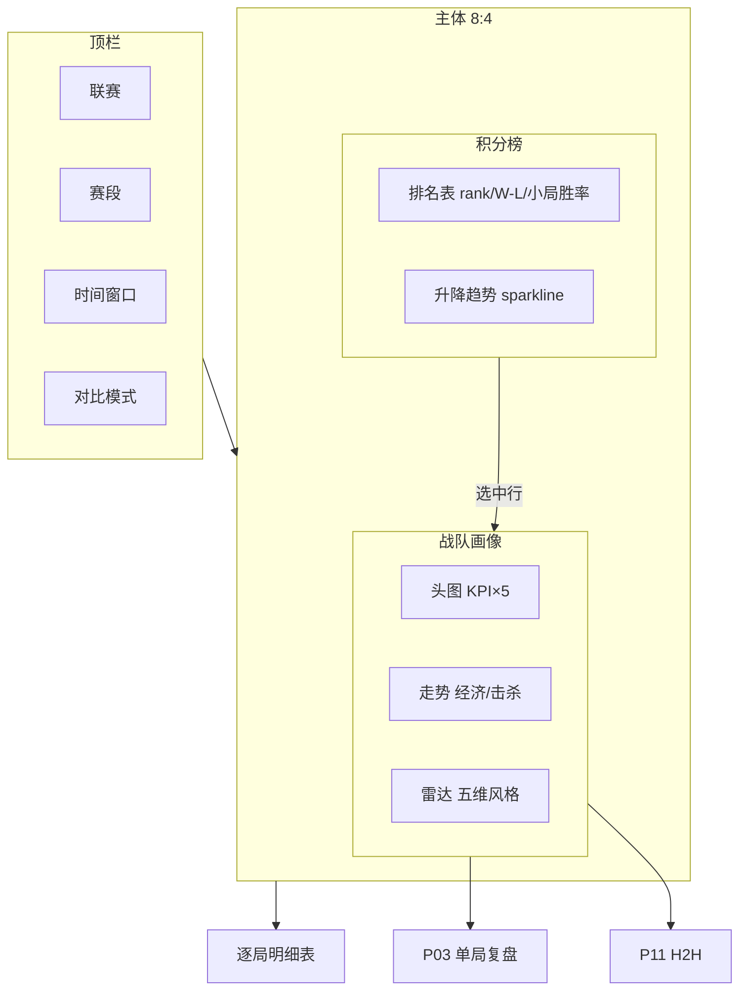

# P08 · 战队画像与积分榜

> 导航：[`P01 赛事中心`](./P01-赛事中心与赛程.md) · 关联：[`P09 选手排行`](./P09-选手排行与能力雷达.md) / [`P11 英雄池对位`](./P11-英雄池对位与H2H.md) / [`P14 教练元数据`](./P14-教练与战队元数据.md)  
> 技术参考：[../数据字典.md](../数据字典.md) · [../接口逆向笔记.md](../接口逆向笔记.md) · [../项目设计.md](../项目设计.md)（历史架构参考，非当前实现真相源）

---

## 1. 产品定位

**一句话**：在深色教练工作台上，用「积分榜 + 多维战队画像 + 近期走势」回答「这支队现在强在哪、弱在哪、排名上下文是什么」。

**目标用户**

| 角色 | 核心诉求 |
|------|----------|
| 数据分析师 | 按窗口对比战队 KPI，导出可复算口径；区分官方/代理/估算标签 |
| 教练组 | 赛前 5 分钟扫对手：胜率、经济/团战/推进风格、近期状态曲线 |
| KPI / 运营 | 积分榜叙事、战队热度素材、赛段排名变化选题 |

**非目标**：粉丝向战队主页、未经标注的「实力分」黑箱排名、依赖视频 CV 的行为解读。

**现状**：对应 `scripts/dashboard.py` 中 `page_team_profile`——单队 KPI、经济/击杀差走势、五维雷达、明细表；**本 PRD 为升级规格**，补齐积分榜、多队对比、置信区间与交叉下钻。

---

## 2. 用户故事（含验收标准）

| ID | 作为… | 我希望… | 以便… | 验收标准 |
|----|--------|---------|--------|----------|
| US-08-01 | 教练 | 在积分榜看到当前赛段排名与胜场/小分 | 快速定位对手联赛位置 | 积分榜展示 rank、大场 W-L、小局 win rate；**官方**字段有来源徽章；无官方积分时展示 **估算** 代理榜并标黄 |
| US-08-02 | 分析师 | 选择时间窗口（近 7 天 / 赛段 / 全赛季）刷新战队 KPI | 与复盘口径一致 | 切换窗口后 KPI、走势图、雷达同步重算；附样本量 n；n&lt;10 显示「小样本」 |
| US-08-03 | 教练 | 查看单队「五维风格雷达」与经济/击杀/推塔走势 | 判断对手打法倾向 | 雷达五轴：胜率、经济、团战、推进、资源；走势与现 `page_team_profile` 一致并可点击跳转 P03 |
| US-08-04 | 分析师 | 多选 2–4 支战队并排对比 KPI 与雷达 | 做对阵前瞻 | 对比模式下列表对齐同一窗口；差异列显示 Δ 与 z-score（**代理**） |
| US-08-05 | 运营 | 从积分榜点击战队进入画像 Tab | 内容链路顺畅 | 积分榜行点击 → 战队画像主区；面包屑可返回榜 |
| US-08-06 | 分析师 | 看到积分/排名数据的来源与缺口说明 | 对外引用不误导 | 缺官方积分榜 API 时，页顶 Banner 说明「代理榜 = 窗口内胜场排序」 |
| US-08-07 | 教练 | 从战队画像一键跳转 H2H / 选手榜 / 赛程 | 深度下钻 | 侧栏链接 P11（对该队）、P09（ roster ）、P01（过滤该队赛程） |

---

## 3. 信息架构与 UI

### 3.1 页面区块（主次层级）

1. **顶栏（主）**：联赛 · 赛段 · 日期窗口 · 战队单选/多选对比开关  
2. **左主（一级）**：积分榜 / 代理榜 Tab  
3. **右主（一级）**：选中战队画像卡（Logo、缩写、`team_id`、窗口 KPI 五格）  
4. **中部（二级）**：走势双轴图（经济差 + 击杀差，沿用现实现）  
5. **下部（二级）**：风格雷达 + 资源/时长分布小图  
6. **底表（三级）**：逐局明细（date、对手、win、diff 列）；行点击 → P03  
7. **侧链（辅）**：→ P14 档案 · P11 H2H · P09 选手

### 3.2 Mermaid 线框

### 3.3 空态 / 加载 / 错误态

| 状态 | 表现 |
|------|------|
| 加载 | KPI 骨架屏；积分榜 skeleton；雷达占位圆 |
| 空数据 | 「暂无战队数据，请先 build_history_dataset」+ 运维入口 P17 |
| 筛选无队 | 「当前窗口无该队出场」+ 建议扩大窗口 |
| 缺官方积分 | 琥珀 Banner：「展示代理榜（胜场排序），非联赛官方积分」 |
| 部分字段缺失 | 单元格「—」+ tooltip 指数据字典缺口 |
| API 错误 | 保留本地 `teams` 表缓存，Toast「展示本地归档」 |

**视觉**：深色教练工作台（对齐 `00-设计系统`）；主色战队色条 + 青 accent；指标角标 **官方** / **代理** / **估算**。

---

## 4. 关键指标与统计方法

| 指标 | 类型 | 定义 | 窗口 | 公式 / 方法 | 置信 / 显著性 |
|------|------|------|------|-------------|---------------|
| 小局胜率 | **官方** | 该队 win 占比 | 用户窗口 | `mean(win)`，`win` 来自 `camp*.is_win` 解析 | Wilson 95% CI；n 必显 |
| 出场局数 | **官方** | battle 粒度行数 | 同上 | `count(battle_id)` | — |
| 平均经济差 | **官方** | 终局 gold 差 | 同上 | `mean(gold_diff)`，`build_team_summary` | Bootstrap 95% CI（待建） |
| 平均击杀差 | **官方** | 终局 kill 差 | 同上 | `mean(kill_diff)` | 同上 |
| 平均推塔差 | **官方** | 终局 tower 差 | 同上 | `mean(tower_diff)` | 同上 |
| 资源控制 | **官方** | 暴君+主宰类合计 | 同上 | `mean(tyrant+lord+…)` 见数据字典字段去重规则 | 附 n |
| 风格雷达归一化 | **代理** | 0–1 展示轴 | 同上 | 如经济：`(gold_diff_mean + 8000)/16000` clip | 标注归一化参数可配置 |
| 联赛排名 | **官方** | 官方积分榜 rank | 当前赛段 | 来自官方接口（**待接入**） | — |
| 代理排名 | **估算** | 窗口内胜场序 | 用户窗口 | `rank(wins)` 并列处理 | 与官方榜差异列 |
| 近期状态 | **代理** | 近 k 局胜率 vs 赛季 | 滚动 k=5 | `wr_recent - wr_season` | \|Δ\|&gt;0.15 且 n≥5 标「状态波动」 |
| 大场 W-L | **官方** | match 粒度胜负 | 赛段 | 由 `match_id` + BO 比分聚合（赛程表） | 附 BO 系列 completeness |

**教练口径**：凡胜率类指标必须同时展示 **n** 与 CI；禁止只给百分比。

---

## 5. 数据源

| 层级 | 来源 | 用途 | 状态 |
|------|------|------|------|
| 主源 | 官方 `battle/open` → `camp1/camp2` | 胜负、终局 diff、资源 | **已有** raw JSON |
| 主源 | `matches/open` + 赛程归档 | 赛段、大场比分、开赛日 | **已有** `ScheduleCenter` |
| 本地 | `build_history_dataset` → `teams` / `battles` | Dashboard 聚合 | **已有** |
| 本地 | `build_team_summary()` | 战队行级特征 | **已有** `kpl_official_core.py` |
| 辅源 | 官方积分榜页 / 营地 | 排名校验 | **待建** |
| 缺口 | 官方积分榜 JSON 接口 | 真·联赛 rank | **缺口** → 代理榜 |
| 缺口 | 小分 / 净胜局官方字段 | .tiebreak 规则 | **待逆向** |

**字段映射**（详见 [../数据字典.md](../数据字典.md)）

| UI 字段 | 代码 / 官方字段 |
|---------|-----------------|
| 战队名 | `team` ← `team_name` / `team_abbreviation` |
| team_id | `camp*.team_id` |
| 胜负 | `win` ← `is_win` / `win_camp` |
| 经济差 | `gold_diff` ← `camp*.gold` 终局快照 |
| 击杀差 | `kill_diff` ← `kill_num` |
| 推塔差 | `tower_diff` ← `push_tower_num` |
| 资源 | `objectives` ← 暴君/主宰字段（注意 `kill_big_dragon_num` 语义重复，见数据字典） |
| 对手 | `opponent` ← 对侧 `team_name` |
| 赛段 | `stage` ← 赛程 `stage` / `match_stage` |

**接口层级**见 [../接口逆向笔记.md](../接口逆向笔记.md)：`leagues/open` → `matches/open` → `battle/open`。

---

## 6. 算法与 AI

| 层级 | 内容 | 状态 |
|------|------|------|
| 基线 | `build_team_summary` 逐局展开 + 窗口聚合 | **已有** |
| 规则 | 雷达五维 clip 归一化（与现 `page_team_profile` 一致） | **已有** |
| 统计 | Wilson CI、Bootstrap 均值 CI、近期状态 z-score | **待建** |
| 规则 | 代理积分榜：胜场 → 小局胜率 → 净胜 diff 多级 tiebreak | **待建** |
| 进阶 | 「风格相似队」余弦近邻（雷达向量，**估算**） | **P2** |
| 进阶 | 积分走势异常检测（排名骤降告警） | **P2** |
| AI | 自然语言「战队简报」摘要（P18 导出共用，输入=结构化 KPI） | **P2** |

本页不跑实时胜率模型（V11）；可展示「该队历史局预测校准率」只读指标（**代理**，来自 predictions CSV）。

---

## 7. 与竞品差异

| 维度 | 营地 / 官方数据站 | 本产品 |
|------|-------------------|--------|
| 积分榜 | 官方排名为主 | **官方 + 代理双轨**，缺口透明标注 |
| 战队页 | 静态赛季总览 | **可配窗口** + 走势 + 多队对比 |
| 统计深度 | 胜率/时长 | **CI、小样本警告**、资源字段去重口径 |
| 下钻 | 录像 / 资讯 | 链到 **P03 复盘、P11 H2H、P09 选手、P12 赛段归因** |
| 解释性 | 少 | 雷达轴定义公开；不依赖黑箱 Elo |

---

## 8. 实现优先级

| 优先级 | 能力 | 依赖 |
|--------|------|------|
| **P0** | 单队画像升级：窗口筛选 + n/CI + 来源标签 | `dashboard.page_team_profile`；`teams` 表 |
| **P0** | 积分榜 Tab（代理榜 v1：胜场排序） | `teams.groupby`；赛程 `matches` |
| **P0** | 逐局表行点击 → P03 | `page_match_drilldown` 路由参数 |
| **P1** | 多队对比模式（2–4 队 KPI + 雷达 overlay） | Plotly multi-trace |
| **P1** | Wilson CI / 小样本 UI | 新建 `stats_utils`（或 notebook 抽函数） |
| **P1** | 侧栏交叉链接 P09/P11/P01/P14 | 导航 query param |
| **P2** | 官方积分榜 API 对接与 diff 视图 | 逆向新接口；`kpl_official_core` 扩展 |
| **P2** | 风格相似队、排名异常告警 | 向量检索；z-score 规则 |
| **P2** | 预测校准率只读卡片 | `predictions/*.csv` + battles join |

### 已有 vs 待建

| 已有（`scripts/dashboard.py` + `kpl_official_core.py`） | 待建 |
|----------------------------------------------------------|------|
| `page_team_profile` 五 KPI、走势、雷达、明细表 | 积分榜、窗口、CI、对比模式、官方榜 |
| `build_team_summary` | 大场 W-L 聚合、tiebreak、Banner 缺口说明 |
| 侧栏战队筛选（全局） | 页内赛段/联赛一等公民筛选 |

---

## 9. 验收清单

**数据正确性**

- [ ] 随机 20 局：`teams` 表 win/gold_diff/kill_diff 与 raw JSON 终局一致  
- [ ] 窗口筛选后 KPI 可用手工 pandas 复算  
- [ ] 资源指标未双计 `kill_big_dragon_num`（遵循数据字典警告）  
- [ ] 代理榜排序与胜场数 manual sort 一致  

**交互**

- [ ] 积分榜 → 画像切换 &lt; 200ms（内存过滤）  
- [ ] 对比模式 4 队雷达可读、图例可开关  
- [ ] 空态 / 小样本 / 缺官方积分 三态文案齐全  

**视觉与合规**

- [ ] 深色主题；指标 **官方/代理/估算** 角标  
- [ ] 对外截图模式隐藏内部路径（P18 可选）  

**性能**

- [ ] 赛季规模（~200 局）冷加载 &lt; 2s  

---

## 修订记录

| 日期 | 说明 |
|------|------|
| 2026-07-22 | 初稿：对齐现 `page_team_profile`，补齐积分榜与统计口径 |
