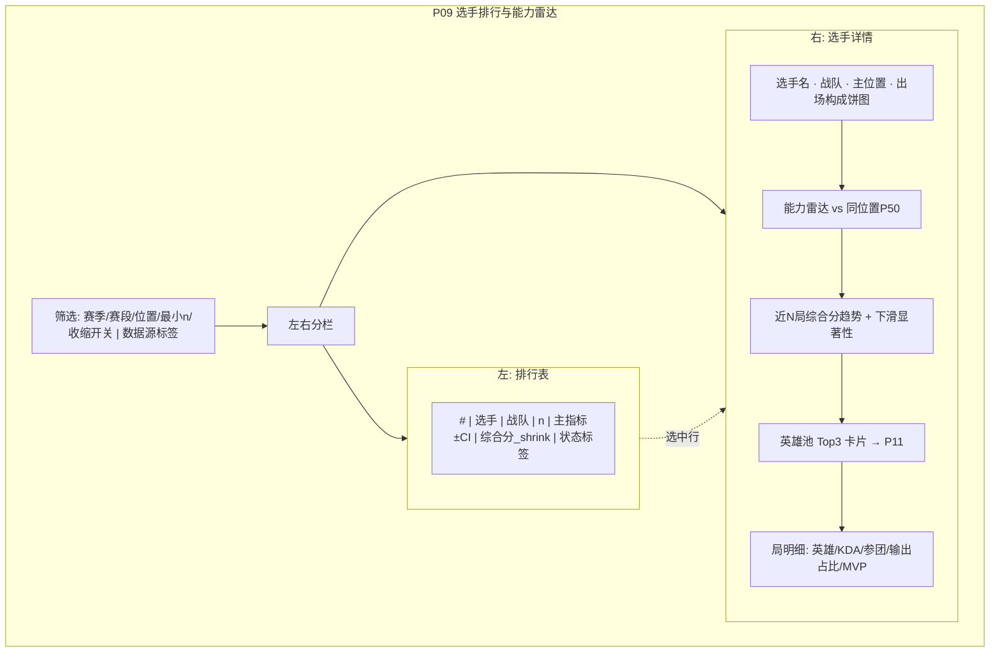

# P09 · 选手排行与能力雷达

> **模块编号**：P09  
> **主用户**：教练组 / 数据分析师  
> **导航入口**：榜单与对比 → 选手排行  
> **相关 PRD**：P08（战队）、P05（出装铭文）、P11（英雄池）、P12（归因）、P19（行为指标）  
> **技术参考**：[../数据字典.md](../数据字典.md) · [../接口逆向笔记.md](../接口逆向笔记.md) · [../项目设计.md](../项目设计.md)（历史架构参考，非当前实现真相源）

---

## 1. 产品定位

**一句话**：按**位置标准化**的选手排行与能力雷达，回答「谁在同位置真正强、强在哪、样本是否够信」，而非粉丝向「击杀榜」。

竞品多按全联盟混排 KDA/MVP；本模块强调：**分位置权重与分位、角色期望修正、置信与回归均值、对位上下文**。

| 角色 | 核心任务 |
|------|----------|
| 教练 | 选人/替补评估、对手核心点名 |
| 分析师 | 位置榜、趋势、异常检测（状态下滑） |
| KPI | 荣誉叙事素材（与 P13 联动，本模块供数） |

---

## 2. 用户故事（含验收标准）

### US-09-01 分位置排行榜
**作为**分析师，**我希望**按对抗/打野/中路/发育/游走分别排序，**以便**避免发育路输出碾压游走榜。

**验收**：
- [ ] 默认「仅主位置」（该位置出场占比 ≥60%）
- [ ] 可切换：KDA、参团率、对英雄输出占比、MVP 分、综合能力分
- [ ] 显示 n（局数）、排名、指标、CI 或 SE

### US-09-02 选手能力雷达
**作为**教练，**我希望**看到选手多维雷达并与同位置联盟中位数对比，**以便**一眼看风格（输出型/工具人/稳定型）。

**验收**：
- [ ] 五维随位置模板变化（见 §4）
- [ ] 叠加「同位置 P50」参考多边形
- [ ] 轴值 = 同位置分位，非跨位置硬编码

### US-09-03 最小样本与回归均值
**作为**教练，**我希望**10 局高光新人不会虚高到第一，**以便**避免错误点名。

**验收**：
- [ ] 默认过滤 `n < 5`（可配置）
- [ ] 综合分使用经验贝叶斯收缩：\(\tilde{s} = \frac{n}{n+n_0}s + \frac{n_0}{n+n_0}\mu_{pos}\)
- [ ] UI 标注「收缩后得分 · 估算」

### US-09-04 状态下滑警报
**作为**分析师，**我希望**近 5 局综合分相对赛季基线显著下降时被标红，**以便**写状态跟踪。

**验收**：
- [ ] 近窗 vs 赛季剩余局：Welch t 或置换检验
- [ ] p&lt;0.05 且效应量为负 → 「状态下滑」标签
- [ ] 禁用因果措辞：「关联到发挥波动」，不写「因伤病」

### US-09-05 英雄池摘要入口
**作为**教练，**我希望**从选手页看到英雄池广度与招牌英雄胜率，**以便**准备 BP（深链 P11）。

**验收**：
- [ ] Top3 英雄：出场、胜率±CI、同英雄联盟胜率差
- [ ] 点击跳转 P11 该选手英雄池

### US-09-06 身份歧义处理
**作为**用户，**我希望**同 ID 转会/同名被正确归并或拆分。

**验收**：
- [ ] 主键优先 `team_id + player_name`；转会用时间窗切段
- [ ] 无法归并时分开展示并标「待人工确认」

---

## 3. 信息架构与 UI

### 3.1 页面区块

| 优先级 | 区块 |
|--------|------|
| 主 | 筛选：赛季、赛段、位置、最小场次、收缩开/关 |
| 主 | 排行表（左）+ 选中选手雷达（右） |
| 次 | 趋势折线（综合分 by 局序） |
| 次 | 英雄池摘要 |
| 辅 | 原始局明细 |

### 3.2 Mermaid UI 线框

### 3.3 状态

| 状态 | 表现 |
|------|------|
| 加载 | 表骨架 + 雷达占位圈 |
| 空态 | 「该位置无满足最小场次的选手」 |
| 错误 | 聚合失败；提示 player 主键冲突数 |
| 低样本 | 灰色排名、禁用「联盟第一」文案 |

---

## 4. 关键指标与统计方法

### 4.1 原始指标（官方终局）

来自 `battle_player_list`：

| 字段 | 用途 |
|------|------|
| `kill_num` / `death_num` / `assist_num` / `kda` | 击杀参与 |
| `participation_rate` | 参团 |
| `hurt_to_hero_total_rate` | 对英雄输出占比 |
| `be_hurt_by_hero_total_rate` | 承伤占比 |
| `gold` / 队内经济占比（自算） | 发育 |
| `mvp_score` / `is_mvp` | 官方评分 |

### 4.2 分位置雷达模板

| 位置 | 维度（均为同位置分位 0–1） |
|------|---------------------------|
| 对抗路 | 承伤、参团、经济占比、死亡控制（低死亡高分）、MVP |
| 打野 | 参团、击杀参与、资源代理分*、死亡控制、MVP |
| 中路 | 输出占比、参团、经济占比、KDA、MVP |
| 发育路 | 输出占比、经济占比、KDA、参团、MVP |
| 游走 | 助攻率代理、参团、死亡控制、视野/支援代理*、MVP |

\*资源/支援代理：能从终局字段构造的用**代理**标签；精确开团/支援见 P19，本模块只做浅链。

### 4.3 综合能力分（位置加权）

\[
S_{i,pos} = \sum_k w_{pos,k} \cdot z_{pos}(x_{i,k})
\]

\(z_{pos}\) 为同位置赛季标准化。默认权重示例（发育路）：

| 维度 | 权重 |
|------|------|
| 输出占比 | 0.30 |
| 经济占比 | 0.25 |
| KDA | 0.15 |
| 参团 | 0.15 |
| MVP | 0.15 |

打野提高参团与资源代理权重；游走降低输出权重。权重表产品可配置，版本记入「指标字典」。

### 4.4 收缩与区间

- 先验样本量 \(n_0\) 默认 8（同位置）。
- 指标均值 SE：\(s/\sqrt{n}\)；胜率类用 Wilson。
- 排行并列：综合分相同按 n 降序。

### 4.5 状态检验

近 \(m=5\) 局得分 \(\bar{s}_{recent}\) vs 历史 \(\bar{s}_{hist}\)：

- Welch t；备择：recent &lt; hist
- 报告 p、Cohen’s d
- UI：**「统计意义上的近期偏低」**，禁止「状态下滑证明」式断言

---

## 5. 数据源

| 用途 | 主源 | 辅源 | 可得性 | 缺口 |
|------|------|------|--------|------|
| 选手局表现 | 官方 `battle_player_list` | — | **高** | 铭文名不可读（P05） |
| 位置 | `position_desc` | — | **高** | 野辅换位需按局记 |
| 官方荣誉榜 | 营地/官网「最佳选手」等 | 第三方 | **中** | 口径不一；P13 消费 |
| 行为：开团/入侵 | P19 代理层 | 付费商 | **低–中** | 本页不展示伪官方 |
| 选手百科 | P14 | — | **中** | 非阻塞 |

**标签**：`官方终局` / `位置标准化估算` / `收缩估计`。

---

## 6. 算法与 AI

| 层级 | 内容 | 优先级 |
|------|------|--------|
| 基线 | 分位置聚合、分位雷达、过滤 n | P0 |
| 进阶 | 加权综合分、经验贝叶斯收缩、下滑检验 | P1 |
| 实验 | 对手强度调整后的选手贡献（回归残差价值）；可选 RAPM 风格 | P2 → P20 |

---

## 7. 与竞品差异

| 能力 | 竞品常见 | 本模块 |
|------|----------|--------|
| 全联盟混排击杀榜 | ✅ | 可选，默认关闭 |
| 分位置榜 | 部分有 | ✅ 默认 |
| 同位置分位雷达 | 少 | ✅ |
| 小样本收缩 | ❌ | ✅ |
| 状态下滑显著性 | ❌ | ✅（谨慎措辞） |
| 来源标签 | 弱 | ✅ |

---

## 8. 实现优先级

| 级别 | 项 | 依赖 |
|------|----|------|
| **P0** | 分位置排行、基础指标、选手明细 | player 级事实表 |
| **P0** | 位置分位雷达 + P50 参考 | — |
| **P1** | 综合分、收缩、最小 n、趋势与检验 | — |
| **P2** | 对手调整贡献、P19 行为维接入 | P19、P20 |

**已有 vs 待建**：Dashboard 无独立选手榜；仅战队层。本模块**全量待建**，复用 battle JSON 解析管线。

---

## 9. 验收清单

### 数据正确性
- [ ] 同局 10 行选手不丢不重
- [ ] 主位置判定与抽样人工一致
- [ ] 收缩后极端新人排名下降可复现

### 性能
- [ ] 赛季选手聚合预计算 &lt; 3s；查询 &lt; 200ms

### 视觉
- [ ] 排行表与雷达联动不打架
- [ ] 状态标签有色盲友好图案（不仅靠红）

---

## 10. 交叉引用

- 战队上下文 → [P08](./P08-战队画像与积分榜.md)
- 英雄池 / H2H → [P11](./P11-英雄池对位与H2H.md)
- 行为代理维 → [P19](./P19-行为指标-入侵开团支援.md)
- 赛季荣誉 → [P13](./P13-高光赛季之最与荣誉.md)
