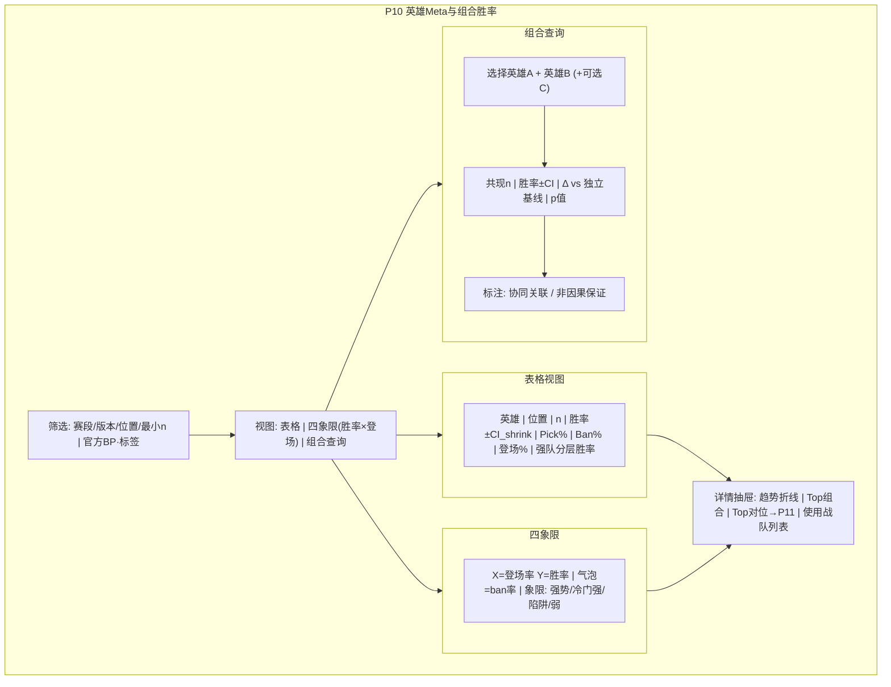

# P10 · 英雄 Meta 与组合胜率

> **模块编号**：P10  
> **主用户**：教练组 / 数据分析师（BP 顾问）  
> **导航入口**：Meta 与 BP → 英雄 Meta  
> **相关 PRD**：P04（BP 看板）、P11（对位/池）、P16（BP 模拟器）、P12（赛段切片）  
> **技术参考**：[../数据字典.md](../数据字典.md) · [../接口逆向笔记.md](../接口逆向笔记.md) · [../项目设计.md](../项目设计.md)（历史架构参考，非当前实现真相源）

---

## 1. 产品定位

**一句话**：在版本/赛段切片下，提供英雄登场、胜率、BP 热度、**位置约束下的组合胜率**与**不确定性量化**，支撑教练禁抢优先级，而非娱乐向「英雄胜率墙」。

竞品常给全局胜率与 ban/pick 率；本模块加深：**位置分层、先验收缩、组合共现检验、版本漂移、与阵容强度去混淆的初步表述**。

| 角色 | 核心任务 |
|------|----------|
| 教练 | 决定优先 ban、抢点、应对版本陷阱 |
| 分析师 | Meta 周报、版本补丁前后对比 |
| KPI | 热度叙事（须带来源与样本） |

---

## 2. 用户故事（含验收标准）

### US-10-01 英雄 Meta 表
**作为**分析师，**我希望**看到每个英雄的出场局数、胜率±CI、pick 率、ban 率、登场率，**以便**写版本报告。

**验收**：
- [ ] 指标定义与官方 BP 列表一致（`bp_list`）
- [ ] 默认按位置过滤（如仅统计「打野位出场」）
- [ ] `n < 10` 灰显并收缩胜率

### US-10-02 组合（Synergy）胜率
**作为**教练，**我希望**查询「英雄 A + 英雄 B」同队时的胜率与期望，**以便**规划体系。

**验收**：
- [ ] 支持 2 英雄组合（P0）、3 英雄（P1）
- [ ] 展示：共现场次、胜率±CI、相对独立基线的提升 Δ
- [ ] Δ 的置换检验或超几何/bootstrap p 值

### US-10-03 Counter 提示入口
**作为**教练，**我希望**从英雄页看到「常见对位胜率」摘要，**以便**跳到 P11 深挖。

**验收**：
- [ ] Top 对位同位置英雄胜率表（样本足够时）
- [ ] 深链 P11

### US-10-04 版本 / 赛段对比
**作为**分析师，**我希望**对比补丁前后或常规赛 vs 季后赛的胜率变化，**以便**判断 Meta 漂移。

**验收**：
- [ ] 双窗胜率差 + 比例差检验（两比例 z 或贝叶斯）
- [ ] 显著上升/下降打标（FDR 可选）

### US-10-05 去混淆提示（渗透）
**作为**教练，**我希望**知道高胜率是否只是强队在用，**以便**避免照抄陷阱。

**验收**：
- [ ] 展示「使用战队强度加权胜率」或「强队/弱队分层胜率」
- [ ] 文案：**相关，非纯英雄因果**

### US-10-06 空样本诚实
**验收**：组合 n=0 显示「无共现」；不显示 50% 占位假数据。

---

## 3. 信息架构与 UI

### 3.1 页面区块

| 优先级 | 区块 |
|--------|------|
| 主 | 筛选：赛季、赛段、版本标签、位置、最小 n |
| 主 | Meta 热力/排行表（胜率、登场、ban） |
| 次 | 英雄详情抽屉：趋势、组合、对位摘要、强队分层 |
| 辅 | 组合查询器（双英雄选择器） |

### 3.2 Mermaid UI 线框

### 3.3 状态

| 状态 | 表现 |
|------|------|
| 加载 | 表骨架 |
| 空态 | 赛段无 BP 数据 → 链 P17 |
| 错误 | bp_list 缺失局数告警 |
| 低样本 | 收缩胜率 + 「n 过小」 |

---

## 4. 关键指标与统计方法

### 4.1 单英雄

设赛段总单局数为 \(N\)，英雄 h 在位置 pos：

| 指标 | 公式 |
|------|------|
| 出场局数 \(n_h\) | pick 且位置匹配的局数 |
| 胜率 | 出场且己方胜 / \(n_h\) |
| Pick 率 | \(n_h / N\) |
| Ban 率 | ban 次数 / \(N\)（每局最多计 1） |
| 登场率 | (pick 局 + ban 局去重) / \(N\) |

**收缩胜率**（Beta-Binomial）：

\[
\tilde{p} = \frac{w + \alpha}{n_h + \alpha + \beta},\quad \alpha=\beta=n_0/2,\ n_0=10
\]

Wilson CI 基于原始 w/n；展示两者。

### 4.2 组合协同

英雄 A、B 同队出场 \(n_{AB}\)，胜场 \(w_{AB}\)：

- 独立基线：\(\hat{p}_A \hat{p}_B\) 不直接用；改用**边际校准基线**：

\[
p_0 = \frac{\sum_{games} \hat{p}_{\text{team}}(g)}{n_{AB}}
\]

简化 P0：\(p_0 = (\tilde{p}_A + \tilde{p}_B)/2\)（文档标明粗糙）。

- Lift：\(\Delta = \tilde{p}_{AB} - p_0\)
- 检验：对共现局胜负标签做相对置换（固定两英雄出场集合的队级协变量时 P2）

### 4.3 强队混淆

- 将出场局按「使用方赛季胜率」分高/低两组，分别报胜率。
- 或：战队固定效应逻辑回归中英雄系数（P2，P20）。

### 4.4 四象限规则（默认分位）

| 象限 | 登场 | 胜率 |
|------|------|------|
| 版本答案 | ≥P70 | ≥P70 |
| 冷门强势 | &lt;P40 | ≥P70 |
| 热门陷阱 | ≥P70 | &lt;P40 |
| 弱势 | &lt;P40 | &lt;P40 |

中间带不打标。

---

## 5. 数据源

| 用途 | 主源 | 辅源 | 可得性 | 缺口 |
|------|------|------|--------|------|
| Pick/Ban | 官方 `bp_list` | — | **高** | 第二阶段 pick 顺序以数据字典为准，需校验 |
| 胜负 | `camp.is_win` / `win_camp` | — | **高** | — |
| 位置 | `bp_list.position` 或选手 `position_desc` | — | **高** | ban 无位置；ban 率不按位置分 |
| 版本号 | 补丁日程表（人工/配置） | 营地公告 | **中** | 需维护 `patches.yaml` |
| 大众分路热度 | 非职业端 | 第三方 | **低** | 明确不做或标「非 KPL」 |

**标签**：`官方 BP` / `收缩估计` / `协同关联`。

---

## 6. 算法与 AI

| 层级 | 内容 | 优先级 |
|------|------|--------|
| 基线 | Meta 表、CI、收缩、四象限 | P0 |
| 进阶 | 2–3 英雄组合、Lift 检验、赛段对比、强队分层 | P1 |
| 实验 | 阵容嵌入 + 协同模型；因果森林估计英雄效应 | P2 → P16/P20 |

与 P16 边界：P10 **描述性 Meta**；P16 **给定 BP 的胜率仿真**。

---

## 7. 与竞品差异

| 能力 | 竞品 | 本模块 |
|------|------|--------|
| Ban/Pick/胜率 | ✅ | ✅ |
| 位置分层 | 部分 | ✅ 默认 |
| 小样本收缩 | 少 | ✅ |
| 组合 Lift + p 值 | 少/无 | ✅ |
| 强队混淆提示 | 无 | ✅ |
| 因果措辞克制 | 营销向 | ✅ 教练向 |

---

## 8. 实现优先级

| 级别 | 项 | 依赖 |
|------|----|------|
| **P0** | Meta 表、位置过滤、Wilson+收缩、四象限 | `bp_list` 入库 |
| **P1** | 双英雄组合、赛段对比、强队分层、详情抽屉 | — |
| **P2** | 三英雄、回归去混淆、链 P16 | P16、P20 |

**已有 vs 待建**：解析侧有 `bp_list` 字段定义；Dashboard **无 Meta UI**，全量待建。P04 实时 BP 看板消费同一数据不同场景。

---

## 9. 验收清单

### 数据正确性
- [ ] 单局 10 pick + 10 ban 计数对齐
- [ ] 英雄胜率与手工抽 5 英雄对账
- [ ] 组合共现不跨队误计

### 性能
- [ ] Meta 预聚合赛段级；组合查询有索引/物化高频对

### 视觉
- [ ] 四象限不拥挤；标签可读
- [ ] 收缩与原始胜率切换不混淆

---

## 10. 交叉引用

- 实时/单局 BP → [P04](./P04-BP看板与阵容分析.md)
- 对位与选手池 → [P11](./P11-英雄池对位与H2H.md)
- 胜率模拟 → [P16](./P16-BP与大场胜率模拟器.md)
- 赛段归因 → [P12](./P12-赛段切片与胜负归因.md)
