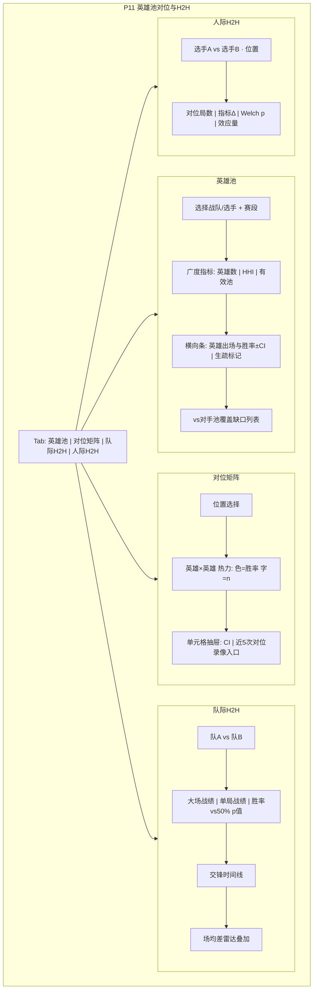

# P11 · 英雄池对位与 H2H

> **模块编号**：P11  
> **主用户**：教练组 / 数据分析师  
> **导航入口**：榜单与对比 → 对位与 H2H  
> **相关 PRD**：P08（战队）、P09（选手）、P10（Meta）、P04（BP）、P16（模拟）  
> **技术参考**：[../数据字典.md](../数据字典.md) · [../接口逆向笔记.md](../接口逆向笔记.md) · [../项目设计.md](../项目设计.md)（历史架构参考，非当前实现真相源）

---

## 1. 产品定位

**一句话**：回答三类教练高频问题——**选手英雄池有多深**、**同位置英雄对位谁优**、**队/人历史交锋（H2H）是否显著**——并给出样本与检验，拒绝「3 局 100% 克制」式误导。

| 角色 | 核心任务 |
|------|----------|
| 教练 | 赛前点名克制链、预判对手招牌、交锋心理预期（数据侧） |
| 分析师 | H2H 报告、对位矩阵、池广度指标 |

---

## 2. 用户故事（含验收标准）

### US-11-01 选手英雄池
**作为**教练，**我希望**看到选手各英雄出场、胜率±CI、最近使用时间，**以便**判断可 BP 范围。

**验收**：
- [ ] 池广度：不重复英雄数、HHI 集中度、有效英雄数 \(e^{H}\)（Shannon）
- [ ] 招牌英雄：出场占比 Top 与胜率双高
- [ ] 长期未用英雄标「生疏」（阈值可配，默认 ≥30 天或 ≥10 局未用）

### US-11-02 同位置对位矩阵
**作为**教练，**我希望**在指定位置查看英雄 A vs 英雄 B 的胜率，**以便**抢反制。

**验收**：
- [ ] 矩阵单元格：n、胜率、Wilson CI
- [ ] n&lt;8 显示「不足」不给结论色
- [ ] 可按「仅统计双方都是该位置」过滤

### US-11-03 战队 H2H
**作为**分析师，**我希望**两队历史大场/单局交锋记录与指标差，**以便**写德比前瞻。

**验收**：
- [ ] 胜场、胜率±CI、场均经济差等
- [ ] 时间衰减权重可选（近一年权重高）
- [ ] 显著性：相对 50% 的二项检验

### US-11-04 选手 H2H（同位置）
**作为**教练，**我希望**两名同位置选手历史对位的个人指标差，**以便**单点针对。

**验收**：
- [ ] 仅统计同局且同位置对位
- [ ] KDA、输出占比、参团等差 + Welch
- [ ] 样本量不足时强制灰态

### US-11-05 池 vs 池匹配度
**作为**教练，**我希望**看到「我方池 vs 敌方池」在当前 Meta 下的覆盖缺口，**以便** ban 位规划。

**验收**：
- [ ] 敌方高胜率英雄中我方缺少对位经验的列表
- [ ] 数据标签：`池覆盖估算`

### US-11-06 防泄漏
**验收**：任何「赛前预测」视图不得使用未开始局的结果；H2H 仅历史已完赛。

---

## 3. 信息架构与 UI

### 3.1 页面区块

| Tab | 主任务 |
|-----|--------|
| 英雄池 | 选选手/战队 → 池可视化 |
| 对位矩阵 | 选位置 → 矩阵 / 搜索一对英雄 |
| 队际 H2H | 两队选择器 → 时间线 + 汇总 |
| 人际 H2H | 两选手 + 位置 → 对位卡片 |

### 3.2 Mermaid UI 线框

### 3.3 状态

| 状态 | 表现 |
|------|------|
| 加载 | 矩阵骨架 |
| 空态 | 「两队本赛季未交手」 |
| 低样本 | 单元格虚线边框 + 禁止「稳克」文案 |
| 错误 | 选手归并冲突提示 |

---

## 4. 关键指标与统计方法

### 4.1 英雄池

| 指标 | 定义 |
|------|------|
| 池大小 | 赛段内不重复 `hero_id` 数 |
| HHI | \(\sum s_i^2\)，\(s_i\) 为英雄出场份额；越高越偏科 |
| 有效英雄数 | \(\exp(H)\)，\(H=-\sum s_i \ln s_i\) |
| 生疏 | 距上次出场局数或日历天数超阈值 |

### 4.2 对位胜率

同局、同位置、英雄 A 对英雄 B：A 所在阵营获胜比例。  
CI：Wilson。  
与全局英雄胜率差：\(\Delta = p_{A|B} - \tilde{p}_A\)，bootstrap p（P1）。

**重要**：对位优不蕴含机制克制（装备/队员影响），文案用「历史对位关联」。

### 4.3 H2H

- 队际大场：BO 胜负序列；二项检验 \(H_0: p=0.5\)。
- 时间衰减：权重 \(w = e^{-\lambda \Delta t}\)，\(\lambda\) 默认使半衰期=180 天。
- 人际：配对局指标差均值，Welch；报告 Cohen’s d。

### 4.4 池覆盖缺口

敌方英雄集合 \(H_e\)（出场≥k），我方池 \(H_s\)：  
缺口 = \(H_e\) 中我方对位经验 \(n_{matchup}<k'\) 且敌方胜率高的英雄。  
全部标「估算」。

---

## 5. 数据源

| 用途 | 主源 | 辅源 | 可得性 | 缺口 |
|------|------|------|--------|------|
| 选手-英雄-位置 | `battle_player_list` | — | **高** | — |
| 队际赛程结果 | `matches` + battles 聚合 | — | **高** | 历史跨赛季队名变更 |
| 对位 | 同局双侧 player 行 join | — | **高** | 非同位置对线不可用「对位」一词 |
| 录像跳转 | `video_list` | 平台页 | **中** | 仅外链，不做 CV |
| 粉丝投票克制 | 社区 | — | **低** | 不接入主路径 |

**标签**（对齐 [00-术语表](./00-术语表.md)）：`官方`（对局聚合）/ `代理`（历史关联统计）/ `估算`（池深度与对位优度）。

字段语义见 [../数据字典.md](../数据字典.md)（`hero_id` / `position_desc` / `battle_player_list`）；接口链路见 [../接口逆向笔记.md](../接口逆向笔记.md)。

---

## 6. 算法与 AI

| 层级 | 内容 | 优先级 |
|------|------|--------|
| 基线 | 池统计、H2H 战绩、对位表、Wilson、最小 n | P0 |
| 进阶 | 衰减 H2H、对位 Δ 检验、覆盖缺口、有效池 | P1 |
| 实验 | 对位贝叶斯层级模型（英雄+选手随机效应） | P2 → P20 |

---

## 7. 与竞品差异

| 能力 | 竞品 | 本模块 |
|------|------|--------|
| 历史交锋比分 | ✅ | ✅ |
| 对位矩阵 + CI | 少 | ✅ |
| 小样本熔断 | 弱 | ✅ 强制 |
| 池广度/HHI | 无 | ✅ |
| 人际同位置检验 | 无 | ✅ |
| 「克制」措辞 | 营销夸张 | **禁止无 n 断言** |

---

## 8. 实现优先级

| 级别 | 项 | 依赖 |
|------|----|------|
| **P0** | 英雄池条形图、队际 H2H、对位查询（非全矩阵） | player 事实表 |
| **P1** | 全矩阵热力、人际 H2H、衰减、覆盖缺口 | — |
| **P2** | 层级贝叶斯对位 | P20 |

**已有 vs 待建**：无独立 H2H 页；战队画像仅单队。全量待建。

---

## 9. 验收清单

### 数据正确性
- [ ] 对位 join 不出现同队两人
- [ ] H2H 胜场与赛程手算一致
- [ ] 生疏阈值变更可复算

### 性能
- [ ] 单对位查询 &lt; 100ms（索引 team/player/hero）
- [ ] 全矩阵可异步物化

### 视觉
- [ ] 热力色盲友好顺序色带
- [ ] 低 n 单元格无误导绿色

---

## 10. 交叉引用

- Meta 全局 → [P10](./P10-英雄Meta与组合胜率.md)
- 选手榜 → [P09](./P09-选手排行与能力雷达.md)
- 战队 → [P08](./P08-战队画像与积分榜.md)
- BP 模拟 → [P16](./P16-BP与大场胜率模拟器.md)
