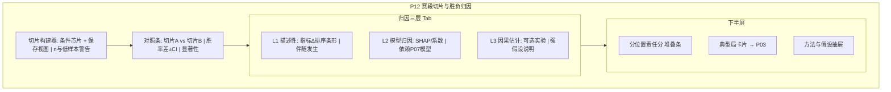

# P12 · 赛段切片与胜负归因

> **模块编号**：P12  
> **状态**：**部分实现**（单局阶段切片 + 归因卡（描述性·伴随措辞）+ 叙事因子分层已落地；跨局切片器、对照检验/FDR、L3 因果待建）  
> **主用户**：数据分析师 / 教练组  
> **导航入口**：复盘与归因 → 赛段切片  
> **相关 PRD**：P03（单局复盘）、P07（实时胜率）、P08（战队）、P10（Meta）、P18（简报）、P20（算法实验室）  
> **技术参考**：[../数据字典.md](../数据字典.md) · [../接口逆向笔记.md](../接口逆向笔记.md) · [../项目设计.md](../项目设计.md)（历史架构参考，非当前实现真相源）

---

## 1. 产品定位

**一句话**：把赛季拆成**可配置切片**（版本、阶段、主客、BO 局序、时间窗），在切片内做战队/选手/阵容的对比，并用**可解释的贡献分解**回答「为什么这段时间赢/输」，明确区分 **描述性归因 / 模型归因 / 因果估计** 三层，避免把相关性当战术真理。

现有 Dashboard 下钻页有因子叙事（`FeatureBuilder.explain`），文档已标明**不是模型归因权重**。本模块产品化分层，并支持跨局赛段聚合。

| 角色 | 核心任务 |
|------|----------|
| 分析师 | 阶段总结、输赢驱动因子排名 |
| 教练 | 针对性训练：劣势切片（如「第三局」「落后开局」） |
| KPI | 阶段叙事素材（须带来源层标签） |

---

## 2. 用户故事（含验收标准）

### US-12-01 切片构建器
**作为**分析师，**我希望**用多条件组合切片（赛段∧版本∧局序∧是否先手方等），**以便**定位问题子集。

**验收**：
- [ ] 条件：日期、赛事阶段、版本、BO 第 n 局、阵营、对手强度分位
- [ ] 显示切片内 n，n&lt;阈值警告
- [ ] 切片可保存为命名视图

### US-12-02 切片对照
**作为**教练，**我希望**切片 A vs 切片 B 的胜率与关键指标差及显著性，**以便**证明「季后赛推进变差」等命题。

**验收**：
- [ ] 胜率差两比例检验；连续指标 Welch
- [ ] FDR 控制多指标时的假阳性（默认开）
- [ ] 效应量并列展示

### US-12-03 三层归因面板
**作为**分析师，**我希望**在同一屏看到三层结论且互不混淆，**以便**写严谨复盘。

**验收**：
- [ ] L1 描述：场均经济差/击杀差/资源差/时长等贡献排序（标准化均值差）
- [ ] L2 模型：基于胜率模型的特征贡献（SHAP/系数，标「模型归因」）
- [ ] L3 因果：可选 IPW/简单差分（P2），标「因果估计·实验」
- [ ] 层间颜色/标签强制区分

### US-12-04 单局归因对齐
**作为**教练，**我希望**从赛段因子下钻到典型单局（P03），**以便**看录像点。

**验收**：
- [ ] 每因子给出「最能代表该因子」的 3 局链接
- [ ] 与 P07 胜率拐点事件可对齐（若有预测曲线）

### US-12-05 分位置权重归因
**作为**教练，**我希望**知道该切片内输赢更依赖哪个位置的发挥偏差，**以便**安排加练。

**验收**：
- [ ] 位置级指标相对对手的 z 分，按权重合成「位置责任分」
- [ ] 标签：`估算·非追责`

### US-12-06 措辞合规
**验收**：UI 文案禁用「证明因 xxx 而输」；L1 用「伴随」，L2 用「模型贡献」，L3 用「估计效应」。

---

## 3. 信息架构与 UI

### 3.1 页面区块

| 优先级 | 区块 |
|--------|------|
| 主 | 切片构建器 + n 与警告 |
| 主 | 对照摘要 KPI |
| 主 | 三层归因 Tab |
| 次 | 位置责任、趋势、典型局 |
| 辅 | 方法说明抽屉 |

### 3.2 Mermaid UI 线框

### 3.3 归因层视觉规范

| 层 | 标签色（设计系统 token） | 允许动词 |
|----|--------------------------|----------|
| L1 | `tag-official` / 中性青 | 伴随、相关、更高/更低 |
| L2 | `tag-estimate` | 模型贡献、解释权重 |
| L3 | `tag-experiment` | 估计效应、在假设下 |

### 3.4 状态

| 状态 | 表现 |
|------|------|
| 加载 | 计算中进度（归因可能 &gt;2s） |
| 空态 | 切片无局 |
| 错误 | 模型文件缺失时 L2 灰掉并说明 |
| 低样本 | 禁用 L3；L1/L2 加警告 |

---

## 4. 关键指标与统计方法

### 4.1 切片定义

切片 \(S = \{g \mid g \text{ 满足过滤器}\}\)。默认最小 \(n=15\) 局（可配）。

### 4.2 L1 描述性贡献

对败局集合（或胜率低于基线的切片），计算各指标相对联盟/自身基线的标准化差：

\[
c_j = \frac{\bar{x}_{j,S} - \bar{x}_{j,0}}{\sigma_{j,0}}
\]

排序 \(|c_j|\)。指标池：终局经济差、击杀差、推塔差、资源差、时长、参团方差、位置输出失衡等。

**检验**：切片 vs 基线 Welch；BH-FDR。

### 4.3 L2 模型归因

- 复用实时/终局胜率模型特征（见 `kpl_official_core` / V11 特征）。
- 赛段级：对切片内每局终局或关键分钟特征做平均 \|SHAP\| 或逻辑回归系数×标准差。
- **禁止**把 Dashboard `FeatureBuilder.explain` 解说因子标成 SHAP；若暂无 SHAP，只显示「叙事因子」子区并继承现有免责声明。

### 4.4 L3 因果（实验）

可选简易设定（P2）：

- 处理：是否拿到首暴君 / 是否经济领先@10（需时间轴数据，P06）
- 结局：胜负
- 方法：IPW 或匹配；强可忽略假设写进抽屉

无时间轴时 **隐藏 L3**。

### 4.5 分位置责任分

\[
R_{pos} = w_{pos} \cdot z(\Delta \text{metric}_{pos})
\]

权重与 P08/P09 默认表一致，可覆写。总和归一便于堆叠图。

---

## 5. 数据源

| 用途 | 主源 | 辅源 | 可得性 | 缺口 |
|------|------|------|--------|------|
| 终局指标 | 官方 battle 终局 | — | **高** | — |
| 分钟级经济/事件 | 快照时间轴 / 预测 CSV | — | **中高**（视采集覆盖） | 无快照局不能做分钟归因 |
| 模型特征 | `kpl_official_core.predict` 特征 | — | **高**（有模型时） | SHAP 需另算 |
| 版本切片 | 补丁配置表 | 公告 | **中** | 人工维护 |
| 舆情归因 | P15 | — | **中** | 仅相关，不进 L1 默认 |

**标签**：`官方终局` / `模型归因` / `因果实验` / `叙事因子（非权重）`。

---

## 6. 算法与 AI

| 层级 | 内容 | 优先级 |
|------|------|--------|
| 基线 | 切片器、L1 标准化差、检验+FDR、位置责任 | P0 |
| 进阶 | L2 SHAP/系数、典型局检索、与 P07 拐点对齐 | P1 |
| 实验 | L3 IPW/匹配、双重机器学习 | P2 → P20 |

与 P03 边界：P03 单局故事线；P12 **跨局赛段**归因。与 P07：提供概率曲线与特征，不替代切片器。

---

## 7. 与竞品差异

| 能力 | 竞品 | 本模块 |
|------|------|--------|
| 赛段筛胜率 | 浅 | ✅ 多维切片 |
| 因子排序 | 少/黑盒 | ✅ 三层透明 |
| 显著性 + FDR | 无 | ✅ |
| 分位置责任 | 无 | ✅ |
| 因果/相关混淆 | 常见 | **强制分层** |

---

## 8. 实现优先级

| 级别 | 项 | 依赖 |
|------|----|------|
| **P0** | 切片构建、L1、对照检验、位置责任 | battle 聚合 |
| **P1** | L2（有模型时）、典型局、叙事因子隔离展示 | `kpl_official_core`、P03 |
| **P2** | L3、分钟级归因 | P06 时间轴、P20 |

**已有 vs 待建**：

| 已有 | 待建 |
|------|------|
| 单局阶段切片（≤8′ / 9–15′ / 16′+，官方字段差分；生成器 `build_phase_attribution`） | 跨局切片器与命名视图（US-12-01） |
| 归因卡（胜率摆动 / 资源转折 / 分路失衡，描述性·伴随措辞） | 切片对照检验 + BH-FDR（US-12-02） |
| 叙事因子分层展示（FeatureBuilder.explain，标「非权重」） | SHAP 赛段聚合（L2）、L3 因果（P2） |

---

## 9. 验收清单

### 数据正确性
- [ ] 切片过滤与 SQL/手算 n 一致
- [ ] FDR 开关可复现 p 调整
- [ ] L1/L2/L3 标签无互贴

### 性能
- [ ] L1 &lt; 1s；L2 &lt; 5s（可缓存 SHAP）

### 视觉
- [ ] 三层颜色遵循设计系统
- [ ] 方法抽屉必达（每层「？」入口）

---

## 10. 交叉引用

- 单局复盘 → [P03](./P03-单局赛后复盘.md)
- 实时胜率 → [P07](./P07-实时胜率与官方胜率对标.md)
- 经济时间轴 → [P06](./P06-经济分路与资源时间轴.md)
- 算法实验 → [P20](./P20-进阶算法实验室.md)
- 简报导出 → [P18](./P18-导出报告与教练简报.md)

## 修订记录

| 日期 | 说明 |
|------|------|
| 2026-07-22 | 初稿 |
| 2026-10-15 | 单局阶段切片 + 归因卡 + 叙事因子分层落地（复盘页「事件归因」Tab）；跨局切片器与 FDR 对照待建 |
