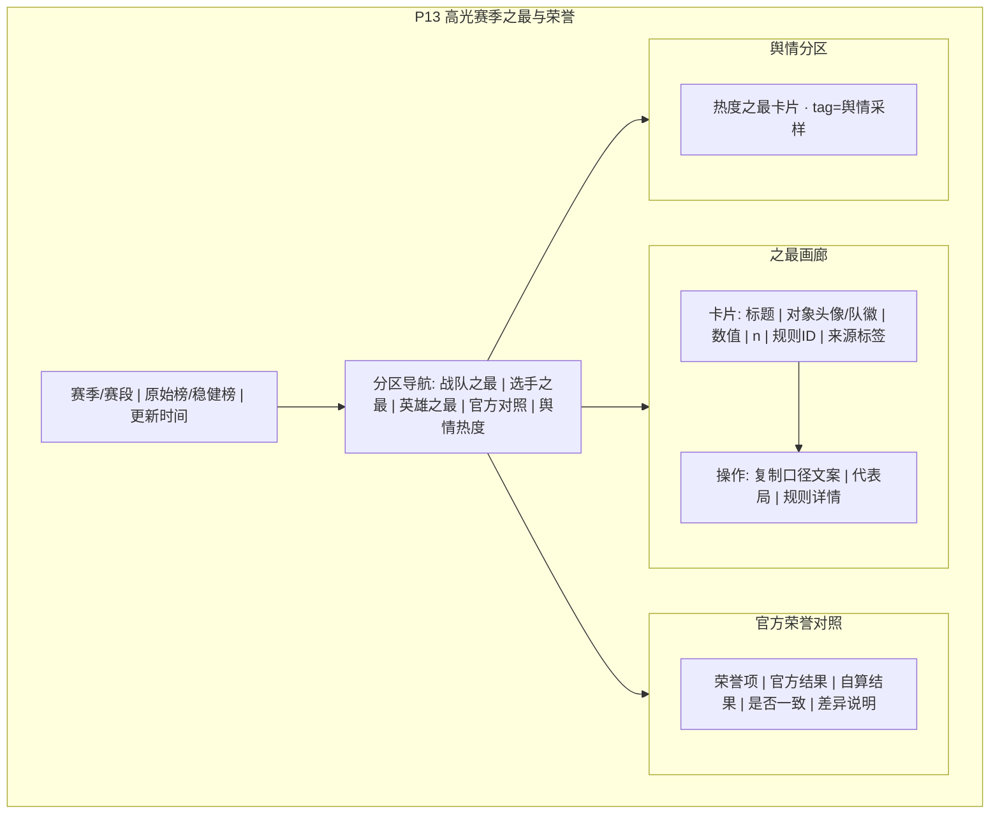

# P13 · 高光赛季之最与荣誉

> **模块编号**：P13  
> **状态**：**P0 已实现**（规则引擎 + 之最画廊 + 复制口径文案；生成器 `scripts/kpl_official_core.build_season_honors`，入口：赛事中心）  
> **主用户**：数据分析师 / KPI 运营（次要：教练组用于激励与对外叙事校对）  
> **导航入口**：榜单与对比 → 赛季之最 / 荣誉墙  
> **相关 PRD**：P08、P09、P10、P12、P15（舆情热度）、P18（导出）  
> **技术参考**：[../数据字典.md](../数据字典.md) · [../接口逆向笔记.md](../接口逆向笔记.md) · [../项目设计.md](../项目设计.md)（历史架构参考，非当前实现真相源）

---

## 1. 产品定位

**一句话**：在**透明规则 + 最小样本 + 不确定性**约束下，生成赛季/赛段「之最」与荣誉榜，服务运营稿与分析师周报，同时给教练一份**可核对口径**的荣誉清单——不是粉丝应援榜。

竞品「赛季之最」常缺规则与并列处理；本模块要求：**规则版本化、可复算、可导出方法脚注**。

| 角色 | 核心任务 |
|------|----------|
| KPI / 运营 | 海报文案、节目包装点 |
| 分析师 | 周报「数据之最」、与官方荣誉对照 |
| 教练 | 核对队友荣誉是否统计口径一致；避免错误对外引用 |

---

## 2. 用户故事（含验收标准）

### US-13-01 赛季之最画廊
**作为**运营，**我希望**一屏看到多项之最卡片（最高胜率战队、最高参团选手等），**以便**选题。

**验收**：
- [ ] 每卡：标题、对象、数值、n、规则摘要、来源标签
- [ ] 并列显示全部并列者，不随机只留一个
- [ ] 一键复制「含口径」文案

### US-13-02 规则可审计
**作为**分析师，**我希望**展开每条荣誉的完整计算规则与过滤条件，**以便**写进报告脚注。

**验收**：
- [ ] 规则 ID + 版本号（如 `HONOR_TEAM_WR_v1`）
- [ ] 展示 SQL/伪代码级过滤：最小局数、位置、是否含加赛等
- [ ] 历史规则版本可回看（变更日志）

### US-13-03 官方荣誉对照
**作为**分析师，**我希望**把官方/营地公布的最佳阵容等与自算榜对照，**以便**发现口径差。

**验收**：
- [ ] 对照表：官方名次 vs 自算名次
- [ ] 差异原因字段（样本窗不同 / 指标不同 / 人工评选）
- [ ] 官方数据源可得性：中（依赖人工录入或半自动）

### US-13-04 高光片段索引
**作为**运营，**我希望**之最关联到代表局，**以便**找素材。

**验收**：
- [ ] 每卡最多 3 场代表 battle 链接（P03）
- [ ] 无录像时仅数据局，不假装有视频

### US-13-05 防刷榜与稳健性
**作为**教练，**我希望**只打 3 局的选手不会拿「最高 KDA」，**以便**荣誉可信。

**验收**：
- [ ] 全局默认 `n ≥ 10`（之最类型可覆写）
- [ ] 可选收缩指标排序（与 P09 一致）
- [ ] 「含缩场次」与「稳健」两种榜可切换

### US-13-06 舆情热度之最（可选层）
**作为**运营，**我希望**看到弹幕/话题热度之最，**以便**做传播向选题。

**验收**：
- [ ] 独立分区，标签 `舆情·采样`
- [ ] 依赖 P15；无数据时整区隐藏，不显示空榜

---

## 3. 信息架构与 UI

### 3.1 页面区块

| 优先级 | 区块 |
|--------|------|
| 主 | 赛季/赛段选择 + 榜模式（原始/稳健） |
| 主 | 之最画廊（战队 / 选手 / 英雄 / 赛事） |
| 次 | 官方荣誉对照表 |
| 次 | 代表局与复制文案 |
| 辅 | 规则字典与变更日志 |

### 3.2 Mermaid UI 线框



### 3.3 卡片文案模板（复制）

```text
【{赛季}{赛段}·{荣誉标题}】{对象}（{数值}，样本 n={n}）
口径：{规则摘要}（规则ID {rule_id} v{ver}）
数据源：{source_tag}；生成时间 {ts}
注：非官方评选，转载请附口径。
```

### 3.4 状态

| 状态 | 表现 |
|------|------|
| 加载 | 卡片骨架 |
| 空态 | 「该赛段样本不足生成之最」 |
| 错误 | 规则执行失败列出 rule_id |
| 部分官方缺失 | 对照表行显示「官方未录入」 |

---

## 4. 关键指标与统计方法

### 4.1 预设荣誉目录（P0 子集）

**战队**

| rule_id | 标题 | 指标 | 最小 n |
|---------|------|------|--------|
| `HONOR_TEAM_WR` | 最高胜率战队 | 大场胜率 Wilson 下界排序（稳健模式）或原始胜率 | 8 大场 |
| `HONOR_TEAM_GOLD` | 场均经济差最高 | 终局 gold_diff 均值 | 10 单局 |
| `HONOR_TEAM_STREAK` | 最长连胜 | 大场连胜 | — |

**选手**（分位置颁发，避免混排）

| rule_id | 标题 | 指标 | 最小 n |
|---------|------|------|--------|
| `HONOR_PLAYER_MVP` | MVP 次数最多 | `is_mvp` 求和 | 10 |
| `HONOR_PLAYER_PART` | 参团率最高 | `participation_rate` 均值 | 10 |
| `HONOR_PLAYER_DMG` | 输出占比最高 | `hurt_to_hero_total_rate`（仅发育/中） | 10 |
| `HONOR_PLAYER_SCORE` | 综合能力分最高 | P09 \(S_{shrink}\) | 10 |

**英雄**

| rule_id | 标题 | 指标 | 最小 n |
|---------|------|------|--------|
| `HONOR_HERO_WR` | 胜率最高英雄 | 收缩胜率 / 稳健用 Wilson 下界 | 15 |
| `HONOR_HERO_PICK` | 登场率最高 | 登场率 | — |
| `HONOR_HERO_BAN` | Ban 率最高 | Ban 率 | — |

### 4.2 排序稳健性

- **原始榜**：点估计排序。
- **稳健榜**：胜率类用 Wilson 下界；均值类用 \(\bar{x} - t_{0.95} SE\)。
- 并列：差值小于 ε（胜率 0.5pct）视为并列。

### 4.3 与显著性

之最默认**不宣称为显著第一**；若需「显著高于第二名」，做领先者 vs 第二名的检验并单独角标 `显著领先`（p&lt;0.05）。

### 4.4 分位置权重

选手类荣誉**默认分位置各颁一份**（五份「位置之最」），与 P09 一致。全联盟混排仅存在于「运营娱乐开关」，默认关。

---

## 5. 数据源

| 用途 | 主源 | 辅源 | 可得性 | 缺口 |
|------|------|------|--------|------|
| 自算之最 | P08/P09/P10 同一聚合层 | — | **高** | — |
| 官方最佳阵容/FMVP 等 | 营地公告、联盟官网、新闻稿 | 人工表 `honors_official.csv` | **中** | 无稳定开放 API；半自动+人工 |
| 代表局 | battle 事实表 | `video_list` 外链 | **高** / 录像 **中** | — |
| 舆情热度 | P15 | B 站弹幕等 | **中**（合规与采样） | 小红书不强承诺 |
| 粉丝投票 | 社区 | — | **低** | 不进默认荣誉 |

**标签**：`自算荣誉` / `官方录入` / `舆情采样`。

---

## 6. 算法与 AI

| 层级 | 内容 | 优先级 |
|------|------|--------|
| 基线 | 规则引擎执行预设 rule_id、画廊、复制文案、最小 n | P0 |
| 进阶 | 稳健榜、显著领先角标、官方对照、代表局挑选（极值局） | P1 |
| 实验 | 文案大模型润色（必须保留口径块不可改）；舆情之最 | P2 → P15/P18 |

代表局挑选启发式：该对象指标最极端的 3 局，且优先有录像。

---

## 7. 与竞品差异

| 能力 | 竞品 | 本模块 |
|------|------|--------|
| 之最列表 | ✅ 娱乐向 | ✅ 规则透明 |
| 最小样本 / 稳健排序 | 少 | ✅ |
| 规则版本与复制口径 | 无 | ✅ |
| 官方对照 | 少 | ✅ |
| 分位置荣誉 | 少 | ✅ 默认 |
| 舆情分区隔离 | 混排 | ✅ 标签隔离 |

---

## 8. 实现优先级

| 级别 | 项 | 依赖 |
|------|----|------|
| **P0** | 预设战队/选手/英雄之最、最小 n、卡片与复制文案 | P08–P10 聚合 |
| **P1** | 稳健榜、并列、官方对照表、代表局 | 人工荣誉表 |
| **P2** | 舆情之最、LLM 润色、显著领先 | P15、P18 |

**已有 vs 待建**：P0 已落地（`build_season_honors` 规则引擎 + 赛事中心之最画廊 + 复制口径文案，含并列与最小样本）；P1（官方对照表、代表局挑选）、P2（舆情之最、LLM 润色）待建。

---

## 9. 验收清单

### 数据正确性
- [ ] 同一 rule_id 两次运行结果一致（给定数据快照）
- [ ] 稳健榜不会把 n=3 送上最高胜率
- [ ] 并列全部展示
- [ ] 复制文案含规则 ID 与 n

### 性能
- [ ] 赛段荣誉全量计算 &lt; 3s（可日更缓存）

### 视觉
- [ ] 卡片网格整齐；官方/自算/舆情标签清晰
- [ ] 不出现无来源的「官方认证」假徽章

---

## 10. 交叉引用

- 战队指标 → [P08](./P08-战队画像与积分榜.md)
- 选手综合分 → [P09](./P09-选手排行与能力雷达.md)
- 英雄 Meta → [P10](./P10-英雄Meta与组合胜率.md)
- 舆情 → [P15](./P15-赛事舆情与弹幕分析.md)
- 导出 → [P18](./P18-导出报告与教练简报.md)

## 修订记录

| 日期 | 说明 |
|------|------|
| 2026-07-22 | 初稿 |
| 2026-10-15 | P0 落地：规则引擎 + 之最画廊（赛事中心）+ 复制口径文案（并列全展示、最小样本、稳健排序） |
