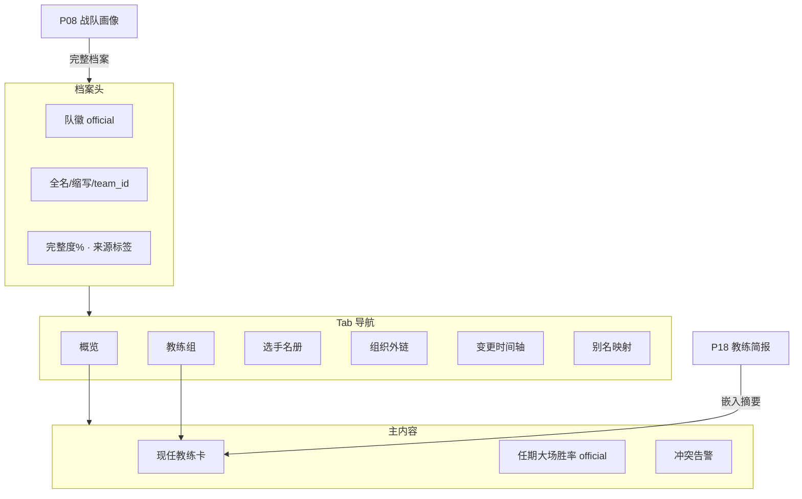

# P14 · 教练与战队元数据

> 导航：[P08 战队画像](./P08-战队画像与积分榜.md) · [P15 赛事舆情](./P15-赛事舆情与弹幕分析.md) · [00-数据源与合规矩阵](./00-数据源与合规矩阵.md)  
> 技术参考：[../数据字典.md](../数据字典.md) · [../接口逆向笔记.md](../接口逆向笔记.md) · [../项目设计.md](../项目设计.md)（历史架构参考，非当前实现真相源）

---

## 1. 产品定位
**一句话**：为教练、分析师与运营提供「战队—教练—选手—组织」可溯源元数据档案，将百科、官网、官微与官方赛程 ID 对齐，支撑赛前简报、对手画像与赛后归因上下文。

**主用户**

| 角色 | 核心诉求 |
|------|----------|
| 教练组 | 对手主教练风格、执教履历、换人/转会线索、任期断点 |
| 数据分析师 | `team_id` / 教练名 / 缩写统一映射，避免同义重复与舆情漏匹配 |
| KPI 运营 | 战队品牌信息、官微入口、对外素材一致性 |

**非目标**：粉丝向百科站、娱乐八卦时间线、自动采信未核验谣言、替代 P08 战绩分析。

**与现有系统关系**：官方接口不提供教练字段（见 [数据字典](../数据字典.md) 战队/选手表）；本模块在 `team_id` 主键之上叠加外部元数据层，消费方包括 P08、P11、P15、P16、P18。

---

## 2. 用户故事（含验收标准）
| ID | 作为… | 我希望… | 以便… | 验收标准 |
|----|--------|---------|--------|----------|
| US-14-01 | 分析师 | 用 `team_id` / 缩写打开战队档案 | 与 `parse_snapshot` 战队字段对齐 | 选中官方 `team_id` 后，档案头图显示 `team_name`、`team_abbreviation`、logo，与赛程一致 |
| US-14-02 | 教练 | 查看对手主教练履历与近期执教战绩 | 赛前会议 3 分钟内形成画像 | 档案页展示现任教练、任期、执教场次、大场胜率（窗口可配）；缺字段显示「待核实」 |
| US-14-03 | 分析师 | 看到元数据来源标签（百科/官网/官微/人工） | 判断可信度 | 每个字段旁有来源徽章；冲突字段并排展示并标「冲突」 |
| US-14-04 | 分析师 | 维护「别名 → 官方 ID」映射 | 舆情与赛程关联不丢匹配 | 支持别名增删改；改后 P15 关键词表同步更新（配置级） |
| US-14-05 | 运营 | 一键打开战队官网 / 微博 / 百科 | 快速核实公开信息 | 外链可点且记录 `last_checked_at`；链接失效进入「待修复」队列 |
| US-14-06 | 教练 | 按赛季查看教练更迭与阵容核心变化 | 理解风格断点 | 时间轴展示教练上任/离任与关键选手变动（人工标注优先） |

---

## 3. 信息架构与 UI
### 3.1 页面入口
- **全局导航**：元数据 / 战队档案（与 P08 并列；P08 偏战绩，P14 偏组织与人物）
- **交叉入口**：P08「完整档案」；P01 赛程卡片悬停「对手教练」；P18 简报自动嵌入教练摘要段

### 3.2 页面区块
1. **档案头（主）**：队徽、`team_name`、`team_abbreviation`、`team_id`、档案完整度、编辑入口  
2. **Tab 区（主）**：概览 / 教练组 / 选手名册 / 组织与外链 / 变更时间轴 / 映射与别名  
3. **概览卡（主）**：现任教练、任期战绩、字段冲突告警  
4. **底栏（辅）**：`last_sync`、人工核实人、导出 JSON

### 3.3 Mermaid 线框


### 3.4 状态设计
| 状态 | UI |
|------|-----|
| 加载 | 骨架屏 + 来源徽章灰色 |
| 空态 | 「尚无人工档案」+「从官方赛程初始化」 |
| 部分缺失 | 字段「待核实」；完整度 < 60% 黄标 |
| 冲突 | 黄条并排两值 +「采用」需权限 |
| 错误 | 不阻断 P08 战绩页 |

---

## 4. 关键指标与统计方法
| 指标 | 定义 | 窗口 | 公式/方法 | 数据来源层 |
|------|------|------|-----------|------------|
| 档案完整度 | 必填字段填充比例 | 当前快照 | `filled_required / required_total` | **代理**（工程规则） |
| 字段置信分 | 来源权威加权 | 当前 | 官网/官微=1.0，百科=0.7，人工核验=1.0 | **估算**（展示高/中/低） |
| 教练任期大场胜率 | 任期内大场胜/负 | 任期 ∩ 赛季 | `wins/(wins+losses)`；Beta(2,2) 平滑 | **官方**（赛果）+ **估算**（平滑） |
| 教练更迭次数 | 主教练变更次数 | 赛季/年 | 计数 | **代理**（人工时间轴） |
| 映射覆盖率 | 活跃战队有别名映射比例 | 当前赛季 | `mapped/active` | **代理**（运维 KPI） |

**教练口径**：任期胜率对比仅在各大场 ≥ 10 时展示 Wilson 95% 区间；否则标「样本不足」。

---

## 5. 数据源
| 层级 | 来源 | 用途 | 交叉引用 |
|------|------|------|----------|
| **主源** | 官方 `battle/open`、`matches/open` | `team_id`、`team_name`、`team_abbreviation`、`team_icon` | [数据字典](../数据字典.md) 表二；[接口逆向笔记](../接口逆向笔记.md) §一 |
| **辅源** | 战队官网、官方微博 | 教练名单、公告 | 半自动；合规矩阵 |
| **辅源** | 百度百科、维基 | 沿革、曾用名、履历线索 | 默认置信中/低；禁止自动覆盖官网 |
| **人工** | 教练组/运营录入 | 最终口径 | 优先于自动源 |
| **缺口** | 官方无 `coach_id` | 自建任期表 | 多对多 `team_id` ↔ `coach_id` |

### 字段映射

| 元数据字段 | 官方字段 | 备注 |
|------------|----------|------|
| `team_id` | `camp*.team_id` | 主键 |
| `team_name` | `camp*.team_name` | 展示以官方为准 |
| `team_abbr` | `camp*.team_abbreviation` | P15 默认关键词 |
| `team_icon` | `camp*.team_icon` | URL 缓存 |
| `coach_name` | — | 外部元数据 |
| `aliases[]` | — | 舆情匹配 |

### 落盘约定

```text
data/metadata/
  teams/{team_id}.json
  coaches/{coach_id}.json
  aliases.json
  sources_log/{yyyy-mm-dd}.jsonl
```

---

## 6. 算法与 AI
| 阶段 | 方法 | 数据来源层 |
|------|------|------------|
| 基线 | 规则抽取 + 字段模板 | 百科摘要正则 → **估算** |
| 进阶 | LLM 结构化（可选） | 输出 JSON；**必须人工确认** |
| 冲突消解 | 来源优先级状态机 | 人工 > 官网/官微 > 百科 |
| 不做 | 全自动信任百科写回 | 避免污染 P18 简报 |

---

## 7. 与竞品差异
| 对象 | 对齐 | 本产品更深 |
|------|------|------------|
| 粉丝百科 / 维基 | 基础人物与沿革 | **与官方 `team_id` 强绑定**；可进简报与模拟器 |
| 赛程站战队页 | logo、简介 | **来源置信与冲突管理**；教练任期战绩 |
| 付费数据商档案 | 组织信息 | 开源可自建；不绑定单一商 |

---

## 8. 实现优先级
| 优先级 | 能力 | 依赖 `scripts/dashboard.py` | 依赖 `scripts/kpl_official_core.py` |
|--------|------|----------------------------|-------------------------------------|
| **P0** | `team_id` 档案骨架（名/缩写/logo/外链位） | 战队画像页挂入口 | `parse_snapshot`、赛程归档 |
| **P0** | 人工编辑教练与别名；来源标签 | 新 Tab 或扩展 `page_team_profile` | `ScheduleCenter` 战队列表 |
| **P1** | 百科/官网半自动线索 + 冲突 UI | 表单 + 冲突条 | — |
| **P1** | 教练任期战绩接大场结果 | 与 P08 共用筛选 | `build_history_dataset` 产出 |
| **P2** | LLM 结构化建议流；变更时间轴 | 审核工作流 UI | — |

**本轮约束**：只写 PRD，不改 Python。

---

## 9. 验收清单
**数据正确性**

- [ ] 档案 `team_id` 与赛程、快照一致，无错绑  
- [ ] 官方名与百科别名冲突时，展示层默认官方名  
- [ ] 人工核验字段不被自动同步覆盖  

**性能**

- [ ] 档案页首屏 < 1.5s（本地 JSON 缓存）  
- [ ] 外链检查异步，不阻塞页面  

**视觉 / 教练可用性**

- [ ] 每个字段有来源徽章（官方/代理/估算）  
- [ ] 完整度与冲突状态一目了然  
- [ ] 深色数据台风格，无娱乐向装饰  

---

## 修订记录

| 日期 | 说明 |
|------|------|
| 2026-07-22 | 批次 P14–P20 初稿，对齐术语表与数据字典交叉引用 |
