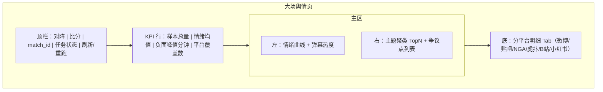
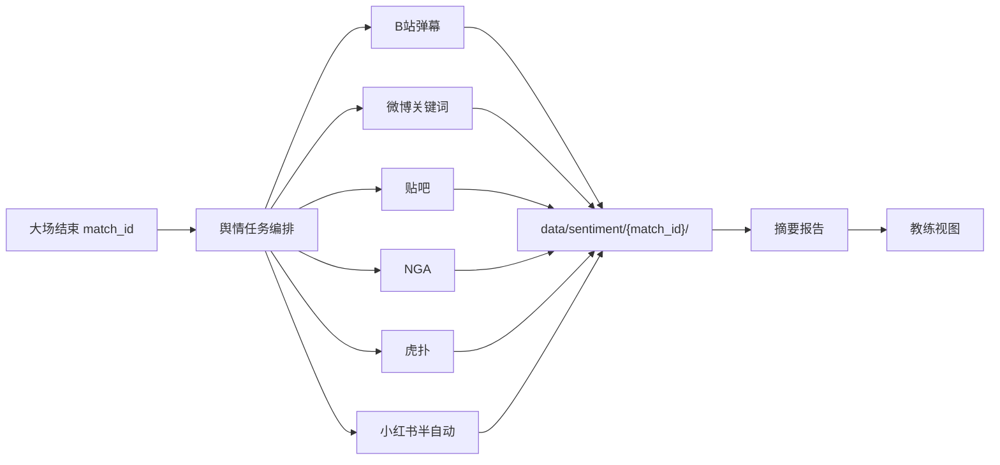

# P15 · 赛事舆情与弹幕分析

> 模块编号：P15  
> 状态：PRD（文档阶段，未改代码）  
> 主用户：教练组 / 数据分析师 / KPI 运营  
> 关联：[P01 赛程](./P01-赛事中心与赛程.md) · [P03 复盘](./P03-单局赛后复盘.md) · [P14 元数据](./P14-教练与战队元数据.md) · [P18 简报](./P18-导出报告与教练简报.md)  
> 技术参考：[../数据字典.md](../数据字典.md) · [../接口逆向笔记.md](../接口逆向笔记.md) · [../项目设计.md](../项目设计.md)（历史架构参考，非当前实现真相源）  
> **落盘强制**：`data/sentiment/{match_id}/`（赛后任务产出，与赛程 `match_id` 关联）

---

## 1. 产品定位

**一句话**：大场结束后自动（或半自动）汇聚多平台舆情与 B 站弹幕，按 `match_id` 落盘并可复看，把「舆论焦点 / 情绪 / 争议点」对齐到赛程与赛果，供教练会与运营复盘。

**目标用户**

| 角色 | 用途 |
|------|------|
| 教练组 | 了解外界对 BP、选手发挥、判罚/节奏的舆论焦点（非战术真理） |
| 数据分析师 | 情绪曲线与赛果、关键事件时间对齐 |
| KPI 运营 | 话题热度、负面峰值、素材风险提示 |

**非目标**：全站实时舆情监控中心、水军清洗 SaaS、小红书「全站实时」虚假能力。

---

## 2. 用户故事（含验收标准）

| ID | 作为… | 我希望… | 以便… | 验收标准 |
|----|--------|---------|--------|----------|
| US-15-01 | 分析师 | 大场结束后看到该 `match_id` 的舆情任务状态 | 知道是否可看报告 | 赛程状态=已结束触发任务；状态机含 `pending/running/partial/done/failed` |
| US-15-02 | 教练 | 阅读「主题 / 情绪 / 争议点 / 与赛果关联」一页摘要 | 会前 5 分钟掌握舆论面 | 摘要 ≤ 1 屏；每条结论带来源平台计数 |
| US-15-03 | 分析师 | 查看 B 站弹幕热度与关键词时间轴 | 对照比赛关键节点 | 弹幕按分钟聚合；可与官方事件时间粗对齐（±60s 标注） |
| US-15-04 | 运营 | 区分平台采样偏差 | 避免被单一平台带节奏 | 各平台卡片显示样本量、时间窗、偏差提示文案 |
| US-15-05 | 分析师 | 小红书走半自动分层 | 不强行承诺全量 | UI 明确「检索补录 / 人工粘贴 / API（若有）」三档，未配置时不显示假实时流 |
| US-15-06 | 分析师 | 后人打开历史 `match_id` 仍能复看落盘结果 | 赛季复盘 | 数据在 `data/sentiment/{match_id}/`；缺文件显示空态而非报错 |
| US-15-07 | 教练 | 过滤应援口号与纯表情弹幕噪声 | 聚焦可讨论主题 | 可切换「原始 / 清洗后」；清洗规则可配置 |

---

## 3. 信息架构 & UI

### 3.1 入口

- 赛程卡片（P01）：比赛结束后出现「舆情」徽章（绿=done / 黄=partial / 灰=未跑）
- 比赛下钻（P03）：Tab「舆情与弹幕」
- 独立页：舆情中心（按日期/战队/match 检索）

### 3.2 布局线框



### 3.3 分平台信息架构



### 3.4 状态设计

| 状态 | UI |
|------|-----|
| 加载 | 曲线骨架 +「正在拉取 B 站弹幕…」分平台进度 |
| 空态（比赛未结束） | 「大场结束后自动生成」 |
| partial | 已完成平台正常展示；失败平台黄标「采样失败/延迟」 |
| 全失败 | 错误卡 + 日志入口（链到 P17） |
| 小红书未配置 | 固定说明卡：「半自动层：支持导入 CSV / 粘贴笔记链接列表」 |

---

## 4. 关键指标与统计方法

| 指标 | 定义 | 窗口 | 方法 | 教练向说明 |
|------|------|------|------|------------|
| 弹幕速率 | 每分钟弹幕条数 | 整场直播/回放 | `count / minute` | 峰值分钟作「舆论高燃点」 |
| 情绪分 | 文本情感极性 | 全场 / 分平台 | 词典+分类模型；归一化到 `[-1,1]` | 展示均值与 10%/90% 分位 |
| 负面峰值 | 情绪分最低的时间桶 | 1min bucket | `argmin(mean_sent)` | 与死亡/推塔事件对照（非因果断言） |
| 主题份额 | 聚类主题占比 | 全场 | 关键词/嵌入聚类 | Top5 主题 + 代表原句（脱敏） |
| 战队提及比 | A队 vs B队提及次数比 | 全场 | 别名词典匹配（P14） | 应援偏差提示 |
| 平台覆盖度 | 成功采样平台数 / 计划平台数 | 任务级 | 计数 | < 0.5 标「低覆盖」 |
| 赛果关联摘要 | 胜负方与情绪差的描述统计 | 赛后 | 胜方提及情绪 − 负方 | **相关非因果**文案强制展示 |

**置信与偏差**

- 微博/贴吧/NGA/虎扑：搜索 API 或合规采集的**采样集**，非全量；延迟写进报告头。
- B 站：弹幕相对可复现；注明抓取频率与回放接口限制。
- 小红书：强反爬 → **不做全站实时承诺**。

---

## 5. 数据源与产品承诺

| 源 | 能做什么 | 产品承诺 |
|----|----------|----------|
| B 站直播间/回放弹幕 | 文本、时间戳、热度曲线、关键词、情绪 | **可做**；注明频率与合规 |
| 微博 | 赛后「战队名+选手+比赛日」话题与情感 | **可做**；延迟与采样偏差写清 |
| 贴吧 | 吧内主题帖聚合 | **可做**；噪声高，需清洗 |
| NGA | 论坛帖/回复情绪与争议点 | **可做**；社区用语需词典 |
| 虎扑 | 主队/赛事帖情感 | **可做**；主队偏差显著 |
| 小红书 | 笔记标题/摘要级信号 | **半自动分层**（见下） |

### 5.1 小红书半自动分层

| 层 | 方式 | 何时用 |
|----|------|--------|
| L1 人工补录 | 运营粘贴笔记链接或导出文本 | 默认可用 |
| L2 检索辅助 | 合规检索 API / 官方开放能力（若具备） | 有密钥时启用 |
| L3 批量导入 | CSV/JSON 模板导入 | 赛后专题复盘 |

UI 禁止出现「小红书实时全站监控」文案。

### 5.2 与赛程关联

- 触发键：`match_id`（大场，非单局 `battle_id`）
- 关键词：双方 `team_name` / `team_abbreviation` / P14 `aliases` + 比赛日
- 单局弹幕若只能拿到某局直播间，在元数据中记录 `battle_id` 列表，汇总到 `match_id`

### 5.3 落盘结构（强制约定）

```text
data/sentiment/{match_id}/
  manifest.json          # 任务状态、平台覆盖、时间窗、版本
  summary.json           # 教练摘要：主题/情绪/争议/赛果关联
  bilibili_danmaku.parquet
  weibo_samples.jsonl
  tieba_samples.jsonl
  nga_samples.jsonl
  hupu_samples.jsonl
  xhs_manual.jsonl       # 半自动层
  charts/                # 可选预渲染
```

`manifest.json` 最低字段：`match_id`, `teams`, `kickoff_at`, `ended_at`, `sources[]`, `status`, `generated_at`。

---

## 6. 算法与 AI

| 阶段 | 方法 |
|------|------|
| 基线 | 关键词词典（战队/选手/BP/裁判/节奏）+ 情感词典 |
| 进阶 | 文本分类（争议类型：BP 争议、发挥、判罚、赛制、其它） |
| 进阶 | 主题聚类（嵌入 + HDBSCAN/同类）；代表句抽取 |
| 可选 | LLM 生成「教练会三句话」摘要，必须附原平台计数，可关 |
| 不做 | 把舆情情绪当胜率特征默认进 P07（须在 P20 实验显式打开） |

---

## 7. 与竞品差异

| 对象 | 对齐 | 碾压点 |
|------|------|--------|
| 纯弹幕网站 | 弹幕热词 | **与 `match_id` 赛程/赛果强绑定 + 落盘复看** |
| 社媒监听工具 | 多平台情绪 | **电竞域词典 + 教练摘要模板 + 偏差标签** |
| 粉丝情绪帖 | 主观感受 | 可复现目录结构，供分析师复查 |

---

## 8. 实现优先级

| 优先级 | 内容 | 依赖 |
|--------|------|------|
| **P0** | 目录约定 `data/sentiment/{match_id}/` + manifest/summary  schema | 赛程结束事件 |
| **P0** | B 站弹幕拉取与热度/情绪曲线 | 合规采集；P01 `match_id` |
| **P1** | 微博/贴吧/NGA/虎扑赛后关键词采样 | 合规矩阵；P14 别名 |
| **P1** | 比赛页舆情 Tab + 教练摘要 | Dashboard |
| **P2** | 小红书半自动导入模板；LLM 摘要 | 人工流程 |
| **P2** | 与 P18 简报「舆论焦点」章节联动 | P18 |

**现有代码映射**：赛程结束信号来自监控/赛程归档；Dashboard「比赛下钻」扩 Tab；**本阶段不改代码**。

---

## 9. 验收清单

### 数据正确性
- [ ] 舆情目录键为 `match_id`，可反查对阵与比分
- [ ] summary 中每条主题有平台来源计数
- [ ] 小红书无自动化时不伪造数据点

### 性能
- [ ] 单场 B 站弹幕解析在可接受批处理时限内完成（文档默认目标 < 10min）
- [ ] 历史复看只读本地落盘，不现场重爬

### 视觉
- [ ] 平台偏差提示可见
- [ ] 情绪曲线与弹幕热度同轴或可联动刷选
- [ ] 数据来源标签：舆情（非官方战绩）

---

## 10. 合规提示（产品层）

- 遵守各平台 ToS 与频率限制；失败记入 P17。
- 展示原句需脱敏（手机号/站外人身攻击策略按运营配置）。
- 不在文档阶段启动真实爬虫打第三方站（计划约束）。
