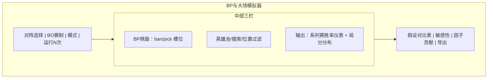
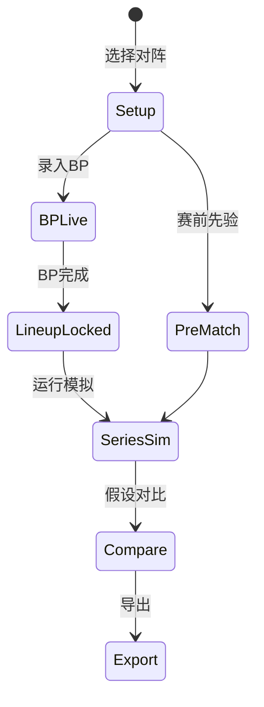

# P16 · BP 与大场胜率模拟器

> 模块编号：P16  
> 状态：PRD（文档阶段，未改代码）  
> 主用户：教练组 / 数据分析师  
> 关联：[P04 BP看板](./P04-BP看板与阵容分析.md) · [P07 实时胜率](./P07-实时胜率与官方胜率对标.md) · [P10 Meta](./P10-英雄Meta与组合胜率.md) · [P20 算法实验室](./P20-进阶算法实验室.md)  
> 技术参考：[../数据字典.md](../数据字典.md) · [../接口逆向笔记.md](../接口逆向笔记.md) · [../项目设计.md](../项目设计.md)（历史架构参考，非当前实现真相源）

---

## 1. 产品定位

**一句话**：在赛前/BP 中/局间，为教练提供基于历史阵容与战队先验的**大场（系列赛）胜率模拟**与 BP 路径推演，输出可解释的假设对比，而非黑箱「玄学胜率」。

**目标用户**

| 角色 | 用途 |
|------|------|
| 教练组 | 红蓝方、BP 顺序、阵容假设下的大场胜率区间 |
| 数据分析师 | 蒙特卡洛假设检验、敏感性（某一 ban/pick 的边际贡献） |

**非目标**：替代临场教练决策；保证单局预测必中；电子游戏式「自动一键最优 BP」（可做建议，须标不确定性）。

---

## 2. 用户故事（含验收标准）

| ID | 作为… | 我希望… | 以便… | 验收标准 |
|----|--------|---------|--------|----------|
| US-16-01 | 教练 | 选择两支战队与 BO 赛制 | 得到系列赛胜率 | 输入 `team_A/B`、`bo_n`（3/5/7），输出 A 赢系列赛概率 + 95% 区间 |
| US-16-02 | 分析师 | 录入当前已 ban/pick | 更新后验胜率 | 支持逐步 BP；每步刷新；可回退 |
| US-16-03 | 教练 | 对比两个阵容假设 | 会前讨论 | 并排假设 A/B，显示 Δwin% 与主要驱动因子 |
| US-16-04 | 分析师 | 看到单局胜率如何合成大场胜率 | 解释给教练 | 展示「单局 p → BO 马尔可夫/蒙特卡洛」示意图与公式 tooltip |
| US-16-05 | 教练 | 使用战队英雄池约束 | 避免不可能阵容 | 可开关「仅历史出场英雄」；池外英雄标警告 |
| US-16-06 | 分析师 | 导出模拟配置与结果 | 写入赛前简报 | 一键导出 JSON/Markdown 片段到 P18 |
| US-16-07 | 分析师 | 区分先验/阵容/实时三种模式 | 避免误用 | 模式标签：赛前先验、BP 完成、局内实时（只读链到 P07） |

---

## 3. 信息架构 & UI

### 3.1 入口

- 导航：模拟器
- P04 BP 看板：「送入模拟器」
- P01 赛前对阵卡：「赛前模拟」

### 3.2 线框

### 3.3 交互状态机

### 3.4 状态设计

| 状态 | UI |
|------|-----|
| 加载历史池 | 英雄池骨架 |
| 空态 | 「选择战队开始」 |
| 样本不足 | 单局 p 使用联赛均值回退，黄标「战队样本 < k」 |
| 运行中 | 进度条（蒙特卡洛 N） |
| 错误 | 非法 BP（重复英雄）内联校验 |

---

## 4. 关键指标与统计方法

| 指标 | 定义 | 方法 |
|------|------|------|
| 单局胜率 \(p\) | 当前假设下 A 赢一局概率 | 逻辑回归 / 梯度提升 on 阵容特征 + 战队先验；或历史同阵容平滑胜率 |
| 大场胜率 \(P_{\mathrm{series}}\) | A 先赢 \(\lceil n/2\rceil\) 局概率 | 独立同分布假设下蒙特卡洛或马尔可夫；默认展示两种若差异 > 2pp |
| 局分分布 | 系列赛比分概率质量函数 | 模拟直方图（如 3-1、3-2） |
| 边际 ban 价值 | 某 ban 对 \(P_{\mathrm{series}}\) 的影响 | 有无该 ban 的 Δ |
| 阵容协同分 | pick 组合历史同出场表现 | 见 P10；贝叶斯平滑 |
| 置信区间 | 模拟不确定性 | 百分位区间；并叠加模型校准误差条 |

**公式（教练向 tooltip）**

- BO5，单局独立：\(P(\text{A wins series}) = \sum_{k=3}^{5} \binom{5}{k} p^k (1-p)^{5-k}\)（先至 3 胜的截断形式用递推/模拟更直观，UI 以模拟为主）。
- **独立同分布是强假设**：UI 固定文案「未建模局间心理/BP 学习效应；进阶见 P20」。

**窗口**：默认近 2 个完整赛季 + 当前赛季；可切换。

---

## 5. 数据源

| 层级 | 来源 | 字段 |
|------|------|------|
| **主源** | 官方 `bp_list`、`battle_player_list`（英雄/位置） | 历史 BP 与出场 |
| **主源** | 赛程大场胜负 | 系列赛标签 |
| **辅源** | 战队先验（历史胜率，无泄漏口径同训练脚本） | `team_winrate_diff` 同类 |
| **辅源** | P10 Meta 胜率表 | 英雄/组合先验 |
| **缺口** | 选手个人英雄熟练隐藏分 | 用出场次数与近窗胜率代理 |
| **实时** | P07 局内胜率 | 仅「局内模式」只读引用，不在 BP 模拟里偷偷用未来帧 |

### 5.1 与现有解析对齐

- `bp_list`：见 `docs/数据字典.md`
- 选手英雄：`hero_id` / `hero_name` / `position_desc`
- 训练先验逻辑参考 `scripts/train_realtime_model_v9.py` 的战队先验思想（赛前无泄漏）

---

## 6. 算法与 AI

| 阶段 | 模型 | 说明 |
|------|------|------|
| 基线 | 历史阵容平滑胜率 + 战队 Elo/贝叶斯胜率合成 | 可解释、先上线 |
| 进阶 | 学习排序/分类模型预测单局 p | 特征：双方 pick、ban、位置、版本补丁桶 |
| 校准 | Isotonic / Platt on holdout | 仪表盘旁显示 ECE |
| 进阶 | 反事实：替换单一 pick 的 Δp | 教练「如果当时抢 X」 |
| 实验（P20） | 序列 BP 的 RL 建议 | 不进默认 P0 |

**护栏**：经济/版本突变期手动降权历史样本；输出强制带「模型版本 + 训练窗」。

---

## 7. 与竞品差异

| 对象 | 对齐 | 碾压点 |
|------|------|--------|
| 百科/帖子经验贴 | 口头 BP 讨论 | **可复现模拟与区间** |
| 简易胜率计算器 | 输入战队出百分比 | **BP 逐步、假设对比、边际 ban 价值** |
| 黑盒付费模型 | 单点胜率 | **因子贡献 + 校准指标公开** |

---

## 8. 实现优先级

| 优先级 | 内容 | 依赖 |
|--------|------|------|
| **P0** | 赛前先验大场蒙特卡洛（战队胜率 → 单局 p → BO） | 赛程归档、战队胜负 |
| **P0** | BP 棋盘 UI + 非法校验 | P04 字段 |
| **P1** | 阵容特征模型 p；敏感性 | 历史 bp/player 表 |
| **P1** | 假设对比与导出 | P18 |
| **P2** | RL/序列建议（实验开关） | P20 |

**现有代码映射**：历史设计中的 `simulator.py` / BO 蒙特卡洛思路；实时 p 不与 V11 局内曲线混用除非显式模式；**本阶段不改代码**。

---

## 9. 验收清单

### 数据正确性
- [ ] 英雄不重复、位置可选约束生效
- [ ] 样本不足时回退逻辑可测
- [ ] 导出配置可复现同一随机种子结果

### 性能
- [ ] N=10_000 模拟 < 2s（本地）
- [ ] BP 每步增量更新不卡顿

### 视觉
- [ ] 系列胜率与局分分布同屏
- [ ] 模式与数据来源标签清晰（估算/历史/模型）

---

## 10. 交叉引用

| 主题 | 文档 |
|------|------|
| `bp_list` 四阶段与字段 | [../数据字典.md](../数据字典.md) |
| 赛程 / battle 获取 | [../接口逆向笔记.md](../接口逆向笔记.md) |
| BP 看板 UI | [P04](./P04-BP看板与阵容分析.md) |
| Meta 先验 | [P10](./P10-英雄Meta与组合胜率.md) |
| 局内胜率（只读模式） | [P07](./P07-实时胜率与官方胜率对标.md) |
| RL 建议（实验） | [P20](./P20-进阶算法实验室.md) |
| 导出片段 | [P18](./P18-导出报告与教练简报.md) |

---

## 修订记录

| 日期 | 说明 |
|------|------|
| 2026-07-22 | 初稿 |
| 2026-07-22 | 补强：交叉引用章 |
