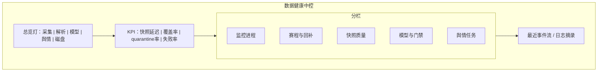
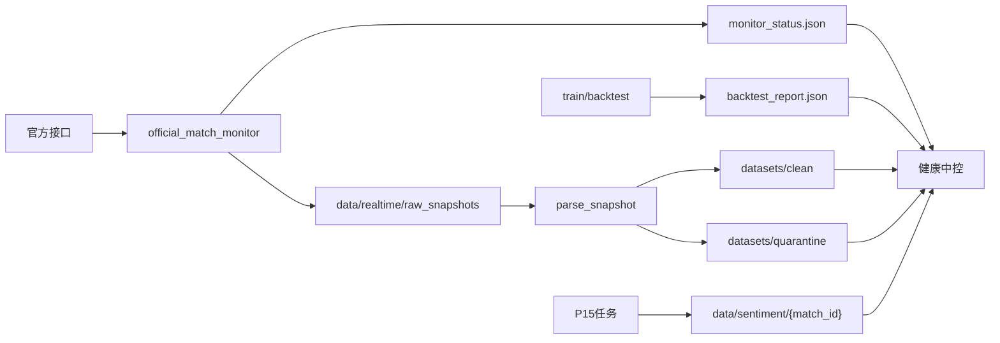

# P17 · 数据健康与采集中控

> 模块编号：P17  
> 状态：PRD（文档阶段，未改代码）  
> 主用户：数据分析师 / KPI 运营 /（兼顾教练只读健康灯）  
> 关联：[P01 赛程](./P01-赛事中心与赛程.md) · [P02 实时中控](./P02-实时中控台.md) · [P07 胜率](./P07-实时胜率与官方胜率对标.md) · [P15 舆情](./P15-赛事舆情与弹幕分析.md)  
> 技术参考：[../数据字典.md](../数据字典.md) · [../接口逆向笔记.md](../接口逆向笔记.md) · [../项目设计.md](../项目设计.md)（历史架构参考，非当前实现真相源）

---

## 1. 产品定位

**一句话**：把赛程监控、快照采集、回补、模型与舆情任务的运行状态收敛到一个「数据健康中控」，让分析师在赛前/赛中/赛后快速判断「数能不能信、哪里断了」。

**目标用户**

| 角色 | 用途 |
|------|------|
| 数据分析师 | SLA、缺口局、quarantine、模型版本 |
| KPI 运营 | 采集覆盖率、任务失败告警 |
| 教练组 | 只读「数据可用/降级」灯，避免误读过期胜率 |

**非目标**：通用 APM 替代品；改采集策略的自动化攻击性重试风暴。

---

## 2. 用户故事（含验收标准）

| ID | 作为… | 我希望… | 以便… | 验收标准 |
|----|--------|---------|--------|----------|
| US-17-01 | 分析师 | 一眼看到监控进程是否存活 | 决定是否相信实时页 | 展示 `monitor_status` 心跳时间；超时标红 |
| US-17-02 | 分析师 | 看到今日赛程采集覆盖率 | 发现漏采 | `已采 battle / 应采 battle`；点入缺口列表 |
| US-17-03 | 分析师 | 区分 clean / quarantine 数据集 | 训练与展示隔离 | 数量、样例原因、最近入库时间 |
| US-17-04 | 运营 | 收到采集失败原因分类 | 排障 | 错误桶：网络/解析/空包/限流/未知 |
| US-17-05 | 分析师 | 查看模型版本与回测门禁 | 上线置信 | 展示 Brier/ECE 门禁通过与否（读报告 JSON） |
| US-17-06 | 分析师 | 查看舆情任务健康（P15） | 知道哪些 match 缺报告 | 按日列出 `sentiment` manifest 状态 |
| US-17-07 | 教练 | 在实时页看到「数据降级」提示 | 避免用坏数决策 | 当快照延迟 > 阈值，P02 顶栏黄灯链到本页 |

---

## 3. 信息架构 & UI

### 3.1 入口

- Dashboard 现有「数据运维」页升级为本 PRD 的健康中控
- 全局顶栏健康灯（绿/黄/红）

### 3.2 线框

### 3.3 数据流（运维视角）

### 3.4 状态设计

| 状态 | UI |
|------|-----|
| 加载 | 卡片骨架 |
| 空态 | 新环境：「尚未运行监控」+ 启动命令提示（只读文档链接） |
| 降级 | 黄：延迟高但仍有数 |
| 故障 | 红：心跳超时 / 连续失败 |
| 权限 | 教练角色隐藏敏感路径细节，仅灯与一句话 |

---

## 4. 关键指标与统计方法

| 指标 | 定义 | 窗口 | 阈值建议（可配） |
|------|------|------|------------------|
| 心跳延迟 | `now - last_heartbeat` | 实时 | > 30s 黄；> 120s 红 |
| 快照间隔 | 相邻快照时间差中位数 | 当前 battle | > 3× 配置 interval 黄 |
| 赛程覆盖率 | 已落盘终局 / 已结束应采 | 今日/赛季 | < 0.95 黄 |
| 解析成功率 | 成功 `parse_snapshot` / 尝试 | 24h | < 0.99 黄 |
| quarantine 率 | quarantine / (clean+quarantine) | 7d | 上升趋势告警 |
| 模型门禁 | backtest gates pass | 当前版本 | fail 则红灯，禁止标「生产可信」 |
| 舆情完成率 | done manifest / 已结束 match | 7d | < 0.8 黄 |
| 磁盘占用 | snapshots + sentiment | 实时 | 超配额黄 |

**统计方法**：失败率用滚动 1h/24h；覆盖率分母来自赛程归档 `schedule_archive`。

---

## 5. 数据源

| 主源 | 路径/对象 | 用途 |
|------|-----------|------|
| 监控状态 | `data/realtime/monitor_status.json` | 心跳、当前 match/battle |
| 回补状态 | `data/realtime/backfill_status.json` | 回补进度 |
| 训练状态 | `data/realtime/train_status.json` | 训练任务 |
| 原始快照 | `data/realtime/raw_snapshots/{battle_id}/` | 覆盖与延迟 |
| 赛程归档 | `data/realtime/schedule_archive.csv` | 应采集合 |
| 回测报告 | `data/realtime/backtest_v9_report.json` 等 | 门禁 |
| 舆情 | `data/sentiment/{match_id}/manifest.json` | P15 健康 |
| 核心库 | `scripts/kpl_official_core.py` | 健康报告函数（若已有则展示） |

**辅源**：操作系统进程列表（可选，文档阶段仅建议）。

**缺口**：统一告警通道（邮件/IM）— P2。

---

## 6. 算法与 AI

本模块以规则与阈值为主：

| 能力 | 方法 |
|------|------|
| 异常检测 | 延迟、失败率的滚动 z-score 或分位数 |
| 根因初筛 | 错误栈关键词桶分类 |
| 不做 | 自动无上限重爬；自动提交外部任务 |

---

## 7. 与竞品差异

| 对象 | 对齐 | 碾压点 |
|------|------|--------|
| 裸日志 | 排障信息 | **教练可读健康灯 + 覆盖率缺口列表** |
| 通用监控 SaaS | uptime | **赛事语义（battle/match/clean）一等公民** |
| Dashboard 简易运维页 | 状态 JSON | **模型门禁、舆情、quarantine 一体化** |

---

## 8. 实现优先级

| 优先级 | 内容 | 依赖 |
|--------|------|------|
| **P0** | 升级现有「数据运维」：心跳、覆盖率、缺口列表 | `dashboard.py`、`monitor_status`、`schedule_archive` |
| **P0** | clean/quarantine 计数与样例原因 | 数据集约定 |
| **P1** | 模型门禁面板读 backtest 报告 | `backtest_realtime_v9.py` 产出 |
| **P1** | 舆情任务健康面板 | P15 manifest |
| **P2** | 告警推送；错误自动分类增强 | 运营配置 |

**现有代码映射**：`scripts/dashboard.py` 数据运维页；`scripts/official_match_monitor.py`；`scripts/kpl_official_core.py`；**本阶段不改代码**。

---

## 9. 验收清单

### 数据正确性
- [ ] 覆盖率分母只含「应采且已结束」局
- [ ] 门禁状态与报告文件一致
- [ ] 红灯时 P02 有降级提示（联调项）

### 性能
- [ ] 健康页刷新 ≤ 5s 周期不阻塞
- [ ] 大目录扫描有缓存

### 视觉
- [ ] 五灯总览首屏可见
- [ ] 缺口列表可复制 `battle_id`

---

## 10. 交叉引用

| 主题 | 文档 |
|------|------|
| Headers / 限流 / battle_id | [../接口逆向笔记.md](../接口逆向笔记.md) |
| 字段解析失败对照 | [../数据字典.md](../数据字典.md) |
| 舆情任务健康 | [P15](./P15-赛事舆情与弹幕分析.md) · `data/sentiment/{match_id}/manifest.json` |
| 实时降级提示 | [P02](./P02-实时中控台.md) |
| 实验门禁 | [P20](./P20-进阶算法实验室.md) |
| 合规禁爬 | [00-数据源与合规矩阵](./00-数据源与合规矩阵.md) |

---

## 修订记录

| 日期 | 说明 |
|------|------|
| 2026-07-22 | 初稿 |
| 2026-07-22 | 补强：交叉引用；舆情健康入口 |
