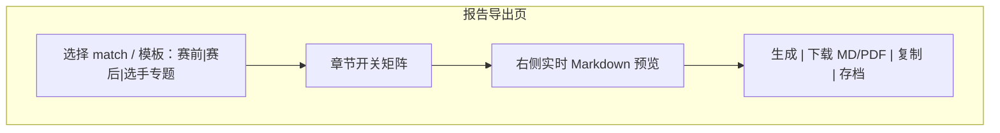
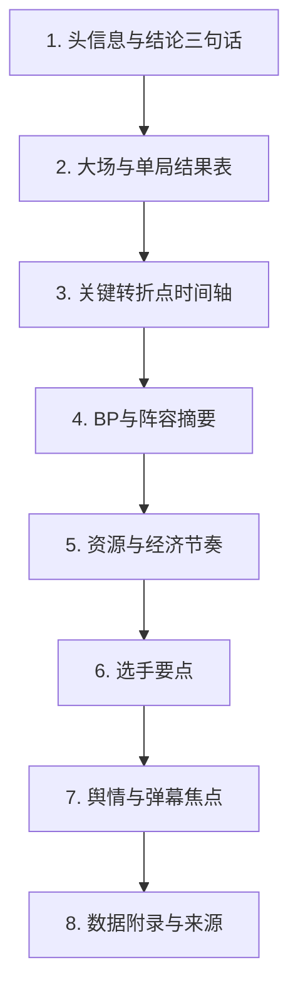

# P18 · 导出报告与教练简报

> 模块编号：P18  
> 状态：PRD（文档阶段，未改代码）  
> 主用户：教练组 / 数据分析师 / KPI 运营  
> 关联：[P03 复盘](./P03-单局赛后复盘.md) · [P12 归因](./P12-赛段切片与胜负归因.md) · [P15 舆情](./P15-赛事舆情与弹幕分析.md) · [P16 模拟器](./P16-BP与大场胜率模拟器.md)  
> 技术参考：[../数据字典.md](../数据字典.md) · [../接口逆向笔记.md](../接口逆向笔记.md) · [../项目设计.md](../项目设计.md)（历史架构参考，非当前实现真相源）

---

## 1. 产品定位

**一句话**：一键把赛前模拟、赛中关键曲线、赛后归因与舆情焦点组装成**教练简报**（Markdown/PDF/图片卡），保证指标带来源标签与可复现数据快照。

**目标用户**

| 角色 | 用途 |
|------|------|
| 教练组 | 会前/会后 1 份结构化简报 |
| 数据分析师 | 可复现导出，附参数与版本 |
| KPI 运营 | 对外/对内素材切片（可脱敏） |

**非目标**：自动生成公关稿；无人工审阅的对外发布流水线。

---

## 2. 用户故事（含验收标准）

| ID | 作为… | 我希望… | 以便… | 验收标准 |
|----|--------|---------|--------|----------|
| US-18-01 | 教练 | 选择一场大场生成赛后简报 | 复盘会直接用 | 输出含对阵、比分、局列表、转折点、资源、舆情摘要 |
| US-18-02 | 教练 | 生成赛前简报 | 准备会议 | 含 H2H、近期状态、P16 模拟、注意事项 |
| US-18-03 | 分析师 | 导出时锁定数据版本 | 事后可审计 | 简报头写 `generated_at`、模型版本、快照范围、sentiment manifest 版本 |
| US-18-04 | 分析师 | 选择章节开关 | 控制篇幅 | 可关舆情/模拟/选手雷达等块 |
| US-18-05 | 运营 | 导出 PNG 图卡（胜率曲线、经济差） | 投放素材 | 单图带数据来源脚注 |
| US-18-06 | 分析师 | 批量导出某日所有大场 | 日报 | 任务队列+进度；失败可重试单场 |
| US-18-07 | 教练 | 简报内指标有定义 tooltip 文本附录 | 统一口径 | 附录含指标词典链接或内嵌短定义 |

---

## 3. 信息架构 & UI

### 3.1 入口

- 比赛下钻页：「生成教练简报」
- 赛程列表：批量
- 模拟器：导出片段
- 独立「报告中心」：历史简报库

### 3.2 线框



### 3.3 简报结构（默认赛后模板）



### 3.4 状态设计

| 状态 | UI |
|------|-----|
| 加载依赖 | 「拉取复盘/舆情…」分章节进度 |
| 缺依赖 | 章节显示「无数据已跳过」（如舆情 partial） |
| 生成中 | 不可重复点击；可取消 |
| 成功 | 预览+下载链接；写入 `data/reports/` |
| 错误 | 指出失败章节与日志 |

---

## 4. 关键指标与统计方法

简报本身是组装层；嵌入指标继承各 PRD 定义，并遵守：

| 规则 | 说明 |
|------|------|
| 来源标签 | 官方 / 估算 / 舆情 / 模拟 四选一强制 |
| 样本声明 | 凡胜率类附场次 n |
| 不确定性 | 模拟类附区间；模型类附版本 |
| 结论句限制 | 默认 ≤ 3 条；每条可回溯到图表/表 |

**赛后「结论三句话」生成逻辑（基线规则）**

1. 大场结果 + 关键局（最长/翻盘局）  
2. 最大胜率波幅或经济转折（P07/P12）  
3. 舆论 Top1 主题（P15，可关）

进阶可用 LLM 润色，但必须可切换回规则版。

---

## 5. 数据源

| 章节 | 主源 | 辅源 |
|------|------|------|
| 头信息 | 赛程归档、大场比分 | P14 队名口径 |
| 转折点 | 快照事件、V11 胜率曲线 | P12 归因 |
| BP | `bp_list` | P04/P16 |
| 资源经济 | `parse_snapshot` 资源/分路字段 | P06 |
| 选手 | `battle_player_list` | P05/P09 |
| 舆情 | `data/sentiment/{match_id}/summary.json` | — |
| 模拟 | P16 导出 JSON | — |

### 5.1 落盘约定

```text
data/reports/{match_id}/
  brief_postmatch_{timestamp}.md
  brief_postmatch_{timestamp}.meta.json
  assets/*.png
```

`meta.json`：章节开关、版本、依赖文件哈希。

字段与接口真相源：[../数据字典.md](../数据字典.md) · [../接口逆向笔记.md](../接口逆向笔记.md)。历史架构参考（非现行真源）：[../项目设计.md](../项目设计.md)。

---

## 6. 算法与 AI

| 阶段 | 方法 |
|------|------|
| 基线 | 模板填充 + 规则选转折点（胜率斜率极值、资源互换） |
| 进阶 | LLM 摘要（中文教练语气）；输入仅限已计算指标 JSON |
| 护栏 | 禁止模型编造不存在的数据点；数字必须来自输入 JSON |

---

## 7. 与竞品差异

| 对象 | 对齐 | 碾压点 |
|------|------|--------|
| 手工复制 Dashboard 截图 | 图 | **结构化、可复现、带来源** |
| 通用 BI 导出 | 表 | **电竞教练模板 + 舆情/模拟混排** |
| 媒体战报 | 叙事 | 指标可追溯，适合专业组 |

---

## 8. 实现优先级

| 优先级 | 内容 | 依赖 |
|--------|------|------|
| **P0** | 赛后 Markdown 模板 + 单场导出 | P03/P07 数据可读 |
| **P0** | meta 版本信息 | 模型版本文件 |
| **P1** | 赛前模板；图卡 PNG | P16、绘图组件 |
| **P1** | 舆情章节 | P15 summary |
| **P2** | PDF；批量日报；LLM 润色开关 | 报告中心 |

**现有代码映射**：Dashboard 复盘与战报素材；**本阶段不改代码**。

---

## 9. 验收清单

### 数据正确性
- [ ] 简报比分、局序与官方赛程一致
- [ ] 无舆情数据时不生成假情绪数字
- [ ] meta 可复现同一输入

### 性能
- [ ] 单场 Markdown < 5s（不含 LLM）
- [ ] 批量有进度与失败重试

### 视觉
- [ ] 预览符合深色数据台导出为打印友好浅色可选
- [ ] 脚注来源完整

---

## 10. 交叉引用

| 主题 | 文档 |
|------|------|
| 战报/曲线素材 | [P03](./P03-单局赛后复盘.md) · [P07](./P07-实时胜率与官方胜率对标.md) |
| 赛段归因块 | [P12](./P12-赛段切片与胜负归因.md) |
| 舆情块（可选） | [P15](./P15-赛事舆情与弹幕分析.md) · `data/sentiment/{match_id}/summary.json` |
| 行为块（可选，默认仅 L1/L2） | [P19](./P19-行为指标-入侵开团支援.md)（**不含 CV**） |
| 模拟片段 | [P16](./P16-BP与大场胜率模拟器.md) |
| 教练元数据摘要 | [P14](./P14-教练与战队元数据.md) |
| 字段/接口真源 | [../数据字典.md](../数据字典.md) · [../接口逆向笔记.md](../接口逆向笔记.md) |
| 来源标签 | [00-术语表](./00-术语表.md) |

**简报默认章节开关**：舆情默认开（有落盘才渲染）；P19 实验层（L3）默认关。

---

## 修订记录

| 日期 | 说明 |
|------|------|
| 2026-07-22 | 初稿 |
| 2026-07-22 | 补强：交叉引用；舆情/行为块默认开关 |
