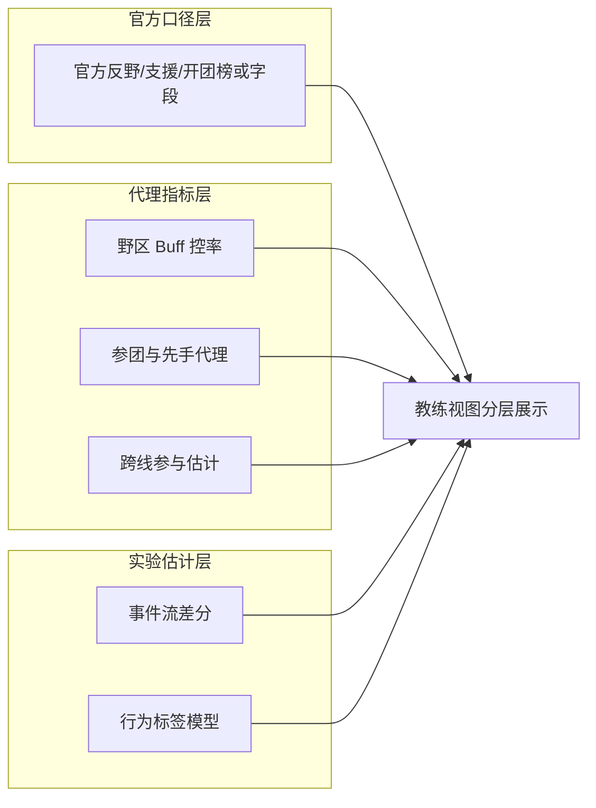
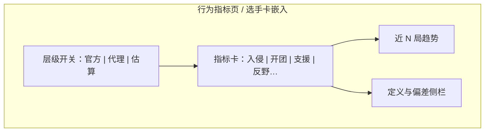

# P19 · 行为指标：入侵 / 开团 / 支援

> 模块编号：P19  
> 状态：PRD（文档阶段，未改代码）  
> 主用户：教练组 / 数据分析师  
> 关联：[P05 选手面板](./P05-选手实时面板-出装铭文.md) · [P06 经济分路](./P06-经济分路与资源时间轴.md) · [P09 雷达](./P09-选手排行与能力雷达.md) · [P20 实验室](./P20-进阶算法实验室.md)  
> 技术参考：[../数据字典.md](../数据字典.md) · [../接口逆向笔记.md](../接口逆向笔记.md) · [../项目设计.md](../项目设计.md)（历史架构参考，非当前实现真相源）  
> **硬约束**：主路径 = L1 官方 + L2 代理 + L3 实验估计（UI 徽章分别为 `官方` / `代理` / `估算`）；**不以选手视角视频 CV 为主路径**

---

## 1. 产品定位

**一句话**：为教练提供「入侵 / 开团 / 支援」等行为向指标，但**严格分层展示**（官方口径 / 统计代理 / 实验估计），默认主路径基于赛事日志与差分近似，**不是**选手视角视频 CV。

**目标用户**

| 角色 | 用途 |
|------|------|
| 教练组 | 评价打野节奏、游走支援、先手开团倾向（在可信层级内） |
| 数据分析师 | 代理指标可复现、可回测，避免与官方榜混称 |

**非目标**：宣称与官方「开团次数」逐局 100% 一致（除非字段来自官方同一口径）；量产个人视角录像 CV 管道。

---

## 2. 用户故事（含验收标准）

| ID | 作为… | 我希望… | 以便… | 验收标准 |
|----|--------|---------|--------|----------|
| US-19-01 | 教练 | 在选手页看到入侵/开团/支援分数 | 讨论节奏风格 | 每个分数旁有层级徽章：`官方` / `代理` / `估算`（对齐 [00-术语表](./00-术语表.md)） |
| US-19-02 | 分析师 | 打开指标定义抽屉 | 解释口径 | 抽屉含公式、窗口、字段依赖、已知偏差 |
| US-19-03 | 教练 | 过滤只看「官方口径层」 | 对外沟通不翻车 | 一键隐藏代理层与估算层 |
| US-19-04 | 分析师 | 对比代理分与官方榜（若有） | 校准代理 | 同窗口散点与相关；样本不足提示 |
| US-19-05 | 分析师 | 知道主路径不是视频 CV | 排期不误判 | PRD/UI 帮助文案明确写「非 CV 主路径」 |
| US-19-06 | 教练 | 按位置看行为画像 | 针对性复盘 | 打野默认突出入侵/资源；游走突出支援代理 |
| US-19-07 | 分析师 | 实验层可关且默认不进简报 | 风控 | P18 默认不嵌入实验层；需显式勾选 |

---

## 3. 信息架构 & UI

### 3.1 三层口径（产品强制）

### 3.2 页面线框

### 3.3 状态设计

| 状态 | UI |
|------|-----|
| 官方字段缺失（空态） | 官方层显示「本数据源无官方榜」；不回填代理值冒充 |
| 代理可算 | 代理层正常；徽章 **`代理`**（禁止标成「估算」或「官方」） |
| 估算层未上线 | L3 灰置「实验室」链到 P20；上线后徽章 **`估算`** |
| 加载 | 指标卡骨架 |
| 错态 | 公式依赖字段缺失时隐藏该卡并记原因，禁止静默填 0 |

**禁止**：代理指标标签写成「官方开团数据」。

---

## 4. 关键指标与统计方法

### 4.1 官方口径层（L1）

| 指标 | 定义 | 来源 | 说明 |
|------|------|------|------|
| 官方反野/入侵相关榜 | 以官方公布口径为准 | 官方榜单/接口字段（若存在） | 有则展示，无则缺省 |
| 官方支援/开团榜 | 同上 | 同上 | 不与 L2 混名 |

窗口：跟官方榜统计窗；产品只做对齐展示与排名。

### 4.2 代理指标层（L2）— 主路径

| 指标 | 定义 | 窗口 | 代理逻辑 | 已知偏差 |
|------|------|------|----------|----------|
| 野区 Buff 控率 | 己方拿到红/蓝/暴君等与野区相关目标的比例 | 单局/近 N 局 | 资源击杀字段差分（`kill_*`、快照目标） | 不等于「侵入对方野区次数」 |
| 反野代理分 | 对方野区相关资源旁的击杀/视野事件近似 | 单局 | 事件流中在对方半区资源点附近的参与（若仅有汇总字段则降级为资源抢夺差） | 无坐标时弱代理 |
| 参团率代理 | `(K+A)/团队击杀` | 单局 | 标准参团 | 不含「开团」语义 |
| 先手开团代理 | 团战窗口内「先致伤/先控制」近似 | 单局 | 若无事件，则用「团战前 5–10s 经济位臵变化 + 死亡顺序」弱代理 | **弱**；必须标弱 |
| 跨线支援代理 | 非本分路参与击杀/助攻比例估计 | 单局 | 分路经济曲线突变 + 助攻位置启发式；无坐标时用「游走位参团−本路经济」组合 | 不能当精确轨迹 |
| 支援响应代理 | 队友受击后短窗内到场参与 | 实验倾向 | 需要事件时间戳；否则不进 L2 | 缺事件则隐藏 |

**统计**：近 N 局均值用贝叶斯收缩到位置联盟均值；展示 95% 置信区间（场次 < 5 不展示区间）。

### 4.3 实验估计层（L3）

| 指标 | 方法 | 用途 |
|------|------|------|
| 事件流差分标签 | 对高频快照差分，推断可能的越塔/越野 | 研究 |
| 行为标签模型 | 监督/弱监督打「疑似开团」标签 | 研究，需校准 |
| 付费数据商字段对照 | 文档列对照，不默认采购 | 对齐评估 |

### 4.4 明确非主路径

| 方案 | 产品态度 |
|------|----------|
| 选手个人视角视频 CV | **非主路径**：成本高、难对齐官方、延迟大；仅可在 P20 记为探索项 |
| 未经标注的端模型镜头识别 | 不进教练默认视图 |

---

## 5. 数据源

| 层级 | 主源 | 辅源 | 缺口 |
|------|------|------|------|
| L1 | 官方榜/接口荣誉字段 | 营地公开榜 | 可能无稳定 API |
| L2 | `parse_snapshot` 经济/击杀/资源/分路字段；`battle_player_list` | 历史局汇总表 | 无精确 x,y 轨迹 |
| L3 | 高频 `raw_snapshots` 差分 | 第三方事件日志（若有） | 标签噪声 |

**字段映射（示例）**

| 代理需要 | 现有字段线索 |
|----------|----------------|
| 参团 | `kill_num`, `assist_num`, 团队击杀 |
| 资源控 | `kill_tyrant_num`, `kill_prophet_dragon_num`, `kill_shadow_dragon_num`, … |
| 分路 | `position_desc`, 分路经济差（FeatureBuilder / 快照） |
| 先手弱代理 | 时间序列击杀事件（若快照含事件列表则用；否则降级） |

---

## 6. 算法与 AI

| 阶段 | 方法 |
|------|------|
| 基线 L2 | 规则与公式，完全可解释 |
| 进阶 L2 | 位置分位数标准化（同位置对比） |
| L3 | 弱监督 / HMM 状态（发育/游走/团战） |
| 校准 | 与 L1 官方榜相关与 MAE（有官方时） |
| 不做默认 | 视频 CV 流水线 |

---

## 7. 与竞品差异

| 对象 | 对齐 | 碾压点 |
|------|------|--------|
| 第三方「开团率」单值 | 行为叙事 | **三层口径防过度承诺** |
| 官方荣誉榜 | L1 展示 | L2 可复现代理 + 趋势，赛后即得 |
| CV 演示视频 | 花哨 | 量产路径务实，教练可解释 |

---

## 8. 实现优先级

| 优先级 | 内容 | 依赖 |
|--------|------|------|
| **P0** | UI 层级徽章与定义抽屉；参团率/资源控率代理 | `parse_snapshot`、选手页 |
| **P0** | 官方层有则展示、无则诚实空态 | 官方字段调研 |
| **P1** | 跨线支援弱代理；近 N 局趋势 | 分路时间序列 P06 |
| **P1** | 与官方榜相关性面板（有数据时） | L1 |
| **P2** | L3 事件差分与模型分；P20 联动 | 高频快照 |
| **不做 P0** | 视频 CV | — |

**现有代码映射**：快照与 FeatureBuilder 分路/资源特征；选手雷达可挂 L2；**本阶段不改代码**。

---

## 9. 验收清单

### 数据正确性
- [ ] 代理值从不写入「官方」徽章
- [ ] L2 徽章恒为 `代理`、L3 徽章恒为 `估算`（不与术语表冲突）
- [ ] L1 缺失时不静默用 L2 填充同名指标
- [ ] 公式与抽屉文档一致

### 性能
- [ ] 单局 L2 计算 < 100ms（汇总字段路径）

### 视觉
- [ ] 三层颜色/徽章编码一致（全站）
- [ ] 帮助文案含「主路径非视频 CV」

---

## 10. 教练沟通口径（固定话术）

> 「官方层有什么展示什么；没有官方字段时，我们提供可解释的统计代理，用于风格与趋势，不用于宣称官方开团次数。更细的事件估计在实验层，默认不进对外简报。」
