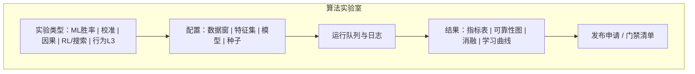
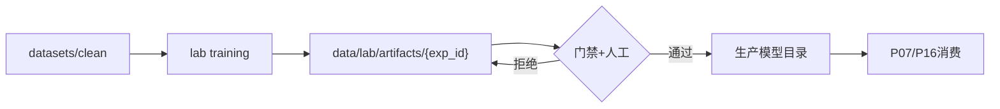

# P20 · 进阶算法实验室

> 模块编号：P20  
> 状态：PRD（文档阶段，未改代码）  
> 主用户：数据分析师 /（教练只读「已发布实验结论」）  
> 关联：[P07 胜率](./P07-实时胜率与官方胜率对标.md) · [P16 模拟器](./P16-BP与大场胜率模拟器.md) · [P19 行为指标](./P19-行为指标-入侵开团支援.md) · [P17 健康](./P17-数据健康与采集中控.md)  
> 技术参考：[../数据字典.md](../数据字典.md) · [../接口逆向笔记.md](../接口逆向笔记.md) · [../项目设计.md](../项目设计.md)（历史架构参考，非当前实现真相源）

---

## 1. 产品定位

**一句话**：为分析师提供 ML / 概率校准 / 因果 / RL 的**实验台**，与生产链路隔离，通过门禁后才能「发布」到 P07/P16/P19 等教练可见能力。

**目标用户**

| 角色 | 用途 |
|------|------|
| 数据分析师 | 训练、回测、消融、校准曲线、因果估计、BP 策略仿真 |
| 教练组 | 只读已发布实验卡片（结论、适用窗口、风险） |

**非目标**：实验室模型直接默认覆盖生产；无门禁自动上线。

---

## 2. 用户故事（含验收标准）

| ID | 作为… | 我希望… | 以便… | 验收标准 |
|----|--------|---------|--------|----------|
| US-20-01 | 分析师 | 在隔离环境跑训练与 holdout 回测 | 不污染生产 | 产物写入 `data/lab/`；生产读路径不变 |
| US-20-02 | 分析师 | 查看分阶段 Brier / ECE / 方向准确率 | 与现网对比 | 图表对齐 `backtest_realtime_v9` 口径 |
| US-20-03 | 分析师 | 做特征消融 | 解释模型 | 输出 ΔBrier 表；可复现命令 |
| US-20-04 | 分析师 | 做概率校准实验 | 改善可靠性 | 支持 isotonic/Platt；校准前后可靠性图 |
| US-20-05 | 分析师 | 做简单因果/效应估计 | 回答「资源是否导致胜率跳变」 | 明确假设与混淆因子；输出效应区间 |
| US-20-06 | 分析师 | 跑 BP/系列赛 RL 或搜索仿真 | 研究建议策略 | 实验标记「不可直接作赛场指令」 |
| US-20-07 | 分析师 | 申请发布到生产 | 教练可用 | 门禁清单全绿 + 人工确认；P17 记录版本 |
| US-20-08 | 教练 | 看到「实验室已发布」说明卡 | 了解新指标风险 | 只读：窗口、样本、已知失败模式 |

---

## 3. 信息架构 & UI

### 3.1 入口

- 导航：算法实验室（分析师角色）
- P07/P16/P19：「当前生产版本」旁链「实验室对比」

### 3.2 线框

### 3.3 与生产隔离

### 3.4 状态设计（空 / 载 / 错）

| 状态 | UI |
|------|-----|
| **空态** | 无实验记录：引导「新建实验」；结果区占位说明「尚无 Lab 产物」 |
| **载态** | 队列中/运行中：进度条 + 日志尾部滚动；结果区 skeleton |
| **成功** | 指标表与可靠性图可点；产物路径 `data/lab/artifacts/{exp_id}` |
| **错态** | 失败：红条 + 最后错误栈摘要；允许「复制配置重跑」 |
| 门禁未通过 | 红项列表，禁止发布按钮 |
| 教练只读 | 无运行按钮；仅显示已发布生产版本说明 |

---

## 4. 关键指标与统计方法

### 4.1 ML 胜率实验

| 指标 | 定义 | 窗口 |
|------|------|------|
| Brier | 均方概率误差 | early/mid/late 分阶段 |
| ECE | 期望校准误差 | 分阶段 |
| 方向正确率 | `sign(p-0.5)` 与胜负一致率 | 分阶段 |
| vs 生产 Δ | 实验 − 生产 | 同 holdout |

**方法**：时间序列切分或按比赛 holdout；禁止随机打乱导致泄漏；战队先验必须无泄漏（对齐 `train_realtime_model_v9.py`）。

### 4.2 校准实验

| 方法 | 输出 |
|------|------|
| Platt / Isotonic | 校准器产物 |
| 可靠性图 | 分箱准确率 vs 置信度 |
| 锐度 | 预测分布离散程度 |

### 4.3 因果实验（教练向谨慎展示）

| 问题示例 | 方法（基线） | 必须声明 |
|----------|--------------|----------|
| 拿暴君对胜率的瞬时效应 | 事件研究 / 前后差，控制金差 | 非完全随机；有选择偏倚 |
| BP 某英雄出现的胜率关联 | 匹配/分层 | **关联≠因果** |

输出：效应点估计 + 区间 + 假设列表；默认不进教练简报，除非发布为「研究结论卡」。

### 4.4 RL / 搜索实验

| 对象 | 方法 | 约束 |
|------|------|------|
| 系列赛定局策略 | 蒙特卡洛树 / 简易 RL | 环境=P16 模拟器 |
| BP 建议 | 乐队算法/策略梯度（远期） | 动作空间裁剪到英雄池 |

指标：模拟器内期望系列胜率；**外推风险**文案强制。

### 4.5 行为 L3（衔接 P19）

实验室产出的开团/支援模型分，只能先在 P19 实验层挂载。

---

## 5. 数据源

| 用途 | 路径 |
|------|------|
| 训练/回测主数据 | `datasets/clean`（或项目等价 clean 快照集） |
| 原始排查 | `data/realtime/raw_snapshots` |
| 生产基线 | 当前生产模型与 `backtest_*_report.json` |
| 实验产物 | `data/lab/artifacts/{exp_id}/` |
| 实验索引 | `data/lab/experiments.jsonl` |

**禁止**：默认读取 quarantine 进正式对比（可单开「污染研究」开关）。

---

## 6. 算法与 AI（实验目录）

| 轨道 | 基线 | 进阶 |
|------|------|------|
| 胜率 ML | 现网 FeatureBuilder + 树模型/线性 | 序列模型、对抗校验 |
| 校准 | Isotonic | 分阶段独立校准、温度缩放 |
| 因果 | 事件前后差 | 双重差分、匹配 |
| RL | 规则 agent vs 模拟器 | 策略学习 |
| 行为 | 规则差分 | 弱监督标签模型 |

**发布门禁（最低）**

1. holdout 分阶段 Brier/ECE 不劣于生产超过约定阈值  
2. 金差一致性护栏测试通过（与现网一致）  
3. 无泄漏检查清单勾选  
4. 文档：特征表、训练窗、已知失败局样例  
5. 人工确认人签字（字段）

---

## 7. 与竞品差异

| 对象 | 对齐 | 碾压点 |
|------|------|--------|
| 笔记本散落实验 | 可训练 | **与生产门禁、版本、教练发布流一体** |
| 黑盒 SaaS 模型 | 单点效果 | **可解释消融 + 校准 + 因果假设透明** |
| 纯学术 RL demo | 仿真 | 动作为 BP/系列赛，贴教练场景但隔离风险 |

---

## 8. 实现优先级

| 优先级 | 内容 | 依赖 |
|--------|------|------|
| **P0** | 实验索引 + 调用现有 train/backtest 脚本的作业包装（文档定义 CLI 契约） | `train_realtime_model_v9.py`, `backtest_realtime_v9.py`, `ablate_v11_features.py` |
| **P0** | 结果对比页（vs 生产报告 JSON） | P17 读报告 |
| **P1** | 校准实验与可靠性图 | 回测框架 |
| **P1** | 发布门禁清单 UI | 权限 |
| **P2** | 因果事件研究模板 | 事件流 |
| **P2** | RL/搜索接 P16 模拟器 | P16 |
| **P2** | 行为 L3 训练 | P19 |

**现有代码映射**：`scripts/train_realtime_model_v9.py`、`scripts/backtest_realtime_v9.py`、`scripts/ablate_v11_features.py`、`scripts/diagnose_battle_v11.py`；**本阶段不改代码**。

---

## 9. 验收清单

### 数据正确性
- [ ] 实验产物不覆盖生产模型路径
- [ ] 门禁失败无法发布
- [ ] holdout 口径与生产回测一致

### 性能
- [ ] 作业日志可检索；长训不阻塞 Dashboard 主线程（异步）

### 视觉
- [ ] 分析师/教练权限视图分离
- [ ] 发布卡片含风险与窗口说明

---

## 10. 角色权限矩阵

| 能力 | 分析师 | 教练 | 运营 |
|------|--------|------|------|
| 创建/运行实验 | ✓ | ✗ | ✗ |
| 查看实验指标 | ✓ | 只读已发布 | ✗ |
| 申请发布 | ✓ | ✗ | ✗ |
| 确认发布 | ✓（主） | 可选会签 | ✗ |
| 生产消费新版本 | 自动 | ✓ | ✓ |
